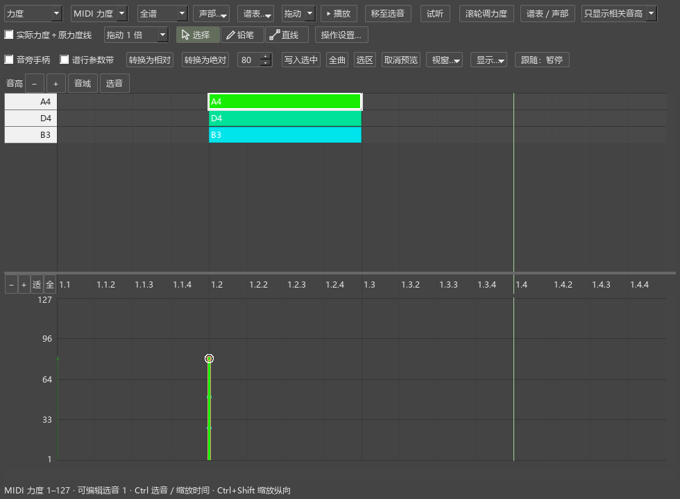
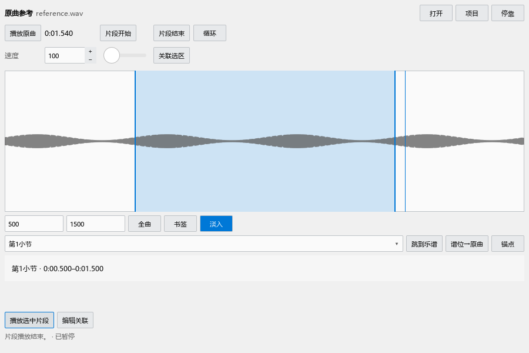
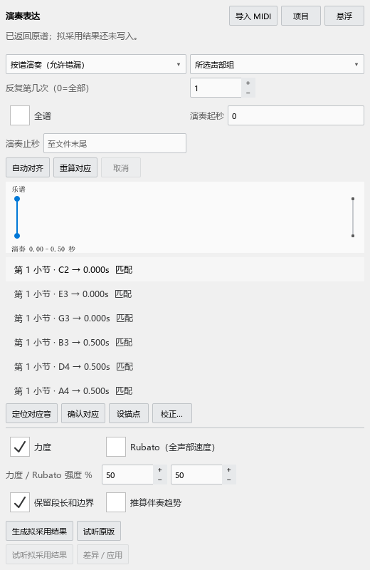

# MuseScore Evolution：个人功能使用说明

当前个人版本 **0.34.0**，Kumo branch / Freddd13。本文按功能讲使用方法。第一次使用时先照例子操作；没有列为可用的功能，请不要当成已经完成。

## 从哪里打开

| 想做什么 | 打开位置 |
|---|---|
| 调整音符力度、速度或踏板 | 视图 → 演奏编辑器（力度／速度／踏板）；上方“其他选项”工具栏有同名图标 |
| 直接在谱行旁调演奏数值 | 视图 → 谱行参数带（独立显示）；也可在编辑器勾选“谱行参数带” |
| 查看和弦、级数和音程 | 插件管理器启用 HarmonyAssistant_MS3.qml，然后插件 → Harmony Assistant |
| 检查编配问题 | 启用 ArrangementAssistant_MS3.qml，然后插件 → Arrangement Check |
| 听原曲片段 | 启用 ReferencePlayer_MS3.qml，然后插件 → Reference Player |
| 把演奏 MIDI 的力度和速度用于谱子 | 启用 PerformanceExpression_MS3.qml，然后插件 → Performance Expression |
| 比较不同写法 | 启用 ArrangementVariants_MS3.qml，然后插件 → Arrangement Variants |
| 点击估计速度 | 节拍器旁的 TAP，也可在快捷键设置中查找 Tap BPM |
| 导出供视频使用的较短 MIDI 音长 | 文件 → 导出，选择 MIDI，勾选“人性化裁剪：保守踏板模式” |

启用插件：打开“插件 → 插件管理器”，勾选相应文件，关闭管理器后从插件菜单运行。若名单没有它，在偏好设置的插件目录或程序安装目录中确认插件文件。和弦助手的主题控件必须与其它插件一起保留。

本项目右侧面板首次打开时与检视器等并列成标签页。原曲参考可与底部演奏编辑器并列。拖住标题栏可以换位置，或点击面板的“悬浮”。再次打开优先使用你自己摆放的位置。

## 1. 演奏编辑器：先调一个音

**用途。** 调整演奏，不改变音高或谱面时值。需要改写音符，仍在谱面输入。

1. 打开谱子，再打开“演奏编辑器”。在谱面点一个音。
2. 面板上方显示音高和音符，下方显示所选演奏参数。选择“力度”。
3. 找到该音下方力度柱的小圆点，向上拖变强，向下拖变弱。点“选音”可以把视图移到已选音。
4. 松开鼠标保存本次调整。Ctrl+Z 撤销；Esc 取消正在拖动的调整。
5. 打开“试听”后，点选音会发声。播放中选音不额外插入试听音。

亮边框表示选中；播放时的描边表示正在发声；橙色虚框表示尚未保存的调整。播放中改力度会先记住，停止播放、乐谱准备完成后再写入。

**相对与绝对力度。** 假设某个音由力度记号得到80：相对+10%约为88，0%仍为80；绝对88则直接指定88。若以后把力度记号改弱，相对值会跟着改变，绝对值仍为88。整数换算可能使很小的百分比变化暂时听不出。

“MIDI 力度”显示实际数值1–127；“相对%”显示增加／减少百分比。切换显示方式本身不改保存方式。需要转换时用明确的相对／绝对转换按钮，转换后可撤销。

**重叠音。** 在谱面先点要改的音，再直接拖同一时刻的力度柱：优先调整已选音，即使另一个音的圆点更靠近鼠标。开始拖动后不会换目标。远处选中的音不会抢占鼠标所在时刻。仅点按时可轮换重叠音；Alt+单击轮换，Alt 连点不启动播放。右键列出音名、谱表和声部，Ctrl+单击加入多选。拖已有多选柱可以一起调整。

**拖动快慢。** “拖动 1 倍”下拉提供0.25、0.5、1、2、4倍。觉得一拖就变太多时选0.5倍；默认1倍保持原有速度。这个设置不改变滚轮步长和图形缩放。按下鼠标后很小的移动不改值，避免点选时误调。

**缩放。** 参数区左侧“适”匹配选音或当前窗口的数值，“全”恢复完整范围，−／+放大缩小；数字轴滚轮缩放，拖动数字轴移动范围。Ctrl+滚轮缩放时间，Ctrl+Shift+滚轮调纵向，Shift+滚轮横移。

**滚轮。** “滚轮调力度”首次关闭。开启后，把鼠标指向一个音头、力度柱或手柄滚动，每格改1，Shift每格改8。Ctrl+滚轮仍缩放。每段连续滚动合成一次撤销；停转约300毫秒保存，Esc取消尚未保存的部分。

**筛选和颜色。** 点“谱表／声部”打开一张表，每行一个谱表，每列一个声部。取消勾选的音不能修改，可选择淡化作参考或隐藏。“全部”“只看选音所在声部”“只看选中谱表”用于快速选择。音旁手柄、谱行带和编辑器共用筛选；谱面原有选音不会被清掉。跨谱表音按它所属的谱表筛选。

键盘下拉提供“完整键盘”“淡化无关音高”“只显示相关音高”。默认淡化；相关音高来自筛选后的音符。收起其它音高时，音符网格也一起收起，点选仍对应实际音高。键盘用于识音和试听，不修改谱面音高。

“显示…”可选力度、声部、谱表配色。“按声部着色”默认跟随 MuseScore 的声部颜色。在“配色／力度柱宽…”取消“声部颜色跟随 MuseScore”，才使用个人声部色；原有自选色保留。

**比较不同谱表的力度。** 勾选“实际力度＋原力度线”，每个柱显示最终 MIDI 力度，各谱表的虚线连接起音处的原力度。右手mf、左手mp可以看到不同的线；休止期间的虚线只是相邻起音值的连接。取消后回到下拉所选显示，百分比的0%表示不增减，所以共用一条0%线。显示切换不改变音符保存为绝对值还是百分比。悬浮提示同时给出保存值和实际力度。

**用铅笔画力度。** 参数选“力度”，直接点上方“铅笔”后拖过一段力度柱。已有选音时只改选音；没有选音时只改筛选允许的音。“直线”按起点到终点渐变。松开鼠标一次保存，Ctrl+Z一次撤销整段，Esc取消。

**速度和踏板。** 下方参数选择速度时，“选择”工具点按空白处添加速度节点；“铅笔／直线”用于画一段速度。画出的范围结束后恢复原速度。选择踏板时，空白处水平拖动建立踏板区间，拖端点改踩下／抬起位置。踏板吸附可选音符边界、不同细分或自由时刻。请停播后操作。

**找不到或没有变化。** 检查该音是否被筛掉、是否只是淡色参考、是否选了其它参数。播放中请先停播。速度已有可见文字或rit.时需要明确编辑相应节点／曲线，不能直接覆盖。关闭编辑器不删除已保存的演奏调整。

## 2. 谱行带和音旁手柄

**用途。** 不打开大面板也能在乐谱旁调力度。启用独立谱行带，或在编辑器勾选“谱行参数带”“音旁手柄”。

先在谱面选音，再找谱行带中对应的柱；两边同时强调。拖圆点调整，右键可挑选重叠音。音旁手柄只显示选中或鼠标附近音，避免全谱挤满数字。

右键谱行带标题可切换固定在视口底部或跟随当前谱行；选中音决定停播时的谱行，播放时跟随播放所在行。空间足够时放在对应谱行下方；靠近视口边缘时尽量保持在该行附近，实在放不下才使用底部位置。−／+、匹配、全和上下移动控制数值显示，不改变演奏值；数字轴滚轮缩放，拖轴平移。高度在“显示…”中选择，也可拖边缘：跟随谱行时拖下边，固定底部时拖上边。Esc取消正在改变的高度。它与编辑器的纵向缩放分别保存。

标题显示当前音名、谱表、声部和数值。带内的播放线与鼠标线分别表示播放位置和指向位置。筛选及所选参数与编辑器共用。暂停跟随时可手动浏览；再次播放恢复跟随。

**临时查看音旁力度。** 打开过演奏编辑器或独立谱行带后，在谱面按住 Ctrl+Alt+V，显示鼠标附近的力度；再按住Shift显示当前视口所有可编辑音的力度，松开恢复。放大谱面更容易分辨密集的数字。文字输入、输入音符和编辑标记时不接管此按键。“操作设置…”可修改快捷键。

**找最近的音滚动调力度。** 在谱面按住 Alt+Shift 滚动，自动找当前视口内最近的可编辑音，每格改1；本次连续滚动固定这个音，鼠标稍微移开也不换目标。浮标显示当前数值，Esc取消，停转后保存；Ctrl仍用于缩放。普通滚轮模式的Shift每格改8。

## 3. 自动规范输入时值

**用途。** 你输入想持续的时长，软件在需要显示拍点或跨小节时，把它写成延音线连接的几个音。总时长不变。

从“工具”菜单开启“自动规范输入时值”。例如4/4第二拍后半开始的四分音符可能写成八分＋八分，并以延音线相连。跨小节也会继续写完，不截短输入。

附点、符杠和延音分别表达时长、分组和持续。自动分割不代表所有延音两端都应该用符杠连接。手动指定的符杠、复杂连音、自定义演奏等保留原设置。特殊记谱需要原样输入时可暂时关闭开关。

## 4. 琶音、小音符和轻重音

**琶音对拍。** 选中琶音符号，在检视器调整对拍方式和延迟。先用“第一音落拍”或“最后一音落拍”，再改每音间隔；默认入口和详细数值名称见较早版本说明中的“琶音对拍”。可让第一音或最后一音落在写定拍点，其它音依次提前或推后。先用较短延迟试听，松开参数拖动一次保存。已有自定义演奏事件优先。

**快速小音符。** 在“倚音”符号面板选择“快速拍前小音符（无斜线）”，应用到主音。选择小音符或其主音，在检视器“和弦”区设置“播放位置”为拍前，再选“持续时间”：每音毫秒或整组占主音比例。默认每音65毫秒。拍前保留主音原拍点；拍上延后主音；拍后从主音末尾让出时间。数字名称可水平拖动，Shift精调，Esc取消。

**轻重音。** 选中重音记号，在检视器勾选“自定义力度倍率”，输入“力度倍率”。100%不增强；115%轻微增强。也可点“应用轻重音预设（115%）”。取消勾选恢复乐器原效果。拖数值名称可调整，Shift精调，Esc取消。音符的手工绝对力度仍按原生规则优先，不能用重音再覆盖它。

以上均随MSCZ保存，可撤销。未听到变化时确认记号确实附在目标音上，且没有手工演奏事件取代它。各入口和较早版本的完整说明保留在本文末尾。

## 5. 颤音与震音的每一下力度

选中震音斜杠、颤音线或tr记号，在检视器找到“发声力度包络”。“柔和”让重复音比第一下轻；“渐强／渐弱”逐渐改变；“自定义”设置起始、结束及曲率。

例如绝对力度80配90%倍率，实际发声约72。双音震音分别使用两边和弦的音符力度。“交替音减弱”再调整另一边。原样恢复原播放方式，不删除音符的保存力度。

拖名称或输入数字调整，松开一次保存，Esc取消。编辑器可看到实际发声范围，但其中力度柱仍编辑音符保存值。手工演奏事件保留；嗡鸣震音不使用这套逐次音事件。

## 6. 渐慢 rit. 与恢复速度 a tempo

选择一段连续乐谱，用“添加 → 文本 → 渐变速度（rit.）”。默认降到原速度的80%，线性渐慢。选择恢复位置，用“添加 → 文本 → 恢复速度（a tempo）”。打开演奏编辑器速度区后可看到曲线。拖曲线两端调范围／速度，拖中间菱形调变化形状。谱面文字与播放相连；改显示文字不等于改实际渐慢。

选中线条，在检视器调整目标速度及曲率。可选目标BPM或相对变化。需要自由画速度时，从曲线右键明确解除播放关联；原文字线仍保留。

a tempo表示回到这次渐变前的速度；Tempo primo回到曲首速度。选中速度文字，在检视器选择恢复方式，也可指定明确BPM。恢复点应在渐变终点或其后，不能放在曲线内部制造冲突。

保存和播放使用同一效果。没有声音变化时检查渐变范围、已有速度文字和冲突提示。文字、曲线和恢复方式都可以撤销。

## 7. Tap：用鼠标估计速度或写速度

点节拍器旁TAP，每次点击代表一拍。至少点击四次才显示正式估计。下拉可选八分、四分、附点四分或二分单位，÷2／×2换算，重置重新测。

例如每次敲一个附点四分，测得80，等于四分音符120。面板分别说明点击单位和四分音符BPM。

默认只测量，不改谱。“设为独立节拍器”改变独立节拍器，跟谱播放时会说明不能直接应用。“写入指定位置”先选择小节和起音位置，再新建可见速度标记。

修改已有速度标记须先选中它；保留原拍单位和说明文字。a tempo、相对速度或曲线不能当作普通数字直接覆盖。若新值和旧值相同，不会产生多余改动。Ctrl+Z撤销写谱；估计本身不进入撤销记录。

## 8. 自由圆滑线与左右手折线

**自由圆滑线。** 选中圆滑线，检视器勾选“自由曲线”。添加位置用整条线的时间百分比。双击进入编辑，中间点移动形状，两边手柄控制切线；拖一边仍保持连接处平滑。

箭头微调、Home重置、Delete删除选中的中间点。Esc取消拖动；“重置切线”只调整当前点，“重置节点”清除中间点。关闭自由曲线保留数据，重新开启可恢复。当前版手动节点由你绕开音符，后续自动避让会另行说明。

**左右手折线。** 在“指法”符号面板选“左手弹（可伸缩）／右手弹（可伸缩）”。选音后添加会附在该音；拖到和弦可附在和弦。标记表示用哪只手，不会把音移动到另一谱表。

选中记号，检视器可改横／竖长度、粗细、是否显示LH/RH及方向。双击后拖端点改形状，拖整体改位置，Esc取消。关闭可伸缩模式恢复原字形。保存到本分支的MSCZ会保留形状；其它版本可能不保留个人扩展。

## 9. 和弦助手

启用插件后，先选调性或确认自动建议，再打开自动识别。谱面选音显示当前内容；播放时查看当前和弦，踏板和延音也参与解释。“踏板内单个／多个和弦”决定一个踏板区间是否允许继续变化。

设置中分别开启音符临时着色、音程文字、谱面和弦、级数，选择仅当前或全谱。颜色只是辅助，原来的选中和播放强调优先。关闭相关开关会清除临时显示，不把它保存成音符原色。

**放在顶部看摘要。** 拖住和弦面板标题放到窗口顶部，摘要只占一行。点“靠左／居中／靠右／自定位置”按钮选择位置；自定位置可用滑条调整。点“详情”同时打开右侧完整面板；点“更多”可打开记号列表或悬浮面板。顶部菜单在独立小窗展开，不受摘要栏高度限制。摘要仍可选择实时音或所属和弦。

**谱面记号和遮挡。** 设置 → 外观中开启“谱面和弦”，选择和弦、级数或两者，再改左右／上下排列、字号和颜色。默认记号画在其它谱面内容上方；两个和弦互相挤到时上下排列，横向仍对齐各自开始的音符，不因找不到空位而省略。

“避让其它谱面内容”首次关闭。开启后尽量找空位，实在放不下仍显示；“遮罩”只控制记号背后的浅色底，两个开关分别生效。页面上方特别密集时也可能排到较低的位置，可关闭避让或调整字号。默认“优先已有和弦记号”会省去与原谱已有和弦相同的临时标记；要逐个查看助手的分析，可关闭这个选项。

点选和播放都强调当前固定位置的记号，双击进入详情。临时记号不会进入打印或PDF，退出插件即清除。

识别结果不一定是唯一解释。可以指定某段的和弦、低音和范围，添加或删除识别位置，再保存分析文件。导出／导入分析保存音乐解释，不是导出MIDI。选择颜色可直接打开选色器。

结果不对时先核对调性、低音、踏板模式和解释范围。延长旋律不一定代表和弦没变；人工确认的内容优先。退出插件、换谱或关闭显示会清除其临时内容。

## 10. 编配检查

先选一段钢琴谱，运行“Arrangement Check”，点“分析”。无选区时检查当前小节；范围会写在面板上。选择调性钢琴／流行、严格对位或爵士，不把同一套要求强加给所有写法。

问题分和声、对位、可弹性。点一项看涉及音、前后位置、跨度或移动时间；“定位”选中相关位置。“忽略此处”只忽略这项提醒，不改音。

“声部／分手”校正旋律、低音、内声部或左右手。已有分手记号会提供线索；上／下谱表不一定就是右／左手。左右手舒适九度、最大十度等参数可以按你自己的手调整。

“局部和弦”指定这段的解释；“导入和声”读取和弦助手的分析文件。保持音和踏板可能使谱面跨度看着大但实际可处理，当前提醒仍需结合真实弹奏核查。检查不会自动改配音或添加指法。

播放中只看已完成的结果；停止后再更新。角色校正、忽略等只用于当前谱会话，通用设置会记忆。

## 11. 原曲参考：先循环听四秒

1. 运行“Reference Player”，点“打开”，选本地WAV、MP3或FLAC。
2. 点“播放原曲”。到片段起点点“片段开始”，到终点点“片段结束”。也可在波形上拖出范围，或输入开始／结束毫秒。
3. 勾选“循环”，反复听这段。“淡入”减轻循环边界的小突变，可关闭。
4. 速度75表示75%，慢放保持音高；50–150可选。音量只影响原曲，不改谱。
5. 点“项目 → 保存工作区”，选择JSON位置。音频默认引用原文件，不复制整首录音。

**把片段对应到谱子。** 在谱面拖选小节，再选音频片段，点“关联选区”。下方列表出现名称和时间。点列表项会显示对应片段；“播放选中片段”只听音频，“跳到乐谱”找到谱段。“谱位→原曲”把音频位置移到当前谱位对应处。

“编辑关联”改名称和播放第几遍，或删除关联。“锚点”把当前谱位和当前音频位置记为内部对应点。多个点要顺序一致；跳段应另建片段。同一录音片段可以关联到多个谱段。

当前版原曲和乐谱分别播放；空格仍播放乐谱。多音频和持续联动在后续批次，不把当前手动对应当成同步播放。

文件移动用“项目 → 重新定位音频”。文件或谱段变化时显示“需检查”，确认后再使用对应关系。关闭插件停止原曲；切换标签页可继续听，项目菜单可选择隐藏面板时暂停。

**没有声音。** 检查原曲音量、音频输出设备和文件是否已加载。缺少媒体扩展会显示原因，不会影响其它插件。短片段无法顺利循环时先把范围加长，取消淡入再试。

## 12. 演奏表达：先确认对应，再采用力度

准备一份谱和一次演奏的MIDI文件。可按谱弹奏但允许错漏音；也可用任意音高只敲节奏和力度。

1. 在谱面选目标小节，运行“Performance Expression”，点“导入 MIDI”。
2. 选择“按谱演奏”或“音序敲击”，选择旋律、voice或相应声部。必要时限制演奏起止秒和反复次数。
3. 点“自动对齐”。列表显示谱面音与演奏时间，分别统计待确认、漏弹和多弹。
4. 点一项，再点“定位对应音”。检查它确实是这次弹的音；“确认对应”只固定这一对关系，不改乐谱。
5. 错配用“校正…”重新连接；跳段、重复节奏可设锚点。未确认的内容不直接用于写谱。
6. 分别打开力度或Rubato，设置采用强度，点“生成拟采用结果”。默认强度50%，先小幅试听。
7. “差异／应用”查看改哪些音、哪些保留及原因。先“试听原版”，再“试听拟采用结果”。首次会要求保存项目位置，试听用的乐谱放在旁边。
8. “停止试听”“返回原谱”结束比较。满意后在差异窗应用；一次Ctrl+Z可以撤销本次写入。

**力度。** 原始MIDI力度保留。设备中心和斜率用于校准键盘响应；不熟悉时保持默认。伴奏推算须明确开启，它不是实际弹出的伴奏力度。已有手工力度、演奏事件等默认保留；查看保留项后才能明确解除保护。

**Rubato。** 用演奏的快慢处理原有节奏，不重新写音符时值。默认保留这一段总时长和两端速度；可选择采用演奏时长。速度对同一时刻全部声部生效。已有速度文字和曲线受保护，无法满足要求时会说明。

**保存。** 项目保存原始MIDI副本、人工对应和设置。音符或方案变了，须重新读取后再采用旧结果。试听副本不改变原谱路径、未保存状态或撤销记录。没有声音设备时仍可查看副本，但会明确说不能试听。

## 13. 试写方案：当前版本用完整谱副本

1. 在谱面选一段，运行“Arrangement Variants”，点“新建组”，选择项目JSON保存位置。
2. 软件保留一份不作修改的原始版本，并建立可以编辑的方案A。你的原谱不改动。
3. 选方案，点“切换并定位”。它在普通乐谱标签页打开；照常改写音符和演奏。
4. “复制当前方案”建立B等版本；“从同处试听”从相同范围开始，会包含必要的前文。
5. “检查差异”说明段外、拍号或长度是否改变。改变后仍能编辑，但不能当成完全相同条件比较。
6. “保存工作区”保存当前方案的新文件和列表。其它打开方案需分别切换、保存。已有文件保留。
7. “另存为成果谱”保存整个当前方案，不只替换某几个小节。

重新打开项目可恢复列表。缺失或变化的文件会报告，先核对材料再加载。此版仍是完整副本，不是单文件内的局部方案；后续实现分段／声部方案时会另写迁移步骤。

## 14. MIDI裁剪：先看对比，再导出

**用途。** 供瀑布流视频等后处理使用；只减少允许提前释放的音长，不修改谱面记谱时值。

文件 → 导出，选MIDI。首次“人性化裁剪”不勾选，普通导出保持原行为。开启后进“裁剪设置”，选择钢琴、小节和声部，设置保护旋律／voice。

当前规则要求新旧释放点在同一个可靠踏板区间。没有踏板、跨抬踏板、手工演奏、同音重触有歧义等保持原长。范围是原谱文件中的小节顺序，导出反复后仍使用这个来源。

原长度比例85%、下次起音间隔90%、最短120毫秒是初始设置，可调。±2%微随机可设为0关闭；随机种子不变时重复导出相同。“最高起音线”只是旋律候选，不一定是你的真正旋律；明确voice保护更可靠。

点“查看对比”：细轮廓原长度，实心新长度，下方单独显示踏板。“谱表声部”选择本次谱的具体voice；通用选择会记忆，具体谱表选择只用于本次导出。“排除／恢复此音”可保留某个音，“重算”更新同一参数的结果。

“同时导出未裁剪MIDI”另外保存原版本，方便在惯用播放器比较。裁剪文件与对比用同一处理。先用少量小节检查画面和听感；当前比例规则还不是完整的实际手指释放安排，后续批次会增加这种处理。

## 15. 字体、保存及遇到问题

Kumo Piano和Kumo Engrave属于个人字体试验，改变字体可能改变间距和避让；它们不是分析算法。普通文字与音乐符号字体分别设置。需要与其他人交换时先用常规字体和普通版副本检查。

个人演奏、自由线条及分手形状用本分支MSCZ保存。原版或MusicXML不一定保留这些个人扩展；原有标准记谱应能正常显示。没有新增功能使用时，仍按原MuseScore方式输入、选择、播放、打印。

遇到问题请先记录：软件“帮助 → 关于”里的版本、操作入口、所选谱段和具体操作。按钮灰色通常是没有材料、结果过期或正在播放；状态栏会说明。无法打开项目先检查文件是否移动。未保存的拖动用Esc取消，已保存的改动用Ctrl+Z撤销。

## 尚未完成的部分

本轮正在分批修复。多音频持续联动、单MSCZ分段方案、自动手指释放、自由曲线自动避让等不能仅凭计划当成已交付。每批发布后会更新对应章节和截图。实时录音、频谱、节奏重新记谱、完整指法和AI自动改配仍在以后阶段。

## 较早版本与完整历史说明

下方保留以前的说明，供查旧安装和功能来源。日常操作优先阅读上文；某些旧目录、版本号和实现描述不代表当前推荐用法。

展开较早版本说明

# MuseScore Evolution 个人版本：用户功能说明

当前个人版本 **0.26.0**，Kumo 分支，维护账号 Freddd13。这里说明个人提交带来的可用功能、入口与操作；实现细节和测试数据另见 [开发更新日志](CHANGELOG.md)。以后每次相关功能更新都维护本文件。

## 演奏编辑器：先这样开始

1. 打开乐谱，点击上方 Evolution **“其他选项 / Alternative Options”栏**末尾的音符块＋力度柱图标，或从 **视图 → 演奏编辑器（力度／速度／踏板）** 打开面板。按钮亮起表示面板开启，与菜单同步；关闭面板会复位。若栏隐藏，在“视图 → 工具栏”开启“其他选项”。
2. 点选一个音符，使用音高区的“选音”找到它。选音默认会试听；“试听”按钮可关闭，播放中不插入试听音。
3. 下方选择“MIDI 力度”或“相对力度”。点选力度柱的端点，向上／向下拖动；检视器、谱面与原钢琴卷帘共享选择，保存值写回原生音符。
4. 力度普遍较小时，点击时间尺左侧 **“适”（匹配值）**，按已选音的最大力度放大显示；无选音时匹配当前视窗中的可编辑音。同处的 **−／+** 缩放参数区，**“全”** 恢复完整范围，右侧滚动条移动该区纵向视窗。显示放大不会改属性值。
5. 想直接在乐谱旁调节：勾选面板内 **“音旁手柄”** 和／或 **“谱行参数带”**。两项首次使用默认关闭。0.20.1 起，工具栏演奏编辑器按钮旁的谱带图标或 **视图 → 谱行参数带（独立显示）** 可独立开启参数带，与面板内勾选框同步；关闭编辑器仍可调节，当前会话中保留所选参数／范围／过滤，重启默认关闭。参数带默认悬浮在谱面视口底部，可切换到当前谱行下方，宽度对齐当前谱行、夹到可见窗口，低调浅灰底，不影响排版。

### 播放、选择与重叠音

| 操作 | 效果 |
| --- | --- |
| 音符／力度端点单击 | 选中对应音符；停播时默认试听，保留播放位置 |
| Ctrl+单击 | 加入或移出原生多选；拖已有多选柱保留整组 |
| 同位置、同力度端点再次单击 | 单选时轮换完全重合的候选音；实际拖动仍编辑当前音 |
| Alt+单击力度柱 | 轮换同刻候选音；右键菜单可按音名、谱表、声部明确选择 |
| 音符块 Alt+上下拖动 | 调整该音／已选组的力度；音高与时值保持不变 |
| 空白处拖动 | 框选，Shift 追加、Alt 减选；松开后更新原生选择 |
| 音符／力度区空白单击（拖动工具）／时间尺单击 | 将播放光标移至该处；不自动起播 |
| 双击音符／时间尺／力度区 | 从该处开始正常播放，复用 MuseScore 原生播放命令 |
| “移至选音” | 播放位置移到原生选中音的起点 |
| “播放／停止”／画布内空格 | 从当前播放光标播放或停止 |

同刻不同力度优先命中鼠标附近的端点；点在柱体上时优先已有选音。音符不做虚假的时间错位。重叠候选菜单适用于音符区和谱行参数带。

### 滚轮快速调单音力度（0.13）

“滚轮调力度”首次默认关闭，开关状态会记忆。开启后，把鼠标放在音符块、力度柱、未选中的谱面音头、音旁手柄或谱行参数带的对应柱上：向上增加、向下减小，每格 **1 MIDI 或 1 个相对百分点**；按住 **Shift** 每格粗调 **8**。先选择重叠候选，再滚动，可明确改其中一个音。

- 编辑器画布内 **Alt+滚轮**可临时调力度。**谱面上先开启“滚轮调力度”，直接指向音头即可，无须先选中、无须 Alt，也无须显示手柄**；Alt 保留 MuseScore 原生谱面移动。关闭模式后普通滚轮恢复浏览。输入／文本编辑／照片模式不接管。
- **Ctrl+滚轮**始终沿用缩放；Ctrl+Shift 仍纵向缩放。关闭滚轮调力度时，普通／Shift 滚轮沿用浏览；开启后只有命中可编辑音才调整，空白、标尺、淡色参考音保持原操作。
- 只修改指向的**一个音**，不把原生多选组全部改掉，也不移动播放光标。拖动仍可编辑已选组。浮标给出当前预览；端点移动后，同一位置连续滚动仍锁定初始音。
- 停转 **300 ms** 后一次原生提交／撤销；未提交前按 **Esc** 取消本次滚轮，或用“取消预览”清空暂存。换目标／开始拖动前结束当前滚轮段。保存、换谱与关闭沿用暂存提交边界。
- 保留相对／绝对存储类型；相对百分比换算到 MIDI 时有原生整数舍入，细调可能需连续几格才能改变实际 MIDI。浮标显示当前轴可表示的预览值，完整悬浮提示包含保存值和实际 MIDI。
- 播放中仍只暂存力度，停播且渲染空闲再提交；不会实时改当前播放流。速度和踏板不使用此滚轮改值功能。

### Kumo 分支标识

启动画面的版本区及 **帮助 → 关于** 显示 `Kumo branch · Freddd13` 和当前个人版本，同时保留 MuseScore Evolution 的上游版本与版权。关于页面提供固定到本版本标签的用户说明链接，“复制版本信息”也包含个人分支信息。每次更新从同一版本文件自动生成标识。

### 看清音高和演奏数值

- 上方左侧键盘采用 REAPER 式轮廓：黑键在左，白键前端朝向右侧网格；所有键的音高中心对齐实音半音行，白键前端按相邻黑键自然分界，并非一格一个白键；悬浮或点击键盘按实际键形识音／试听。“显示… → 键盘显示音名”可显示或关闭键盘文字，重启记忆；音符块内的原生音名和详细提示独立控制，可在“显示…”开启力度数字。
- 悬浮音符／力度柱提示记谱音名、实音 MIDI、乐器、谱表、声部、小节拍位、时值，以及保存／暂存值和整数舍入后的实际力度。
- 编辑器悬浮对应音会在乐谱上强调；乐谱音符／参数带悬浮也会强调编辑器音符和力度柱。参数带标题显示当前音身份和数值，竖线分别指示播放位置与鼠标位置。谱面已有选音在参数带端点同步标记。播放时参数带自动切换到播放所在谱行，长音／休止处也显示连续指针；背景单击定位播放且保留选音。
- 音高区“音域／选音”、时间尺左侧参数区“适／全”各自控制纵向范围；中间时间尺显示原生小节.拍，弱起与变拍沿用原生规则，两区横向保持对齐。MIDI 力度为 1–127，纵向放大及“适（匹配值）”从 1 起提高比例，时间网格、播放线和柱线在有效数值范围内绘制；相对百分比允许负值表示减弱，按独立的百分比视窗和零线显示。
- Ctrl+滚轮缩放时间；Ctrl+Shift+滚轮缩放当前区纵向；Shift+滚轮横移。普通滚轮在上区移动音高、下区移动数值范围；下区左侧数字轴滚轮缩放、拖动平移，左轴 Ctrl+滚轮也只缩放纵向。
- 播放线连续经过长音和休止。默认达到视窗右侧约 85% 时滚页；手动浏览／缩放／编辑暂停跟随，“跟随：暂停”可恢复，下次开始播放也恢复。
- “声部…”可同时启用声部 1–4，并保留淡色参考。参考声部不参与新编辑；“选择这些声部”可按已有时间选区、当前视窗或全曲选择。当前乐器包括双谱表，同号声部按各谱表处理。

### 配色与保存

默认按提供的 REAPER 截图使用灰色半音网格、清楚的黑白键和青蓝→青绿→亮绿→黄→红力度渐变；力度柱采用细线、小圆端点，密集概览也保留颜色。不改变谱面元素颜色。“显示…”可选力度／声部／谱表颜色及自定义配色；已有自定义颜色保留，“REAPER 默认力度色”可显式复位。仅完整旧默认配色自动升级。

亮边框表示选中，独立播放描边表示发声，橙色虚框表示暂存。停播拖动释放后一次撤销；播放中力度先暂存，停播且渲染空闲后一次写入，检视器仍显示已保存值。Esc 取消当前手势，“取消预览”取消全部暂存。保存／关闭前处理暂存。

速度用四分音符 BPM，踏板用原生 Pedal 起止；请停播后绘制。可见速度文字受保护，已有节点可明确调整；踏板默认按 1/16 吸附，可切换 1/32、1/64、1/128、自由时刻或音符边界；非音符边界用菱形和虚线指示。同一音符在总谱和分谱间的力度独立行为沿用 MuseScore，速度与踏板沿用原生链接行为。这里不编辑音高、音符起点和时值，继续在谱面或原卷帘修改。

### 谱行带精调、速度节点与自由踏板（0.16）

- 谱行带左侧有数字刻度和单位。右上 **−／+** 缩放此带的数值范围，**↑／↓** 平移，**匹配（窄带显示“适”）** 优先匹配当前谱行的选音，**全** 恢复完整合法范围。左侧刻度轴滚轮缩放、上下拖动平移。“显示… → 谱行带高度”可选择 48／80／112／144 像素。它与演奏编辑器的纵轴独立，均不修改属性值。
- 谱行带和音旁手柄默认使用 MuseScore 原生声部颜色。“显示…”可关闭此项，改为跟随编辑器所选配色。“声部…”和新增 **“谱表…”** 可同时过滤；过滤外音符可保留为淡色参考，不参与编辑，也不清空谱面已有选择。踏板仍是乐器共享的原生 CC64。
- “显示… → 显示音符详细悬浮提示”可关闭详细音符 tip，重启记忆；双向悬浮强调、拖动数值浮标仍可使用。
- 速度区默认 **“节点 · 点按添加”**：空白点按即在最近的原生音符／休止时刻添加速度节点，上下拖动节点改 BPM；数字框用“写入速度节点”。该速度保持到下一速度事件。**铅笔／直线**用于横向绘制一段速度，画完在下一原生时刻恢复原速度。可见速度文字受保护，须明确点中方形节点再改；定位播放用时间尺。
- 踏板区空白水平拖动建立区间，顶端拖动两端更改踩下／松开的时机。选择 **“踏板 1/16／1/32／1/64／1/128”** 按小节起点吸附，**“踏板自由”**精确到 1 tick，**“踏板音符边界”**保留原方式。**开 127 在顶端，关 0 在底端**；菱形／虚线表示非音符边界，悬浮显示谱表和精确起止 tick。保存后保留细分时机，不补入音符或休止。细分／自由踏板请使用 0.16 及以后版本继续编辑；回到旧安装时使用音符边界模式。
- 谱行带显示跟随播放所在行；原生谱面的播放导航保持原行为。“跟随播放”只控制演奏编辑器的时间轴，谱面导航仍由 MuseScore 自己控制。

### 键盘与参数区布局（0.18.1）

- 黑键从靠近音符网格的一侧嵌入白键，不再画成隔行的整条白键。白键前端等高，右端的每个半音仍与音符块等高、对齐；上下滚动和缩放后保持对应。关闭键盘音名只隐藏文字，不改变键形、音符块或乐谱。
- 参数区 **−／+／适／全** 收到时间尺左侧；按钮悬浮说明完整功能。力度轴单位由上方“MIDI 力度／相对 %”选择明确表示，速度使用 BPM，踏板显示开 127／关 0。数值刻度保留，实际绘图区只留上下各 6 像素的端点空间。
- 速度／踏板的操作说明收为参数下拉框、工具下拉框和时间尺的悬浮提示，避免挤占整行。速度／踏板隐藏不可用的力度转换，踏板隐藏不适用的数值和写入速度节点按钮。需要更大绘图区仍可拖两区之间的分隔条；隐藏控件不再撑大工具栏格子，切换参数后按钮顺序保持一致。
- 本批为显示与操作布局修正，继承 0.18 的 rit./a tempo；提交定位 `personal-v0.18.1`。本机独立程序为 `msvc.install_performance_0_18_1_x64/bin/MuseScore3Evo.exe`，旧安装保留。

## 和声助手

个人 0.2–0.8 带来 HarmonyAssistant 插件及原生临时预览支持。插件管理器启用 **HarmonyAssistant_MS3.qml** 后从插件菜单运行。可显示和弦、转位、级数与功能，播放时随位置更新；临时着色和标签不写入谱面、不产生乐谱撤销记录。

提供顶部、侧边、悬浮显示和独立摘要／详情布局，可选择实时音或所属和声区间。区间可指定、拆分、合并、抑制和恢复，人工修正有自己的撤销／重做；布局和修正自动恢复。谱面内容改变后应复核自动识别，复杂复调允许人工修正。完整插件操作见 [HarmonyAssistant 说明](../share/plugins/HarmonyAssistant/README.md)。

## 自动规范输入时值

个人 0.7.0，0.7.1 修复旧工作区中的开关显示。**工具 → 自动规范输入时值** 默认开启，可随时关闭。新输入与已确认的时值修改按拍子整理必要的延音分组；同一和弦追加的音也加入完整延音链，输入光标按原总时值前进。与原编辑共用一次撤销。

不会在打开旧谱时自动改全谱，关闭也不移除已有延音；自定义演奏事件、连音符等复杂对象保守保留。详见 [输入时值说明](docs/12-input-rhythm.md)。

## 大型钢琴 SF2

个人 0.6.0 改善 Windows 上超过 2 GiB 的标准 SF2 加载。仍从音源搜索目录与合成器面板添加，大文件显示预加载进度并可取消，完成后在 Mixer 选择对应音色。采样驻留需要相应内存，首次加载有等待；旧音源与已有安装保留。详见 [大型 SF2 说明](docs/11-large-sf2.md)。

## 个人版本与提交定位

| 版本 | 用户可见变化 | 提交定位 |
| --- | --- | --- |
| 0.16.0 | 谱行带刻度／独立精调、原生声部色与谱表过滤、提示开关、速度节点、细分／自由踏板 | `personal-v0.16.0` |
| 0.13.0 | 截图风格力度色与键盘、MIDI 纵向范围缩放、稳定紧凑谱行带、未选音头滚轮、末位工具栏按钮 | `personal-v0.13.0` |
| 0.12.0 | 单音滚轮细／粗调、Evolution 工具栏开关、Kumo 启动／关于标识 | `personal-v0.12.0` |
| 0.11.0 | 试听、直接播放定位、重叠音命中、独立缩放按钮、灰色外观、谱面双向悬浮与滚动重绘 | personal-v0.11.0 |
| 0.10.0 | 同步播放线、识音键条、双区视窗、原生多选、声部过滤、自定义配色 | 02346d2dd / personal-v0.10.0 |
| 0.9.0 | 独立力度／速度／踏板编辑器与谱面手柄、参数带 | e46e4e398 / personal-v0.9.0 |
| 0.8.0 | 和声区间人工编辑、原生和弦符号预览 | 77cced440 / personal-v0.8.0 |
| 0.7.1 | 自动时值开关在旧工作区恢复后可见 | abf9e3453 / personal-v0.7.1 |
| 0.7.0 | 自动输入时值规范与和弦延音链 | 92bd6a890 / personal-v0.7.0 |
| 0.6.0 | 大型 SF2 加载与预加载 | 1255ab45c / personal-v0.6.0 |
| 0.5.0 / 0.4.0 | 和声固定标注、摘要／详情显示及布局恢复 | 3a538f4ef / 9a5ae07ec |
| 0.3.0 / 0.2.0 | 和声插件宿主稳定性、乐谱观察和临时音符预览 | a818d9a70 / b878200db |
| 0.1.1 / 0.1.0 | Windows 构建与个人维护说明 | 88d2d9a38 / 5743890f9 |

本机 0.16.0 独立安装位于 `msvc.install_performance_0_16_x64/bin/MuseScore3Evo.exe`，旧安装可继续使用。个人版本见 [VERSION](VERSION)；关于页同时显示上游 3.7.0 和个人分支版本，命令行应用版本仍沿用上游 3.7.0。当前实测与限制以 [开发更新日志](CHANGELOG.md) 为准。

## 0.14.0 琶音对拍与参数拖拽

新增琶音默认最后弹出的音落在原拍点。选中琶音，在检视器选择首音/末音对拍、每音间隔（默认 65 ms）和整体偏移；短和弦自动压缩，并显示实际间隔。旧谱保持原伸缩比，可在选区应用“末音对拍预设”。跨谱表 span 对应的同声部参与音一起展开。

新增数字参数可输入，也可左右拖参数名称；Shift 精调，松开一次撤销，Esc 取消。播放中修改待停播提交，保存会先完成提交。琶音若位于曲首/起播位置，自动保留必要提前时间；导出音频/MIDI 报告首拍偏移，MIDI 添加原谱起点标记，不改谱面小节。

此批仅交付琶音及共用接口，其他六项按后续个人版本交付。原版往返保存可能丢失扩展播放属性。完整开发接口与验证见 [钢琴演奏扩展](docs/15-piano-expression.md)，提交定位 personal-v0.14.0。安装在 `msvc.install_piano_0_14_x64/bin/MuseScore3Evo.exe`，旧安装保留。

## 0.14.1 琶音延音修复

新琶音中的延音续接音继续保持完整时长，不重复发声。此修复不改变音符或延音线。提交定位 `personal-v0.14.1`；独立安装 `msvc.install_piano_0_14_1_x64/bin/MuseScore3Evo.exe`。

## 快速小音符：主音落在原拍点（0.15.0）

在“倚音”调色板选择 **快速拍前小音符（无斜线）**，再应用到主音；也可在快捷键设置中查找这个名称。原有无斜线长倚音和带斜线倚音入口仍可用，播放解释保持原样。

选择小音符或带小音符的主音，在检视器“和弦”区调整：

- **播放位置**：原解释／拍前／拍上／拍后。拍前让小音符先弹，主音仍在原拍点；拍上延后主音；拍后从主音结尾让出空间，下一拍不移动。
- **持续时间**：每音毫秒或整组占主音比例，默认每音 65 ms；整组最多占主音记谱时间一半；拍前还会按前一同声部音／休止到主音的间隔限制，避免短前音被跳过。短间隔自动压缩。实际整组时间显示在下方。
- 数字仍可输入，按住参数名称水平拖动调整；Shift 精调，Esc 取消，松开一次撤销。播放中修改暂存至停止和后台渲染空闲后提交。
- 小音符外观与播放位置分开；谱面的记谱时值仍通过原时值工具修改。选择小音符的“应用快速拍前预设”可显式改为无斜线拍前、65 ms，整组使用共同时间参数，单次撤销恢复。

拍前需要让出时间时，只缩短同声部紧邻前音的播放结束，保留谱面时值、其他声部和外部延音；反复回跳按实际播放顺序处理。曲首／中途起播和音频／MIDI 导出有必要的预备时间，MIDI 的 `Kumo: score first beat` 标记指示原首拍。固定毫秒受既有 MIDI tick 和时值千分比的精度限制，长音可能有数毫秒量化误差。

旧谱、复制和导入不会自动转换；有手动演奏事件的小音符或主音保持原解释，颤音已融合的小音符也沿用原融合。新参数保存在原生 MSCX/MSCZ，其他版本重存可能丢失扩展参数。

版本定位：`personal-v0.15.0`；独立安装为 `msvc.install_piano_0_15_x64/bin/MuseScore3Evo.exe`。实际验证范围与限制见 [更新日志](CHANGELOG.md)。

## 可调轻重音（0.17）

版本定位：`personal-v0.17.0`。

新加的普通 **>** 及带 > 的组合奏法默认把乐器基准力度乘 **115%**；尖顶 **^** 沿用原乐器值。旧谱和原来保存的调色板继续用原效果，复制、导入不会自动转换。

选择重音记号，在检视器勾选 **自定义力度倍率**，用 **力度倍率** 数字框输入，或按住名称左右拖动；Shift 精调，Esc 取消，松开一次撤销。100% 不增强，范围 1–400%；实际 MIDI 仍限于 1–127。播放中修改先暂存，停播且渲染空闲后提交。

取消勾选恢复乐器原倍率；**轻重音预设** 可把选中的普通重音改为 115%。音符的手动绝对力度继续优先于普通重音；相对力度以含重音的基准计算。链接分谱同步，原生 MSCX/MSCZ 保存这些参数，其他版本往返保存可能丢失扩展。

## 可播放 rit. 与 a tempo（0.18）

先选中一段小节或音符范围，使用 **添加 → 文本 → 渐变速度（rit.）**。默认从当前速度降到 **80%**，线性渐慢，结束后保持终速。选择需要恢复的位置，用 **添加 → 文本 → 恢复速度（a tempo）**，恢复最近一次渐变开始前的速度。

选中 rit. 线段，在检视器 **渐变速度线**、**播放渐变速度（系统文字线）** 开关下设置终速百分比/BPM、曲率和起速。起速 **0 随前**，其余数值为指定 BPM。名称左右拖动与数字输入都可用，Shift 精调、Esc 取消、释放一次撤销。关闭播放保留文字线及精确范围；普通文字线默认不影响速度。旧谱不会自动转换。

演奏编辑器切到速度，rit. 显示两端圆点及中间曲率菱形。拖首尾可改范围/BPM，拖菱形改变曲率；点击手柄后可用数字写入。拖动时预览，松开一次撤销，Esc 放弃。右键曲线范围可 **解除 rit. 播放关联**，保留文字线、恢复原速度文字解释，然后才可自由画速度。曲线体内普通点按不会增加第二套节点。

范围内已有速度节点或重叠渐变时会拒绝添加。明确选择 **替换该范围速度** 才会移除内部速度标记及整条重叠渐变，范围两端标记保留。此操作可一次撤销，跨范围的原渐变会整条移除，不能把它理解为只擦掉重叠部分。

选中 a tempo 的检视器可切换 **恢复最近渐变前速度**、**Tempo primo（全曲起速）**、**指定 BPM**。显示文字与播放语义分开，不必从文字拼写猜测行为。拍前琶音、小音符、音序器和音频/MIDI 导出共同使用派生速度图，原生 MSCX/MSCZ 保存扩展属性，其他版本重新保存可能丢失它们。

## Kumo Engrave 符头试验（字体 0.1.0，2026-10-09）

独立字体源码在相邻 `mcp-musescore` 仓库 `fonts/kumo-engrave/`，提交 `6dbde84df3afe023f96d79aa5b09e0b72a0ef94a`。这是 OFL Finale Maestro 的完整字库衍生原型，当前只独立设计三个常规符头；用户确认按 Chaconne Ex 公开样本的视觉方向推进，主候选为 **Kumo Engrave JP**。没有提取商业字体，也没有更改本体源码、内置字库或软件个人版本号。

1. 构建／解压字体包，把 `jp/Kumo Engrave JP` 完整子文件夹复制到 **偏好设置 → 路径 → Score Fonts／乐谱字体** 的私有目录；OTF／JSON 与文件夹同名。重启 Evolution，不必安装到 Windows 全局字体目录。
2. 打开原谱的独立副本，在 **格式 → 样式 → 乐谱** 选择音乐符号字体 `Kumo Engrave JP`，音乐 Text 保持内置 **Finale Maestro Text**，第一轮关闭自动采用推荐样式。字体试用不依赖 MCP 或 skill；字体更新只需成对更新 OTF／JSON 并重启，不用重配 MCP。
3. 0.17 原生 Windows 隔离试验验证基础覆盖／全部字宽保留、Control 与原版全页像素相同、用户谱各候选均9页。所有源 PDF／MSCZ 只读并核验哈希；普通接杆锚点保留，实际轮廓、cutout 与分叉锚点按版本维护，字体可能改变局部避让。

限制：配套改名 Text 虽可注册，Maestro Text 缺 `dynamicMezzo` 码位，内置家族的 Qt 回退规则不随改名继承，mf／mp 等可能变化，因此暂不推荐改名 Text。谱号、变音、休止、力度等仍是 Maestro 基础字形；打印和完整审美验收尚未完成。安装、恢复、可重复构建、版本及原生证据见字体目录 `README.md`、`CHANGELOG.md`、`DESIGN_BRIEF.md`、`VERIFICATION.md` 和 MCP 仓库 `docs/FONT_PLAN.md`。净书与字体分别推进，不应同时改字形和页面参数后把结果全部归因于字体。

## 震音与颤音的逐次力度（0.19）

选中震音斜杠、颤音线或 tr／短颤音奏法，在检视器找到 **发声力度包络**。可选 **原样、柔和、渐强、渐弱、自定义**；右侧 ↺ 重新应用当前预设，所有参数一起撤销。原样回到原播放算法，不改音符保存的力度。

新建默认柔和：单音震音第一下100%、后续90%；双音震音的交替音再减5个百分点；颤音主音100%、辅助音85%。渐强预设80%→100%，渐弱100%→80%。旧谱、导入与复制保留原效果，可自行选择预设。嗡鸣震音不通过这套 MIDI 重复事件发声，参数不可用。

**起始倍率**、**后续／结束倍率**、**曲率**、**交替音减弱**均保留数字输入，也能左右拖动名称，Shift精调、Esc取消，释放一次撤销。柔和模式用起始／后续两个值；渐强、渐弱、自定义按整个演奏范围插值，曲率1为线性。倍率范围1–400%，交替差 −100–100 个百分点；正值减弱，负值增强。不按左右手或谱表猜测力度。

倍率应用在音符定制力度之后：绝对力度80配90%实际发声72；双音震音后续90%再减5个百分点得到68。双音震音分别读取两边音符的力度，修改第二个和弦的力度也有效。同一包络的自动延音链连续计算，参数不同或自定义事件分开处理。已有自定义播放事件优先，不被预设重写。

演奏编辑器的音符条和力度端点继续编辑**保存值**；悬浮提示显示实际发声 MIDI 范围，选择／悬浮时绝对力度轴右侧以虚线和小字显示范围。数字／拖动预览也使用相同倍率；试听采用该音第一下的实际力度。播放中修改先暂存，停播且后台渲染空闲后安全提交；包络本身通过检视器修改，首版不开放逐个生成事件拖绘。

MSCX／MSCZ 保存这些参数，音频和 MIDI 使用同一计算。其他版本保存可能丢失个人扩展，MusicXML首版只保证标准记号。交付位置：`msvc.install_piano_0_19_x64`；提交标签 `personal-v0.19.0`。

## 自由圆滑线（0.20）

选中圆滑线，在检视器勾选 **自由曲线**。输入 **新增位置**（整条线时间百分比）并点 **添加**，选择节点后可改 **水平／竖直偏移** 与 **水平／竖直切线**，单位为谱间距 sp。保留数字输入，也可左右拖动名称；Shift精调、Esc取消，释放一次撤销。多选时共同设置模式，节点单独编辑。

双击圆滑线进入编辑，原有六个手柄继续可用；每个中间节点增加一个点和两侧切线手柄。拖动任意一侧切线会维持两侧平滑。选中中间点或切线可用箭头微调，Home重置对应偏移／切线；Delete或Backspace删除该节点，圆滑线保留。检视器 **重置切线** 只平滑当前节点，**重置节点** 清空所有中间点；原生重置位置也清除节点，均可撤销。

节点按时间百分比保存，换行、重排和缩放重新分段，偏移仍以sp表示。自由节点关闭后保留数据，重新开启恢复；旧谱不自动转换。手动节点开启后由你调整绕行，自动避碰不会悄悄改写它。节点最多32个，允许上下、左右绕行；时间比例映射到每段曲线参数，不会替你猜测避让哪一个符号。该功能只改变圆滑线外观，播放和延音线保持原语义。

原生 MSCX/MSCZ、复制、关联分谱、PDF/SVG保留节点；MusicXML保存标准圆滑线，原版软件往返可能丢扩展形状。播放中检视器修改沿用安全暂存边界，停播后提交。

## 0.20.1：REAPER 键盘、力度柱与谱行选音

- 键盘黑键在左、白键前端在右，键中心与音符行对应；白键前端跨 1.5 或 2 个半音行。音名开关继续在“显示… → 键盘显示音名”，识音／试听与键形一致。
- 力度柱默认 3 px，比以前更清晰。“显示… → 配色／力度柱宽…”可设 1–8 px，同时应用于编辑器和谱行带；重启记忆，恢复默认回到 3 px，不改变时间或力度。
- 谱面选音优先决定停播时的当前谱行，鼠标移到其他谱行不会抢走它；未选音时仍可悬浮浏览。播放时继续显示播放所在谱行。
- 参数带标题、刻度和边缘不会点击／滚轮改到下面的谱表。点柱线选中原生音符，两侧同时强调；选中的柱和端点最后绘制，重叠时仍可辨认。已有单选音可直接拖柱体；同刻同力度再次单击轮换，Alt+单击或右键候选菜单可明确挑音。拖动只修改当前选音或原生多选组。
- 版本／提交定位：`personal-v0.20.1`；独立程序为 `msvc.install_performance_0_20_1_x64/bin/MuseScore3Evo.exe`，包含 0.20 自由圆滑线。显示层修复保持原检视器数值、撤销和保存语义。

## 0.21.0 左右手可伸缩折线

在「指法」调色板增加「左手弹（可伸缩）」「右手弹（可伸缩）」预设。选中音符后应用会附着于单音；拖到和弦可附着于整个和弦。记号随目标移动，不改变声部、谱表、音高或播放。若个人工作区保留旧调色板，请从主调色板库添加新的指法条目；旧字形不会自动转换。

选中记号，在检视器设置「可伸缩折线」、水平／竖直长度、线宽与可选 LH／RH。长度以谱间距 sp 表示；正数向右／向下，负数向左／向上，也可点击反向按钮。保留数字输入，拖动参数名称调节，Shift 精调、Esc 取消，松开一次撤销。双击记号进入编辑：两个端点分别调节横、竖长度；拖动整个记号改变偏移。端点拖动中 Esc 取消。关闭折线模式恢复原 SMuFL 字形，「应用短折线预设」明确转换选中对象。

新预设横长2sp、竖长−1sp、线宽0.12sp，不显示文字；左手横线在上端，右手在下端，原有末端镜像符号也可启用折线模式。只支持单音／和弦附着的短折线，不增加跨多音范围括线。MSCX/MSCZ、PDF/SVG保留；原版及MusicXML往返不保证保留个人几何扩展，原版可能忽略和弦附着的新增Symbol。

本批个人版本 `0.21.0`，提交定位 `personal-v0.21.0`，正式安装 `msvc.install_piano_0_21_x64`。

## Kumo Piano 字体草案 0.2（2026-10-10）

用户改选 Leland 底库，新增独立字体 **Kumo Piano**，以 Animenz 官谱为观察目标，重画38个常用字形（符头、G/F谱号、休止、变音、8/16分旗尾、方向琶音、发音符号和延长号）。其余字形沿用Leland；旧Maestro原型保留。本次是可安装评审的造型草案，未完成审美认可和纸面打印。

取得 [字体项目及安装说明](../../../mcp-musescore/fonts/kumo-engrave/README.md) 的 `dist/kumo-engrave-0.2.0-prototypes.zip`，将 `piano/Kumo Piano` 整个文件夹放进偏好设置的 Score Fonts 目录，重启。在乐谱独立副本的 **格式 → 样式 → 乐谱** 选择音乐符号字体 `Kumo Piano`、音乐Text保留内置 `Leland Text`，第一轮关闭自动优化／推荐样式。无需重装MCP、skill或Windows字体；不覆盖内置字体和原谱。更新时成对更换OTF/JSON并重启，原字体可随时在副本中选回。

包内 `Kumo Piano Text` 暂留作兼容试验：常用测试谱一致，但用户谱的八度线等混排仍有差异，当前不推荐为默认搭配。踏板、力度、数字、装饰及组合发音等尚未独立重画。字体不会替你决定符杠、圆滑线、换行和翻页，后续净书另线实施。

原生0.17固定宿主测试、原PDF/MSCZ哈希与重建检查见 [验证记录](../../../mcp-musescore/fonts/kumo-engrave/VERIFICATION.md)。发现现有大括号对精确名称Leland有特殊处理：6谱表工程只改字体名称也可能改分页；反事实副本验证确认本工程该差异由括号跨度分支触发。新字形与同样处于私人家族分支的Control对照；不建议为此修改原谱span。

字体独立版本为0.2.0，源码提交 `Freddd13/mcp-musescore@cccb8d192f463386d411ca60a2e7a2eb78898b6c`（`codex/musescore-evolution`）。本次只更新本体仓库用户说明，不改原生代码、个人软件版本或字体引擎。

## 和声助手 1.5：界面与密集谱面（个人版本 0.22.0）

从「插件 → Harmony Assistant」开启，或先在插件管理器启用 `HarmonyAssistant_MS3.qml`。新安装为 `msvc.install_harmony_1_5_x64/bin/MuseScore3Evo.exe`，旧程序保留；只有新的主程序提供本次自适应避让。

- 界面改为紧凑检查器分区、细分隔线与统一的输入控件，明暗背景跟随主程序；原有功能音配色、记号样式及保存配置保留。顶部左／中／右／自定义位置、右侧共享详情、浮动窗口和稳定的告警／键盘区域均保留。
- 谱面记号在和弦变化的水平位置显示，遇到高音、速度文字或已有记号时按实际障碍边界向上找空位；不再仅尝试六个固定高度。没有冲突的记号仍在同一水平线。
- 面板「记号」查看当前乐器的全部识别点及起止范围，点击即可定位、高亮并打开详情。页面确实放不下时入口变为「记号 !」，列表显示「待排」；分析仍保留且可导出。
- 持续同一和弦默认只标在起点；想逐小节提示可开设置中的小节重复。原谱已有和弦／级数按原有优先开关避免重复，可在列表区分无新变化与待排。

限制：预览不增加原谱系统间距、不移动原谱对象，也不写入乐谱或 PDF；极密集／过大字号／页边界无空位仍可能待排。初始避让有成本，播放沿用缓存只切换高亮，不每帧重新排版；不承诺任意工程零开销。仅凭局部截图不能确定某个空白究竟是无新识别点、原谱优先还是待排。

提交定位：`personal-v0.22.0`（原生屏幕避让／状态元数据及插件发布副本），插件源标签 `harmony-v1.5.0`；开发边界见 [观察器说明](docs/10-score-observer.md)。

## Tap BPM：独立测速（个人版本 0.23.0）

运输／播放工具栏独立节拍器旁新增固定宽度 **TAP**。每次点击记录按下时刻，至少四拍正式估计；支持八分、四分、附点四分与二分单位，显示换算后的四分 BPM。下拉可 ÷2／×2／重置，只有点击“设为独立节拍器”才应用；跟随乐谱播放时不能应用，不写谱内速度。工具菜单有同一个 QAction，可在偏好快捷键中自定义，无默认抢占键。超出 20–400 的估值仍显示，应用受明确范围限制。长停顿重置，自动重复不计入，鼠标双击的两个按下分别计拍。

提交定位：`personal-v0.23.0`；技术与验收见 [P0 开发说明](docs/14-piano-workflow-p0.md)。

## MIDI 导出：保守裁剪与视觉对比（个人版本 0.24.0）

**文件 → 导出 → MIDI** 增加“人性化裁剪：保守踏板模式”（首次关闭）、“裁剪设置”“查看对比”和“同时导出未裁剪 MIDI”。参数会记忆，旧插件 API 和命令行不继承此开关。对比支持乐器／已裁剪／保留筛选、同轴叠加或上下分列、缩放、单音排除、重算与恢复默认；多谱／分谱在窗口中明确选择当前对象。仅裁剪选择的钢琴部分，关闭窗口取消任务，播放时须先停播准备。

默认原长度 85%、后续同声部起音间隔 90%、最小 gate 120 ms，±2% 释放微随机可关闭，固定种子使重复导出一致。只移动提前 note-off，新旧释放必须在同一支持的 CC64 保持区间；无踏板、跨抬踏板、歧义同音、未知来源、手工演奏、装饰和特殊控制保持原样。不会延长短音，不改起音／力度／音高／速度／控制器。导出处理副本，原谱和撤销栈不变；可生成 `名称.mid` 与 `名称-original.mid`，沿用覆盖规则。

限制：首版保护连续中间值踏板和非标准保持语义，不提供内置声音 A/B。当前 MuseScore General SF3 的代表性固定踏板片段 PCM 差异为 0，不保证任意外部合成器与所有片段相同。

提交定位：`personal-v0.24.0`；技术与验收见 [P0 开发说明](docs/14-piano-workflow-p0.md)。

## 编配检查：独立只读分析（个人版本 0.25.0）

在插件管理器启用 `ArrangementAssistant_MS3.qml`，从 **插件 → Arrangement Check** 打开。无需启动和声助手窗口；同级 HarmonyAssistant 模块必须保留。默认右侧，可浮动，顶部摘要可左／中／右对齐，并可同时保留右侧详情。首次手动“分析”，选区取当前钢琴声部组；无选区取当前小节，可改全谱，非连续选择明确按起止范围检查。

和声／对位／可弹性可独立开关，流行／严格／爵士预设和单项规则可选。问题列表与依据稳定分区、各自滚动。停播“定位”使用原生选中，播放时显示缓存、不抢播放位置；待停播后再执行定位。编辑后约 750 ms 局部刷新，扩展到相邻延音与踏板上下文；隐藏或播放时取消分析。默认不新增谱面文字或警告染色。

“声部／分手”校正自动候选、独立声部、最高／最低音线、voice 与左右手，也可指定所选音或范围。冲突／无结束的分手范围标“待确认”，不直接报成不可弹。左右手个人参数默认舒适大九度、最大小十度、两端白键大十度；提示依据含跨度、移动、可用时间、保持限制及提前释放／滚奏／换手方向，不生成完整指法或自动改音。

支持显式导入和声助手 schema 2 分析及本谱局部和弦解释。先考虑经过／邻音／挂留与扩展音；调号不猜主音，导音提示须手动确认调性。一般配置自动保存，角色／分手纠正／局部和弦／忽略／导入只属于当前谱会话，换谱清空；跨插件实时共享人工纠正后续另做。

独立安装：`msvc.install_p0_x64/bin/MuseScore3Evo.exe`，保留旧安装。全部原功能继续可用，原生选择色、P 键盘、播放色与选区框保持优先。

提交定位：`personal-v0.25.0`；技术与验收见 [P0 开发说明](docs/14-piano-workflow-p0.md)。

## TAP 的旧工作区迁移（个人版本 0.25.1）

升级旧工作区时一次性把 TAP 加到独立节拍器后，并恢复工具菜单的同一个 QAction；保存为新工作区后，自定义移除仍会保留，不在每次启动强制插回。若手动移除了入口，可在工具栏编辑器重新添加或使用工具菜单／自定义快捷键。

本轮最终独立安装仍为 `msvc.install_p0_x64/bin/MuseScore3Evo.exe`，包含 0.23／0.24／0.25 三批。原 MIDI 回归 79 项通过；保留原有未提交 MCP 说明。

提交定位：`personal-v0.25.1`；开发主题 `fix(tempo): migrate Tap action into saved workspaces`。

### 谱行带位置与音头对齐（0.26）

- 演奏编辑器 **显示… → 谱行带位置** 可选 **固定在视口底部** 或 **当前谱行下方（放不下时回到底部）**，重启记忆。收起编辑器后，**右键参数带标题** 也能切换位置与高度。
- 自动位置在当前谱行最低可见谱表及其实际内容下方留出间距；下一个谱行或窗口边界没有足够空位时，回到原来的视口底部。只移动悬浮带，不改变谱面排版、缩放或原生播放翻页。停播跟随原生选行，播放继续显示播放所在谱行。
- 力度柱对准原生排版后的音头中心，包括镜像音头、倚音和手动水平偏移。相邻柱优先选择靠近鼠标的实际端点；真正重叠的柱仍可再次点击轮换或右键按谱表／声部选候选。绘制、点选、拖动和铅笔使用同一位置；速度、踏板仍按真实时间而非音头偏移绘制。
- 两个界面都关闭时停止无用选择缓存扫描；重新开启时恢复当前谱表与原生选音。谱行内播放指针只刷新旧／新位置，跨行、缩放及滚动继续修复完整浮层，避免残影。原生值、Undo 与保存规则沿用既有版本。

提交定位：`personal-v0.26.0`。继承 0.25.1 的 Tap、MIDI 裁剪、编配检查与工作区迁移；性能数据与适用范围见[性能审查](docs/performance-audit.md)。

## 0.27.0：原曲参考播放器（P1 A）

在插件管理启用 Reference Player，从插件菜单打开。默认底部，可停靠侧边／顶部或悬浮；顶部保留播放、时间和速度，不改变乐谱空格播放。支持本地 WAV／MP3／FLAC（单／双声道，8–192 kHz）；速度50–150%保持音高。波形点击定位、拖动选片段和A/B或输入毫秒，循环可开启5ms边界淡入淡出。

选择谱段和音频片段按“关联选区”；“谱位→原曲”按手动锚点插值。停播“定位谱”使用原生选中；反复次数首版记录供核查，独立播放不自动同步。选择谱位及音频时间按“锚点”；项目菜单管理名称／锚点／关联。JSON工作区原子保存、保留书签；音频外部引用，移动用“重新定位音频”。大小／mtime或谱段编辑变化标记待核查。

可选媒体DLL或QtMultimedia缺失显示不可用，不影响软件及其他插件启动。后台解码／保调、输出有界缓存、4096总览与最多16局部瓦片。定位 personal-v0.27.0；Windows x64客观DSP／静音声卡验证不替代人工听感、长期声卡压力与其他平台验证。

## 0.28.0：演奏 MIDI 容错对应（P1 B1）

启用独立 Performance Expression 插件；选谱段后导入 MIDI，按谱／任意音高音序、旋律／voice／声部组选择，演奏起止秒和反复次数。自动对齐保留漏／多／错音；人工连接、取消、锚点，重复音序待确认。工作区保存原始 MIDI 的 SHA256副本、输入范围及人工校正，恢复后重新读取谱面。原生只读分页补力度、速度保护、倚音及反复资料；隔离JSworker分段DP，修改锚点复用未变区间。首版固定band最大384，超出需设锚点。隐藏／改谱取消；缓存64页。B2写回及试听随后交付。

验证：MIDI值6/6，合成真值规则／音序漏敲恢复／同音／tie／反复通过；原生5/5含真实面板启动和悬浮；QML侧顶。真实演奏质量与大曲长期压力待素材验收。修正ReferencePlayer悬浮按钮调用宿主接口；依赖上游Connections旧语法警告保留。

提交定位 personal-v0.28.0，Windows x64已验证，其它平台未验证。

## 0.29.0：表达保护写回、独立副本与Tap写谱（P1 B2）

Performance Expression：力度与Rubato分别启用、强度默认50%，设备校准和推算伴奏来源标识。可靠/人工确认对应才写入，保护手工力度/事件/装饰及已有速度记号/曲线。差异和原/候选曲线，完整MSCZ副本试听及返回原谱。停播/渲染结束后旧值预检、一次撤销和读回，异常回滚。Rubato默认保留段长/边界，有限隐藏速度点；无法满足段长拒绝应用。Tap下拉新增写入指定位置，新建可见速度；已有记号必须选中，保留拍单位/文字；相对/a tempo/曲线交原入口。副本含资源/分谱/链接，原子写入且原谱路径/dirty/撤销栈不变；克隆同步并报告耗时。试听含前一小节、入段tie/踏板及反复位置；段末按播放位置检查并在段末停止，非采样精度；无驱动可查看副本并返回。

验证：宿主9/9：一次Undo/Redo、旧值/会话/保护、Tap可见/保护、音频/图片/分谱/事件副本、预览返回及段长拒绝。JS段长/独立播放倍率/6-8细分/三连音；QML侧顶。真实演奏/声卡听感仍待素材。

提交定位 personal-v0.29.0，Windows x64已验证，其它平台未验证。

## 0.30.0：多方案试写工作区（P1 C）

启用独立Arrangement Variants插件：选谱段、新建组，保留完整原始乐谱，并另建可以编辑的A版本；原生标签页切换、复制/命名、反复次数和同处上下文试听。长度/拍号/段外内容及跨段spanner按小节分页比较，变化取消同条件标识。保存当前方案生成新版本文件后原子更新JSON清单，旧版本保留，其它打开方案须逐个保存；工作区恢复含摘要验证，缺失/修改文件报告。成果另存完整所选副本，无局部合并。原始版本用于查看和试听，新修改保存在可编辑版本中；应用演奏变化不会改动原谱。沿用0.29副本、导航及按播放位置检查并在段末停止，复制和排版仍需等待完成。

验证：宿主10/10含基准只读/禁止应用与覆盖、摘要拒绝、克隆指纹一致/编辑变化、真实方案面板新建/保存/复制。纯值段外/拍号/长度/谱表比较，侧顶QML。真实设备听感及大谱压力待实材；未实现同窗口/局部合并。

提交定位 personal-v0.30.0，Windows x64已验证，其它平台未验证。

## 0.31.0：MIDI范围、声部及旋律保护（P1 D）

MIDI导出裁剪设置增加文件顺序小节范围、通用voice选择/保护、最高起音线保护，参数记忆。对比窗口增加本谱具体谱表/voice裁剪/保护，会话内选择独立于通用预设；原谱小节/谱表/voice来源列及保留原因。实际展开导出事件保留物理谱位，重复/暂停/起音偏移仍沿用原转换；来源不确定保留。范围无效报告，不静默裁剪其它小节。仍只移动允许的note-off，默认导出/QML/命令行不隐式启用；固定种子微随机和P0踏板/手工/重触保护保留。修复工作区副本重开绕过可选旧谱样式迁移，保证完整副本配置一致。

验证：P1宿主13/13，含展开反复源位、范围/具体voice/旋律保护、真实设置记忆和对比窗口及6000音完整表达分页。原功能回归：pluginhost 12/12、scoreobserver 17/17、P0 12/12、演奏编辑44/44、MIDI79/79、读写撤销6/6。详见[最终验证](docs/P1_VALIDATION.md)。真实演奏/人工声卡听感及大谱长期压力仍待素材，试听为按播放位置检查并在段末停止；其它平台未验证。

提交定位 personal-v0.31.0，Windows x64已验证，其它平台未验证。

