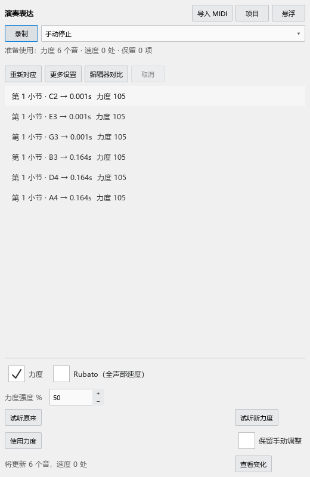
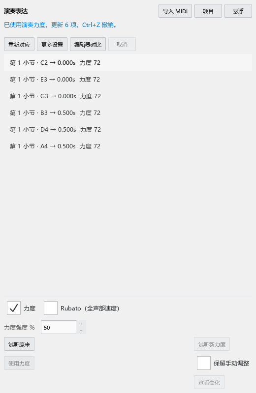

# MuseScore Evolution 个人功能说明

当前个人版本：**0.45.0 · Kumo branch / Freddd13**。

这份说明按你编曲时要完成的事情组织。每章先给一个可以照着操作的例子，再解释相关按钮。谱子的修改随 MSCZ 保存；`Ctrl+Z` 可以撤销刚完成的编辑。

## 打开功能

| 想完成的事情 | 从哪里打开 |
|---|---|
| 调整音符力度、速度、踏板 | 视图 → 演奏编辑器（力度／速度／踏板） |
| 在谱行旁调整演奏数值 | 视图 → 谱行参数带（独立显示） |
| 输入时自动整理节奏写法 | 工具 → 自动规范输入时值 |
| 点击测量速度 | 节拍器旁的敲击测速图标 |
| 尝试同一段的不同写法 | 工具 → 分段试写方案 |
| 查看和弦、级数和构成音 | 插件 → Harmony Assistant |
| 查看编配提示 | 插件 → Arrangement Check |
| 听原曲、慢放、循环 | 插件 → Reference Player |
| 把演奏 MIDI 的力度用于谱子 | 插件 → Performance Expression |
| 用完整谱副本比较方案 | 插件 → Arrangement Variants |
| 导出适合瀑布流视频的 MIDI | 文件 → 导出 → MIDI → 人性化裁剪 |

第一次使用插件，打开“插件 → 插件管理器”，勾选对应的主文件：`HarmonyAssistant_MS3.qml`、`ArrangementAssistant_MS3.qml`、`ReferencePlayer_MS3.qml`、`PerformanceExpression_MS3.qml` 或 `ArrangementVariants_MS3.qml`。关闭管理器后，从插件菜单运行。插件目录中需保留同文件夹的组件和 `WorkflowCommon`。

右侧工具与检视器等排成标签页；底部工具可与演奏编辑器排成标签页。拖标题栏可换位置，“悬浮”可单独开窗。下次打开会恢复你摆放的位置。

## 1. 演奏编辑器：调好一个音，再调一段

演奏编辑器用于调整力度、速度和踏板。上半部的钢琴卷帘帮助你找到音，下半部显示当前参数。

**先试一个音：**

1. 打开乐谱和演奏编辑器，在谱面点一个音。
2. 下方参数选择“力度”。点“选音”，让编辑器显示刚选的音。
3. 拖这个音的力度柱：向上变强，向下变弱。
4. 松开鼠标完成修改，再播放听效果。
5. 按 `Ctrl+Z` 撤销。拖动中按 `Esc` 可以取消。

亮边框表示选中，播放时的描边表示正在发声，橙色虚框表示等待保存的调整。播放中改值时，停止后会完成写入。

### 力度记号、百分比与固定力度

力度记号和渐强渐弱先给每个音一个原力度，音符可以在这个数值上再调整。例如右手原力度80、左手48：

| 保存方式 | 右手最后播放力度 | 左手最后播放力度 |
|---|---:|---:|
| 跟随力度记号，0% | 80 | 48 |
| 跟随力度记号，+10% | 约88 | 约53 |
| 固定力度60 | 60 | 60 |

“跟随力度记号”让选音随以后修改的 mf、p、渐强渐弱一起变化。“固定这个音的力度”保存这个音当前的 MIDI 力度。两种方式转换时，会保持当时的播放力度。

显示下拉控制你怎样看数值：“MIDI 力度”是最后的1–127；“相对%”是增减百分比。百分比视图里的0%表示按原力度演奏，所以高低谱表共用一条0%线。

想直观看出右手 mf、左手 p 的差别，勾选“实际力度＋原力度线”。柱子显示最后力度，虚线显示各谱表、声部的原力度；把鼠标停在音上，可以同时看原力度、增减和最后力度。

### 重叠音、筛选和工具

同一时刻有多个音时，先在谱面选好要改的音，再去拖对应力度柱。拖动开始后目标保持固定。`Alt+单击`可轮换重叠候选，右键可按音名、谱表、声部选择。`Ctrl+单击`加入多选；拖多选中的柱子可以一起调整。

点“谱表／声部”打开筛选表：每行一个谱表，每列声部1–4。“全部”“只看选音所在声部”“只看选中谱表”用于快速选择。其它音可以隐藏，或淡化作参考。编辑器、谱行带、音旁手柄共用这份筛选。

“选择”用于点选和拖动。“铅笔”让你划过一段音来画力度；“直线”让一段音逐渐变强或变弱。有选音时作用于选音；没有选音时作用于筛选中的音。一次拖画可用一次撤销恢复。

“拖动1倍”可以改成0.25、0.5、2、4倍。觉得一拖就变化太多，试0.5倍。

### 看清与缩放

“显示…”里的“一直显示力度（谱面与卷帘）”持续显示数字。按住 `Ctrl+Alt+V` 临时查看附近音的力度，加 `Shift` 查看当前视口全部音；松开恢复。短音的数值放在音符条旁边。

数字轴旁“适”匹配当前内容，“全”恢复完整范围，−／+改变纵向显示范围。滚动数字轴缩放，拖动数字轴移动范围。`Ctrl+滚轮`缩放时间，`Ctrl+Shift+滚轮`调整纵向，`Shift+滚轮`横向移动。

键盘提供完整、淡化无关音高、只显示相关音高三种方式；相关音高来自筛选后的音符。按声部着色默认采用软件的声部颜色，个人配色可以在“配色／力度柱宽…”中设置。

**遇到问题：**先点“全”和“全部”查看完整内容。播放后首次打开时，音符会随当前乐谱显示；状态提示正在准备演奏时，稍等准备完成。需要试听选音，在面板开启“试听”。

## 2. 谱行带和直接调力度

谱行带把力度、速度或踏板放到正在看的谱行旁边。可以单独打开，也可以与底部编辑器同时使用。

1. 打开“视图 → 谱行参数带（独立显示）”。
2. 在谱面点音，选择力度，拖该音旁边的手柄。
3. 在显示设置中选择“跟随选中／播放谱行”或“固定视口底部”。
4. 拖高度边缘改变带的高度；数字轴的缩放和平移与底部编辑器相同。

开启“滚轮调力度”后，把鼠标放到音头或力度手柄上滚动，每格调1，按住 `Shift` 每格调8。连续滚动停下约300毫秒后完成一次修改。

想直接调鼠标附近的音，在谱面按住 **`Alt+Shift+滚轮`**。浮标会显示正在调整的音名、谱表和声部，同一轮滚动保持这个目标。`Esc`取消尚未完成的调整。

谱行带设置会记住；演奏数值随乐谱保存。若手柄被筛选隐藏，点“显示选中音”或恢复“全部”。

## 3. 自动规范输入时值

这个功能按拍号整理输入的时值，帮助读谱者看清拍位。例如4/4从第一拍输入附点四分，再输入八分并将它改成四分，程序会在需要的位置拆分并用延音线连接。

1. 勾选“工具 → 自动规范输入时值”。
2. 像平常一样输入音符或改变时值。
3. 检查拍位、延音线和符杠；想采用个人写法，可以手动调整。
4. `Ctrl+Z`撤销这次输入或时值修改。

“允许延音音符跨拍连符杠”控制跨拍延音的符杠连接；“协调自动拆分音符的符干方向”结合延音链和附近符杠决定自动方向。手动指定的方向和符杠继续采用你的设置。

菜单勾选会记住。切换工作区后仍可从“工具”找到这些选项。附点八分＋附点八分＋八分的3-3-2节奏也按当前拍号处理。

## 4. 琶音、小音符与轻重音

**琶音：**添加琶音符号，选中它，在检视器设置每音间隔、整体偏移和对拍方式。选择“首音对拍”让第一音落在拍上；选择“末音对拍”让最后一音落在拍上。拖动参数名称可连续调整，按住 `Shift`细调。

**快速小音符：**添加小音符后，在检视器设置“小音符持续时间”。设成“主音对拍”时，小音符提前，主音留在原拍点。试听时可从前一小节开始，听清它如何接入主音。

**轻重音：**选中发音符号，在检视器设置力度倍率。100%保持原力度，115%略强，80%略弱。可把常用值存为以后添加的默认设置。

这些演奏设置随乐谱保存。改错后可撤销；想回到软件原设置，点相应参数旁的恢复按钮。

## 5. 颤音与震音

选中颤音或震音，在检视器开启逐次力度设置。起始倍率控制第一下，后续／结束倍率控制后面的走势，曲率决定变化快慢；“交替音减弱”可以让来回音形成轻重区别。

先试起始100%、结束80%，播放听这段是否逐渐收弱。屏幕曲线帮助你看变化，最后仍以试听为准。设置随符号保存，`Ctrl+Z`撤销；关闭逐次力度设置可采用原来的演奏方式。

## 6. 渐慢 rit. 与恢复速度 a tempo

指向一段音的 **rit.** 线可以播放渐慢，**a tempo** 可以恢复速度。

1. 从速度符号面板添加 rit.，调整起点和终点。
2. 选中线条，在检视器设起速、终速和曲率。起速0表示采用该处原速度。
3. 在后面的音上添加 a tempo，选择恢复方式，再播放听整段。
4. 在文字和线条设置里修改前缀、续行、结尾文字，以及虚线长短、间隔和粗细。

隐藏线条后，渐慢仍按设定播放。手动摆放的位置随谱子保存；重新开启自动布局可让软件整理位置。rit.和a tempo默认采用速度文字的字体。

需要一个明确恢复速度时，可选择恢复到指定BPM；需要恢复前面的速度时，使用恢复先前速度。发生速度记号相互覆盖时，按提示定位到相关位置再调整。

## 7. 敲击测速：测量与写谱

节拍器旁的图标用于跟着心里的节奏点击。按钮显示测得速度，下拉里可选择点击单位、倍速、半速和重置。

**只测速度：**连续敲至少四拍，查看数值和“起步／不稳定／稳定”。选择“设为独立节拍器”即可用于独立节拍器。

**写进谱子：**选中音符或休止符，在下拉选择“写入指定位置”，核对小节、拍位和拍单位后保存。

**改已有速度：**选中速度记号，在右键或检视器选择“用 Tap 设置速度”。跟着目标速度敲击，窗口和谱面显示预览；点“保存结果”或按回车完成一次修改，`Esc`回到进入前的状态。

每次点击附点四分测得80时，对应四分音符速度为120。窗口会同时说明点击单位和四分音符换算结果。

rit.可以分别用Tap设置起速或终速。a tempo和速度等式按它们的恢复／比例含义显示可用操作；要另设固定速度时，选择明确的写入位置。

## 8. 自由圆滑线与分手折线

### 自由圆滑线

1. 选中圆滑线，在检视器开启“自由曲线”和“自动避让音符”。
2. 查看自动整理后的弧线；双击线条进入编辑。
3. 拖中间点改变位置，拖两侧手柄调整弯曲；箭头可以微调。
4. 在检视器添加／删除控制点，或用“恢复自动形状”重新整理。

锁定点会保持你调好的位置。拖动一个点会自动锁定；想让它参加自动调整，解除“锁定这个点和切线”。`Esc`取消正在拖动的修改，`Ctrl+Z`恢复上一步。跨谱行分别显示和调整各行曲线。

### 左右手折线

“指法”面板提供左手、右手及各自的结束记号，用于指出某个音或一段音由哪只手演奏。

1. 选中具体音，从面板添加相应分手记号。
2. 双击记号，拖水平端点改横线长度，拖竖直端点改竖线长度。
3. 拖拐点移动整条折线，贴近实际所指的音。
4. 检视器可输入正数长度；“水平反向”“竖直反向”改变朝向。
5. 调好后点“保存为默认形状”，以后添加的同方向记号采用这个形状。

右手标记的拐角通常靠近所指音下方，左手标记的拐角靠近上方；自动布局会结合附近音符寻找位置。关闭自动布局后，可以固定个人摆放。旧字形切到“可伸缩折线”时沿当前外观建立形状。“还原基础折线”恢复简单预设，“使用默认形状”采用你保存的个人设置。

一个记号指出所附的音或和弦；开始与结束成对时指出这段分手范围。编配检查会读取这里保存的左右手信息。形状、方向和位置随乐谱保存，可撤销。

## 9. 和弦助手

和弦助手显示当前和弦、级数、转位和构成音，也可以在谱面显示和弦变化。

**先看一小段：**

1. 运行“插件 → Harmony Assistant”。打开谱子后，会开始读取当前内容。
2. 点一个音，或播放乐谱，查看当前位置的和弦。
3. 开启“谱面上方显示和弦 / 级数”，查看固定在和弦起点的记号。
4. 点谱面记号定位并高亮，双击打开详情。

状态显示正在读取、正在分析或已更新；已更新后给出和弦数量。切换乐谱会建立新谱的结果。

### 顶部摘要与右侧详情

在设置里勾选“同时显示顶部摘要与右侧详情”，顶部显示一行摘要，右侧显示详情。主面板放在右侧时，顶部也可独立显示；主面板放在顶部时，右侧详情单独打开。

“靠左／居中／靠右／自定位置”调整摘要所在位置。“详情”控制配套面板，“更多”可打开记号列表和悬浮窗口。关闭其中一个窗口时，可重新开启双面板。

摘要可选“实时”或“所属和弦”：实时显示当前位置参与识别的音，所属和弦显示这一段已经分析出的解释。

### 记号、级数与修正

`C/E`表示C和弦、实际低音E；级数同样显示转位，例如`I⁶`。详情还会写“第一转位”等中文。

设置中可以选仅和弦、仅级数或两者，调整左右／上下排列、字体、大小和颜色。“100%”恢复谱面和弦原大小。“避让其它谱面内容”控制自动避让，“记号背景遮罩”控制底色。相邻和弦拥挤时会上下排列，横向仍对齐变化位置。

选择踏板内一个／多个和弦，可以比较整段和弦与内部变化。先在调性下拉选择大调或小调，再按需要调整主音；例如没有升降号时，C大调选大调，A小调选小调。小调级数可按当前调式或同名大调显示。遇到几种合理解释，查看备选并手动指定；记号列表和范围编辑可增删识别点、调整作用范围。

“恢复原色”结束临时功能着色；原谱的选中和播放颜色照常显示。配色、标签和显示设置自动保存。JSON保存分析与人工修改，CSV方便查看表格；以后可用“导入JSON”恢复。

**遇到问题：**先看状态，再确认谱面显示开关和记号列表；原谱已有和弦时，“优先保留原谱和弦／级数”会采用已有记号。字号过大可点100%再调整。结果不合心意时，指定局部和弦和范围。

## 10. 编配检查

编配检查帮助你查看和声、声部进行和钢琴演奏中的疑点。每条提示包含位置、涉及音和建议依据。

1. 选中想检查的一段，运行“插件 → Arrangement Check”。
2. 选择调性钢琴／流行、严格对位或爵士预设，点“分析”。
3. 点问题查看详情；停播后点“定位”跳到涉及音。
4. 检查左右手和声部角色，必要时在角色设置中校正，再分析。
5. 对你有意采用的写法，可以“忽略此处”。

和声提示看持续冲突和非和弦音的进入／解决；对位提示给出前后两组音；可弹性提示结合跨度、同时按键和前后衔接。

舒适跨度、最大跨度、两端白键的条件可按个人手型设置。踏板会让声音在松手后继续，因此阅读提示时同时看“需要按住的音”和“踏板保持的音”。角色来源显示用户指定、分手标记或自动建议。

检查结果与设置可以保存；定位使用原生选音。修改乐谱后停播约750毫秒会更新相关范围。播放时看已有结果，停止后继续分析。

## 11. 原曲参考：听片段、循环和多轨

原曲参考支持WAV、MP3、FLAC，可慢放、循环，并把音频片段关联到谱段。

**先循环听一个片段：**

1. 运行“插件 → Reference Player”，点“打开”或把音频拖到面板。
2. 点击波形定位，设置“片段开始”和“片段结束”。
3. 开启循环，再点播放。拖片段端点可调整范围。
4. 把速度改成75%慢听，音高保持原来；回到100%听原速。
5. 面板有焦点时，按空格播放／停止；点击谱面后，空格控制乐谱播放。

多个文件拖入时分别成为音轨。“添加音轨”用于继续增加人声、伴奏或其它材料。每轨可调音量、静音、独听和是否参加播放。

### 把原曲片段关联到谱段

选中谱段，在波形选片段，再点“关联”。列表显示音频时间、对应小节和播放第几遍。点关联可以同时看到两边范围；“跳到乐谱”“跳到音频”和“播放这个片段”分别用于定位和试听。

同一原曲片段可以对应改编谱中的多个位置，源片段可以重叠。不同音轨可以对应同一谱段；一条轨道在同一位置有几个候选关联时，选择本次要用的那一条。内部对齐点用于标记片段里的对应时刻。

### 怎样播放

“原曲”播放音频，“乐谱”播放谱子，“一起播放”同时播放参加的轨道和谱子。联合播放有三种方式：

| 方式 | 听到的效果 |
|---|---|
| 开头对齐，各自播放 | 同时开始，之后各自保持速度，适合先听整体感觉 |
| 跟随乐谱 | 音频按谱内速度和对齐点伸缩 |
| 跟随选定音频 | 所选音频保持节奏，乐谱和其它音频跟着它 |

在项目菜单保存音轨、片段、书签和关联。音频保留外部文件引用，移动文件后用重新定位找到它。编辑器参考轨可以查看共用时间尺上的片段和对应。

**遇到问题：**先检查音轨静音、音量和输出设备。文件读取完成后波形和时长会出现；关联提示待核查时，点对应条目重新检查两边范围。

## 12. 演奏表达：把演奏力度用到谱子

这个功能把演奏MIDI与选中谱段对应，再把力度和速度用于乐谱。

**完整操作例子：**

1. 在谱面选中第9–16小节，打开“插件 → Performance Expression”。
2. 点“导入MIDI”，选择演奏文件。全曲文件会先寻找选中段，再对应每个音。
3. 看已匹配、漏弹、多弹和待检查的位置。重复段有多个候选时，按时间选择要用的那一段。
4. 点“编辑器对比”，查看原力度与演奏力度；点对应项可定位到谱面音。
5. 调“应用强度”。50%表示折中采用原力度和演奏力度，100%更接近演奏。
6. 点“试听原来”或“试听新力度”，从同一位置比较；试听结束点返回。
7. 点 **“使用力度”**，主界面会显示修改了多少音。`Ctrl+Z`撤销整次应用。

### 直接用 MIDI 键盘录一遍

1. 连接键盘。在“编辑 → 偏好设置 → 输入／输出”选择 MIDI 输入，并打开工具栏的 MIDI 输入开关。
2. 在谱面选中要处理的一段，运行演奏表达。
3. 保持“手动停止”，点 **“录制”**，按自己的节奏和力度弹奏。面板显示时间、收到的音名和力度。
4. 弹完点 **“停止录制”**，等对应完成。点“编辑器对比”查看原力度和刚弹的力度。
5. 调整应用强度，试听后点 **“使用力度”**。按 `Ctrl+Z` 可恢复整次修改。
6. 在“项目 → 保存项目”保存这次录制、对应和参数，日后可以继续调整。

“到时停止”按旁边设置的秒数结束；“弹完选段停止”在识别到末尾音序、松键并停顿片刻后结束。重复音型较多时，用手动停止更容易控制。段内短暂停顿后可以继续弹。

“更多设置”中的“录制时听到键盘声音”使用当前谱表的音色。键盘本身已经发声时，可关闭它，选择自己习惯的监听方式。选“任意音高敲击音序”后，可用任意键敲出选段的节奏和力度。

录制文件包含起音、松手、力度、通道和踏板。停止时仍按着的音按停止位置收尾。输入连接中断时，会保留已收到的内容并进入对应。

默认更新已对应的音；勾选“保留手动调整”可以保留你先前逐音设过的值。音原来使用百分比还是固定值，会按原方式换算到目标力度。

“使用速度”单独处理rubato。速度影响这个位置的所有声部；默认保留该段总时长和两端速度。查看速度曲线后再试听，已有速度记号和曲线的冲突会显示具体位置。

按谱演奏模式使用音高和节奏对应；音序敲击模式允许任意音高，按指定音序的节奏和力度对应。“更多设置”可调整对象、范围和手工对齐点。确认对应表示接受这条配对；真正改变谱子用“使用力度／使用速度”。

想同时听原曲，先在原曲参考里选好关联，再点演奏表达的“更多设置”，勾选“试听时播放参考音频”，然后试听。

保存项目会保存原始MIDI、对应和参数，之后可重新打开继续调整。试听自动准备一份副本，返回后继续编辑来源谱。

**遇到问题：**先核对谱段和MIDI候选时间。漏弹处保留原谱音，错配可以重新连接或设对齐点；修改谱子后重新对应，面板会更新可使用的结果。

## 13. 分段试写：在同一份谱子里保留几种写法

适合试“这一段左手写稀疏和弦，还是分解和弦”。每个方案组指定小节、谱表和声部，不同组可分别切换。

1. 选中一段完整小节，打开“工具 → 分段试写方案”。
2. 建立方案组，把当前写法保存为A，给它一个容易记的名字。
3. 复制为B，切到B后在谱面自由修改。
4. 在列表选择A或B，切换到同一位置播放比较。
5. 保存MSCZ，以后打开继续切换；指定主方案组合，决定普通MuseScore看到的完整谱。

当前写法会在切换前保存；切换可以撤销。第一版各写法保持同样的总拍数、拍号和谱表结构。音符的力度随写法保存，速度、踏板、调号及谱表力度记号由共同设置控制。

边界提示会指出延音线、圆滑线、连音组等连接位置。按提示扩大方案范围，让完整对象一起参加方案，再尝试切换。

“导出普通版副本”用于给其它版本打开或分享；选择要导出的组合。普通版重新保存通常只留下它看到的完整谱，所以全部方案请继续保存在本分支的MSCZ里。打印和常规导出使用界面显示的组合。

旧“Arrangement Variants”插件保留完整谱副本方式：新建组、复制方案、切换定位和从同处试听；成果可另存为完整谱，旧JSON工作区也可继续打开。

## 14. MIDI松手处理：让音长更接近实际弹奏

谱上写满的音可以借踏板继续发声，手指往往会提前松开去弹下一组音。MIDI松手处理调整导出文件里的按键长度，方便制作钢琴瀑布流视频。

1. 文件 → 导出，选择MIDI。
2. 勾选“人性化裁剪：保守踏板模式”，选择钢琴、小节范围和声部。
3. 在设置中选择是否保护旋律、最短按键时间、自然变化幅度和随机种子。
4. 点“查看对比”，选音查看原长度、新长度、踏板和处理原因。
5. 导出。勾选“同时导出未裁剪版本”可得到处理前后的两个文件，放到常用播放器比较。

细轮廓表示原按键长度，实心条表示准备采用的长度，下方显示踏板踩下／抬起。保留的音会列出原因，例如跨越抬踏板、手工演奏事件、用户保护或长度太短。

固定种子使相同谱子和参数重复导出得到相同结果。关闭随机可比较确定的长度；调整参数后重新计算预览。

导出处理作用于MIDI副本，谱上的音长照常保留。若试听发现低音或旋律的发声改变，在对比窗口排除相关音，重新导出比较。

## 15. 字体、音源和保存

个人字体可在谱面样式中选择。Kumo Engrave／Kumo Piano字体草案与谱面字体分别设置；和弦助手默认读取谱子的和弦字体。

大型SF2在合成器中加载。加载时等待音源准备完成，再从相同片段试听；音源路径变动时重新选择文件。

乐谱中的演奏、净谱、分手标记和方案随MSCZ保存。插件的显示设置自动记住；音频、演奏表达和旧方案工作区使用各自的“保存项目／保存工作区”。建议把项目文件与素材放在同一个文件夹，便于以后重新打开。

## 接下来会继续完善的部分

分段方案的谱面切换按钮和自动连接、连续手位判断，以及MIDI松手理由的新版显示仍在本次修复清单中。完成后会在对应章节补上入口、操作和实际界面。

版本修改和提交记录见[开发日志](CHANGELOG.md)。此前说明和历史安装信息收在[早期说明记录](docs/USER_GUIDE_HISTORY_20261014.md)。当前操作请按本页和软件里显示的按钮进行。

## Codex 钢琴编曲与 MCP 桥接（2026-10-08）

个人 `mcp-musescore` 桥版本 **2.1.0**，提交定位 **41aea0bf9c8337ba269582c9fee1d2a2ef33b053**，分支 `codex/musescore-evolution`（仓库 Freddd13/mcp-musescore）。它为 Codex 提供当前乐谱的结构化读取、音符/和弦/休止/连音/歌词、小节/选区/导航、拍号、速度和撤销工具，合计 30 项。没有修改 MuseScore 原生源码或个人版本号；本机既有演奏编辑器和和声助手保留。

1. 在 `E:\programming\funcodes\mcp-musescore` 运行 `pwsh -NoProfile -File scripts\install-codex.ps1`，准备 Python 3.13 环境、注册 Codex MCP 并安装 skill；可先加 `-WhatIf` 预览。skill 与 MCP 配置是两个步骤。
2. 将该项目的 `musescore-mcp-websocket.qml` 放入偏好设置中的插件目录，在插件管理器启用；打开谱，从 **插件 → MuseScore API Server** 运行。
3. 在新 Codex 聊天使用 `$mcp-musescore`，例如“分析当前钢琴谱第1–8小节的和声、手跨度和声部进行，先给建议”。连接先 ping，再读取能力与乐谱；小节从 1 开始，谱表/声部从 0 开始。

Windows 安装需要同 SDK 的 QtWebSockets QML 模块和 `Qt5WebSockets.dll`。本机 `msvc.install_performance_0_10_x64/bin` 与 `msvc.install_performance_0_11_x64/bin` 已补齐缺失 DLL，SDK/安装 Qt5Core 哈希完全一致；未覆盖旧 DLL。插件只绑定本机 `127.0.0.1:8765`，Codex 通过 Python stdio 接入，不是 HTTP MCP 地址。

限制：目前可读取存储力度类型/偏移、cent 调律偏移和逐音延音，但没有力度/踏板曲线、SF2、Mixer、调律或净书样式的 MCP 写入工具。旧 `set_staff_mute` 在 MS3 缺少可见性属性，会报不支持，不能用于音频静音；音色接口只打开人工对话框。用现有原生演奏编辑器调节力度/速度/踏板，用 HarmonyAssistant 看临时和声。批处理失败保留前面已完成的动作；写响应丢失时先读谱，不可盲目重复。VexFlow 预览不画延音线/连音括号，最终排版仍在 MuseScore 验证。

验证：17 项 Python/MCP/WebSocket/stdio 测试通过；0.10/0.11 的隔离静音宿主验证加载、读谱保持选中、选区、批处理和撤销、速度。0.11 另验证实际速度图值及音符写入。未验收用户桌面长期交互、真实声卡听感或 Codex 内 MCP App 展示。安装细节与后续钢琴分析/提示/演奏润色/净书路线见相邻 MCP 仓库 `docs/CODEX_SETUP.md` 和 `docs/ARCHITECTURE_AND_PIANO.md`，开发细节见该仓库 `CHANGELOG_PERSONAL.md`。

## AI 音乐分析与写作的数据规划（2026-10-09，尚未实现）

后续智能分析、钢琴编曲、演奏润色与净书采用“本地完整乐谱模型＋按任务提供上下文”的路线：乐谱事实、原生播放语义、音乐解释、用户目标和原曲参考分开保存；AI 读取全曲结构摘要、当前片段及跨边界的延音/踏板/乐句，必要时展开证据。

本次仅规划，没有新增菜单或 MCP 工具，不改软件版本与安装，**无需重新安装/配置 MCP、skill 或 QML 插件**。现有使用入口仍为上面的 Codex MCP 桥和原生演奏编辑器/和声助手。

实现优先级：准确分段读取与版本校验 → 旋律/动机/和声等视图与局部建议 → 受约束草稿、原生试听/净书副本预览 → 全曲、原曲与录音对应。主逻辑放插件与 Python，确需最终演奏/几何或个人属性读取时才补最小通用本体 API。

限制：当前桥尚不能完整提供踏板/标记作用域、所有个人演奏参数、可靠工程版本或净书几何；ScoreObserver 的和声去重视图不是完整声部模型，fingerprint 不是全谱版本。新功能实施后必须另作运行验收，不能把此规划当作已发布功能。

完整方案见 [相邻 MCP 项目的 AI 上下文设计](../../../mcp-musescore/docs/AI_SCORE_CONTEXT_DESIGN.md)。提交定位：`Freddd13/mcp-musescore` 的 `codex/musescore-evolution` 分支，`7fd37be`（`docs: design score data and AI task context`）。本次查看的软件版本为 `059ddd720` / personal 0.18.0，未修改原生源码。

## AI 上下文补充规划：可选资料与实时交互（2026-10-10，尚未实现）

写作时默认从 MuseScore 当前内存谱直接读取，包含已提交但未保存的改动，不要求先保存或导出 MusicXML。参考谱/原曲和弦/歌词、用户知道的旋律与结构解释均可选、可局部提供，缺少原曲仍能分析当前编曲；缺失、未读取、软件不支持、计算失败及过期结果分别报告。

未来交流应区分“这里理解为 Em7”（解释层）、“谱上加 Em7 标记”（原生和弦标记）与“伴奏改成 Em7 配音”（实际音符修改）。先交流或选候选不改谱；明确授权范围内的修改再通过版本/旧值检查、原生执行、读回和撤销验收。

外部材料和模型通过适配器进入共同的本地上下文服务，保留来源、部分覆盖与对应关系；模型结果不会自行获得改谱权限。既有和声助手人工区间/结果交换可作为后续对接起点，当前尚未自动接入。

完整修订见 [可选信息、实时取谱与外部交互契约](../../../mcp-musescore/docs/AI_CONTEXT_INTEGRATION.md)。提交定位：`Freddd13/mcp-musescore` / `codex/musescore-evolution` / `01fdca2`，本次只读核查软件 `4c04ca711` / personal 0.22.0。只改设计与用户说明，无新增菜单/可调用工具，不改软件版本或安装；**无需重装/重配 MCP、skill、QML 插件**。
