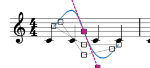
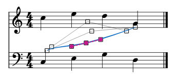
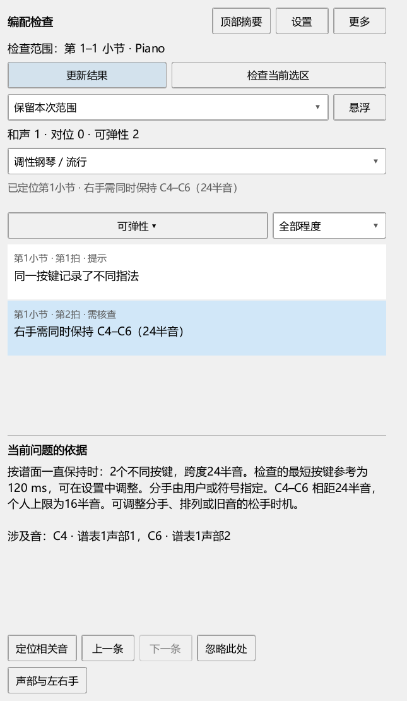

# MuseScore Evolution 个人功能说明

当前修复进度、各功能剩余检查与后续顺序见[进度与完整计划](docs/REWORK_PROGRESS.md)。

低音排列按实际起音、松键与踏板检查；手调音长、起音和踏板后怎样更新，见[完整操作](docs/ARRANGEMENT_122_GUIDE.md)。

尺寸拖动后继续操作面板、编曲工具栏图标与用途见[操作说明](docs/INPUT_121_GUIDE.md)。

和弦音名、低音与转位级数，以及连续换谱后的自动显示，见[和弦例子与操作](docs/HARMONY_109_GUIDE.md)。踏板内单个／多个和弦、导入解释和调号变化见[踏板内的和弦](docs/HARMONY_110_GUIDE.md)。分解伴奏、八度重复与中途换和弦见[连续伴奏](docs/HARMONY_111_GUIDE.md)。即时摘要、全谱调号与无踏板聚合见[操作例子](docs/HARMONY_112_GUIDE.md)。导入、保存、重新检测和临时显示的打印效果见[分析文件](docs/HARMONY_113_GUIDE.md)。问号、识别点增删和跨行范围见[修改和弦](docs/HARMONY_114_GUIDE.md)。

希望换谱后继续使用同一套CFX、Pianoteq或SF2声音，见[所有谱子共用钢琴](docs/COMMON_PIANO_108_GUIDE.md)。每份谱可单独切回自己的音源；本批实际结果见[检查记录](docs/COMMON_PIANO_108_CHECKS.md)。

换谱时复用各谱的音源、释放闲置音源，见[音源保留操作](docs/SOURCE_SESSIONS_107_GUIDE.md)。

钢琴换踏板的整架乐器／单段设置、实际踩踏区间和MIDI选择见[完整操作](docs/PEDAL_106_GUIDE.md)。本批声音及界面结果见[检查记录](docs/PEDAL_106_CHECKS.md)。

踏板相接两端的拖动、画抬起间隙、重画和删除恢复，见[踏板编辑](docs/PEDAL_105_GUIDE.md)。

本次补充的音源面板、换谱保留和两种踏板方式见[后续安排](docs/SOUND_PEDAL_PLAN.md)。这些选项随对应批次交付，当前音源操作见[使用步骤](docs/VST_088_GUIDE.md)。

AI怎样读取当前谱、标题和图片，见[当前实现与后续安排](docs/AI_WORKFLOW_REVIEW_20261024.md)。当前旧画谱入口会根据音符重新排版；MuseScore原生选段图片与数据一起提供的功能安排在E阶段。

本文对应准备发布的个人版本：**0.122.0**（当前安装0.121.0） · Kumo branch / Freddd13。和弦面板见[外观与人工修改](docs/HARMONY_077_GUIDE.md)，完整谱试写见[保存与切换](docs/VARIANTS_076_GUIDE.md)，谱面调节见[操作步骤](docs/SCORE_HARMONY_075_GUIDE.md)，频谱范围与缩放见[完整录音和对齐片段](docs/SPECTRUM_078_GUIDE.md)。

从完整MIDI寻找选段、分别选择两音改对应、撤销重做及使用力度，见[演奏表达操作](docs/EXPRESSION_096_GUIDE.md)。采用演奏中的快慢、分范围使用速度与长休止录制，见[速度与录制](docs/EXPRESSION_097_GUIDE.md)。

分段A/B的修改、组合、保存和删除见[分段写法](docs/VARIANTS_070_GUIDE.md)；完整谱工作区另存后会自动更新文件位置，见[完整谱保存](docs/VARIANTS_076_GUIDE.md)。

密集音符的力度数字、临时查看和谱行带高度调整，见[看清力度与谱行带](docs/VALUES_094_GUIDE.md)。

切换工作视图后保留两侧宽度，以及从编辑器返回原曲参考、符号面板的操作，见[工作视图与面板操作](docs/WORKSPACE_093_GUIDE.md)。

常用按钮图标、音轨静音／独听及新的音源分组见[图标与音源面板](docs/COMPONENTS_092_GUIDE.md)。

不同谱表一起调力度、参考线、固定／跟随和悬浮卷帘查看数值，见[日常调力度](docs/DYNAMICS_090_GUIDE.md)。

混音器与编辑器共同使用、标签组高度恢复和工具图标见[组合面板操作](docs/WINDOWS_089_GUIDE.md)。

写节奏录完后的音名选择、忽略敲击和撤销见[校正操作](docs/WRITING_087_GUIDE.md#改正漏敲多敲和对应位置)。卷帘画音、跨小节延音和拖动中断后的操作见[卷帘写音](docs/WORKSPACE_067_GUIDE.md)；草稿的继续修改、删除与恢复，以及写节奏的录制、试听和采用见[完整步骤](docs/WRITING_087_GUIDE.md)。

工作视图的尺寸与工具页返回见[窗口操作](docs/LAYOUT_079_GUIDE.md)。

原曲的精确选段、一起播放和修改关联见[从同一位置比较原曲与乐谱](docs/REFERENCE_081_GUIDE.md)。原曲暂停继续、Ctrl+空格及与乐谱轮流播放见[播放和快捷键](docs/REFERENCE_098_GUIDE.md)。

播放中静音、独听、切换查看音轨，以及多个片段的采用、修改、删除恢复和保存，见[多轨比较与关联操作](docs/REFERENCE_099_GUIDE.md)。

移动乐谱与录音文件夹、找回音频、取消读取，以及反复中的片段关联，见[文件与遍次操作](docs/REFERENCE_100_GUIDE.md)。

扒谱显示范围由时间下拉框选择：“整条录音 · 原曲时间”用于浏览整首；“按谱对齐”用于对照关联谱段，并与卷帘一起缩放。叠加显示时，编辑器的“全曲”“选区”和参数区缩放也会同步改变频谱范围。完整步骤见[频谱范围](docs/SPECTRUM_078_GUIDE.md)。乐谱保存与本次检查见[保存和范围检查](docs/SAVE_RANGE_0801_CHECKS.md)。

从录音找音到写谱：在“扒谱”选轨、点“播放原曲”，用底部时间条找到要听的位置；点亮线后按“标注这个音”，再去乐谱选择输入位置、声部和时值，点“输入乐谱”。下方“写入”显示当前目的位置，写完会跟随输入光标更新。连续输入、长录音浏览及保存方法见[完整操作](docs/WORKSPACE_066_GUIDE.md)。

循环听辨中可以直接调速度、均衡和选频，继续听当前位置；片段播完后也可以重新点选播放位置。A4调律、移调及列表中的“输入…”音名见同一章的[调律与移调](docs/WORKSPACE_066_GUIDE.md#录音的调律与写入的调性)。

本轮[完整使用检查与返工进度](docs/USABILITY_REWORK_20261019.md)按功能逐项记录。

先按下面的任务找到入口。每章有完整操作例子、按钮说明、保存和撤销方法。“帮助 → 个人功能说明”可以在软件里直接阅读。

| 想完成的事 | 从哪里开始 |
|---|---|
| 面板单独全屏、回到原位置、处理窗口跑到屏幕外 | [面板窗口与工具栏](docs/WINDOWS_072_GUIDE.md) |
| 调整编辑器尺寸、切换工作视图和工具页 | [窗口操作与区域高度](docs/LAYOUT_079_GUIDE.md) |
| 把区域移到右侧或悬浮 | [区域摆放](docs/WORKSPACE_064_GUIDE.md) |
| 选择原曲音轨、删除恢复、拖滑块调速度 | [原曲音轨操作](docs/WORKSPACE_064_GUIDE.md#管理多条原曲音轨) |
| 连接 Codex，让它读取或建议写法 | 视图 → AI 连接；[第一次连接的步骤](docs/WORKSPACE_063_GUIDE.md) |
| 调整力度、速度、踏板 | 下文“演奏编辑器” |
| 设置mp、mf等记号的默认力度 | 演奏编辑器 → 操作设置… → 力度记号；[完整步骤](docs/DYNAMICS_082_GUIDE.md) |
| 谱面滚轮调力度、谱行带跟随选音、保留上一和弦 | [谱面调节与和弦显示](docs/SCORE_HARMONY_075_GUIDE.md) |
| 查看和弦、级数和构成音 | 下文“和弦助手” |
| 听原曲和比较谱段 | [关联、一起播放与保存](docs/REFERENCE_081_GUIDE.md) |
| 导入或录制演奏，再使用力度 | [录制、查看对应与采用力度](docs/EXPRESSION_080_GUIDE.md) |
| 对照频谱听音、标注与输入 | [频谱扒谱完整步骤](docs/WORKSPACE_066_GUIDE.md) |
| 查看整条录音、按谱对齐与缩放频谱 | [频谱范围与缩放](docs/SPECTRUM_078_GUIDE.md) |
| 给频谱或标注列表多留一些空间 | [标注列表开关与高度](docs/REFERENCE_SPECTRUM_074_GUIDE.md) |
| 在卷帘画音、移动或先试草稿 | [卷帘写音完整步骤](docs/WORKSPACE_067_GUIDE.md) |
| 给已经写好的音高换节奏 | [写节奏](docs/P2_RHYTHM_062_GUIDE.md) |
| 查看指法、分手、配音与对位建议 | [编配建议](docs/P2_SUGGESTIONS_061_GUIDE.md) |
| 保留一行的小节、解除锁定 | [谱行锁定](docs/WORKSPACE_068_GUIDE.md) |
| 使用 Pianoteq、CFX，给乐器加效果 | [音源与效果完整步骤](docs/WORKSPACE_069_GUIDE.md) |
| 分享前统一关闭个人工具 | [kumo.ini 开关](docs/WORKSPACE_063_GUIDE.md) |

播放后继续操作符号面板、原曲参考和编辑器，见[播放与面板点击](docs/INPUT_120_GUIDE.md)。

## 打开功能

| 想完成的事情 | 从哪里打开 |
|---|---|
| 调整音符力度、速度、踏板 | 视图 → 演奏编辑器（力度／速度／踏板） |
| 在谱行旁调整演奏数值 | 视图 → 谱行参数带（独立显示） |
| 输入时自动整理节奏写法 | 工具 → 自动规范输入时值 |
| 点击测量速度 | 节拍器旁的敲击测速图标 |
| 尝试同一段的不同写法 | 工具 → 分段试写方案；[保留、切换与删除](docs/VARIANTS_070_GUIDE.md) |
| 查看和弦、级数和构成音 | 视图 → 和弦助手 |
| 查看编配提示 | 插件 → Arrangement Check |
| 听原曲、慢放、循环 | 视图 → 原曲参考 |
| 把演奏 MIDI 的力度用于谱子 | 视图 → 演奏表达 |
| 用完整谱副本比较方案 | 插件 → Arrangement Variants |
| 导出适合瀑布流视频的 MIDI | 文件 → 导出 → MIDI → 人性化裁剪 |

和弦助手、原曲参考和演奏表达从“视图”直接打开。编配检查与完整谱副本试写仍从插件菜单使用：第一次打开“插件 → 插件管理器”，勾选 `ArrangementAssistant_MS3.qml` 或 `ArrangementVariants_MS3.qml`。这些插件使用安装包附带的公共组件。

右侧工具与检视器等排成标签页；底部工具可与演奏编辑器排成标签页。拖标题栏可换位置，“悬浮”可单独开窗。下次打开会恢复你摆放的位置。

设置mp、mf等记号的默认播放力度，见[力度默认值与恢复](docs/DYNAMICS_082_GUIDE.md)。

## 1. 演奏编辑器：调好一个音，再调一段

演奏编辑器用于调整力度、速度和踏板。上半部的钢琴卷帘帮助你找到音，下半部显示当前参数。

**先试一个音：**

1. 打开乐谱和演奏编辑器，在谱面点一个音。
2. 下方参数选择“力度”。点“选音”，让编辑器显示刚选的音。
3. 拖这个音的力度柱：向上变强，向下变弱。
4. 松开鼠标完成修改，再播放听效果。
5. 按 `Ctrl+Z` 撤销。拖动中按 `Esc` 可以取消。

选中的音有亮边框，播放描边标出当前音。拖动中显示拟采用的数值，松开后写入；播放中先保留预览，停止后写入。配色可以在显示设置中调整。

### 在卷帘画音与试草稿

点卷帘左上方的“写音”开启，选择“直接写谱”或“草稿”。拖空白处画音，拖音符移动，拖右端改长度。Ctrl+拖动复制，Delete删除；每次手势可用一次Ctrl+Z撤销。“草稿”可比较试听，再点“使用草稿”。完整例子见[卷帘写音](docs/WORKSPACE_067_GUIDE.md)。

### 力度参考线、谱中力度与一起调整

“力度参考线”显示 mf、p 和渐强渐弱在当前位置给出的数值；音符实际采用的数值叫“谱中力度”。例如右手力度参考线80、左手40：

| 保存方式 | 右手播放力度 | 左手播放力度 |
|---|---:|---:|
| 跟随力度记号，0% | 80 | 40 |
| 跟随力度记号，+10% | 88 | 44 |
| 固定力度60 | 60 | 60 |

“跟随力度记号”让选音随以后修改的mf、p、渐强渐弱变化。“固定这个音的力度”保存当前MIDI力度。两种方式转换时保持当前听到的力度。

上方的“MIDI力度／相对%”选择显示方式。MIDI力度显示1–127，相对%显示在力度参考线上增加或减少多少。切换显示时，音符继续采用原来的保存方式。

**一起调整左右手：**

1. 选择“MIDI力度”，勾选“显示力度参考线”。两条不同颜色的虚线分别显示右手80和左手40。
2. 在谱面选中要一起调整的音，保持“一起增减百分比”。
3. 拖其中一个音的力度柱。右手从80增加到88时，左手相应增加到44。
4. 想让所有选音都增加同样的MIDI数值，切换为“相同MIDI差值”。
5. 松开完成，Ctrl+Z撤销整次调整。

“力度同图／按谱表分区”切换两种排法。分区共用时间尺，每个谱表有独立刻度，点标题可收起或展开。谱表／声部筛选同时控制力度柱、力度参考线线和选音。

### 重叠音、筛选和工具

同一时刻有多个音时，先在谱面选好要改的音，再去拖对应力度柱。拖动开始后目标保持固定。`Alt+单击`可轮换重叠候选，右键可按音名、谱表、声部选择。`Ctrl+单击`加入多选；拖多选中的柱子可以一起调整。

点“谱表／声部”打开筛选表：每行一个谱表，每列声部1–4。“全部”“只看选音所在声部”“只看选中谱表”用于快速选择。其它音可以隐藏，或淡化作参考。编辑器、谱行带、音旁手柄共用这份筛选。

“选择”用于点选和拖动。“铅笔”让你划过一段音来画力度；“直线”让一段音逐渐变强或变弱。有选音时作用于选音；没有选音时作用于筛选中的音。一次拖画可用一次撤销恢复。

“拖动1倍”可以改成0.25、0.5、2、4倍。觉得一拖就变化太多，试0.5倍。

“区域”菜单可以收起、悬浮或移出钢琴卷帘、参数区、演奏对应、演奏表达、扒谱和写节奏。每项都提供“放回编辑器”。拖分隔条调整高度；“恢复区域高度”回到常用比例。“视图 → 工作视图”提供编曲、DAW、雕版和后处理，各自记住布局。完整例子见[工作视图与区域摆放](docs/WORKSPACE_064_GUIDE.md)。

### 看清与缩放

“显示…”里的“一直显示力度（谱面与卷帘）”持续显示数字。按住 `Ctrl+Alt+V` 临时查看附近音的力度，加 `Shift` 查看当前视口全部音；松开恢复。短音的数值放在音符条旁边。

数字轴旁“适”匹配当前内容，“全”恢复完整范围，−／+改变纵向显示范围。滚动数字轴缩放，拖动数字轴移动范围。`Ctrl+滚轮`缩放时间，`Ctrl+Shift+滚轮`调整纵向，`Shift+滚轮`横向移动。

键盘提供完整、淡化无关音高、只显示相关音高三种方式；相关音高来自筛选后的音符。按声部着色默认采用软件的声部颜色，个人配色可以在“配色／力度柱宽…”中设置。

**遇到问题：**先点“全”和“全部”查看完整内容。播放后首次打开时，音符会随当前乐谱显示；状态提示正在准备演奏时，稍等准备完成。需要试听选音，在面板开启“试听”。

## 2. 谱行带和直接调力度

谱行带把力度、速度或踏板放到正在看的谱行旁边。可以单独打开，也可以与底部编辑器同时使用。

1. 打开“视图 → 谱行参数带（独立显示）”。
2. 在谱面点音，选择力度，拖该音旁边的手柄。
3. 在显示设置中选择“跟随选中／播放谱行”或“固定视口底部”。
4. 拖高度边缘改变带的高度；数字轴的缩放和平移与底部编辑器相同。

开启“滚轮调力度”后，把鼠标放到音头或力度手柄上滚动，每格调1，按住 `Shift` 每格调8。连续滚动停下约300毫秒后完成一次修改。

想直接调鼠标附近的音，在谱面按住 **`Alt+Shift+滚轮`**。浮标分两行显示音名、谱表声部、当前力度、增减百分比和力度参考线；被调整的音以声部颜色描边。同一轮滚动保持目标，`Esc`取消尚未完成的调整。音符输入状态也可使用。

在演奏编辑器的“操作设置…”里可将最近音滚轮改为Ctrl+Alt、Ctrl+Shift或关闭。

谱行带设置会记住；演奏数值随乐谱保存。若手柄被筛选隐藏，点“显示选中音”或恢复“全部”。

## 3. 自动规范输入时值

这个功能按拍号整理输入的时值，帮助读谱者看清拍位。例如4/4从第一拍输入附点四分，再输入八分并将它改成四分，程序会在需要的位置拆分并用延音线连接。

1. 勾选“工具 → 自动规范输入时值”。
2. 像平常一样输入音符或改变时值。
3. 检查拍位、延音线和符杠；想采用个人写法，可以手动调整。
4. `Ctrl+Z`撤销这次输入或时值修改。

“允许延音音符跨拍连符杠”控制跨拍延音的符杠连接；“协调自动拆分音符的符干方向”结合延音链和附近符杠决定自动方向。手动指定的方向和符杠继续采用你的设置。

菜单勾选会记住。切换工作区后仍可从“工具”找到这些选项。附点八分＋附点八分＋八分的3-3-2节奏也按当前拍号处理。

## 4. 琶音、小音符与轻重音

**琶音：**添加琶音符号，选中它，在检视器设置每音间隔、整体偏移和对拍方式。选择“首音对拍”让第一音落在拍上；选择“末音对拍”让最后一音落在拍上。拖动参数名称可连续调整，按住 `Shift`细调。

**快速小音符：**添加小音符后，在检视器设置“小音符持续时间”。设成“主音对拍”时，小音符提前，主音留在原拍点。试听时可从前一小节开始，听清它如何接入主音。

**轻重音：**选中发音符号，在检视器设置力度倍率。100%保持原力度，115%略强，80%略弱。可把常用值存为以后添加的默认设置。

这些演奏设置随乐谱保存。改错后可撤销；想回到软件原设置，点相应参数旁的恢复按钮。

## 5. 颤音与震音

选中颤音或震音，在检视器开启逐次力度设置。起始倍率控制第一下，后续／结束倍率控制后面的走势，曲率决定变化快慢；“交替音减弱”可以让来回音形成轻重区别。

先试起始100%、结束80%，播放听这段是否逐渐收弱。屏幕曲线帮助你看变化，最后仍以试听为准。设置随符号保存，`Ctrl+Z`撤销；关闭逐次力度设置可采用原来的演奏方式。

## 6. 渐慢 rit. 与恢复速度 a tempo

指向一段音的 **rit.** 线可以播放渐慢，**a tempo** 可以恢复速度。

1. 从速度符号面板添加 rit.，调整起点和终点。
2. 选中线条，在检视器设起速、终速和曲率。起速0表示采用该处原速度。
3. 在后面的音上添加 a tempo，选择恢复方式，再播放听整段。
4. 在文字和线条设置里修改前缀、续行、结尾文字，以及虚线长短、间隔和粗细。

隐藏线条后，渐慢仍按设定播放。手动摆放的位置随谱子保存；重新开启自动布局可让软件整理位置。rit.和a tempo默认采用速度文字的字体。

需要一个明确恢复速度时，可选择恢复到指定BPM；需要恢复前面的速度时，使用恢复先前速度。发生速度记号相互覆盖时，按提示定位到相关位置再调整。

## 7. 敲击测速：测量与写谱

节拍器旁的图标用于跟着心里的节奏点击。按钮显示测得速度，下拉里可选择点击单位、倍速、半速和重置。

**只测速度：**连续敲至少四拍，查看数值和“起步／不稳定／稳定”。选择“设为独立节拍器”即可用于独立节拍器。

**写进谱子：**选中音符或休止符，在下拉选择“写入指定位置”，核对小节、拍位和拍单位后保存。

**改已有速度：**选中速度记号，在右键或检视器选择“用 Tap 设置速度”。跟着目标速度敲击，窗口和谱面显示预览；点“保存结果”或按回车完成一次修改，`Esc`回到进入前的状态。

每次点击附点四分测得80时，对应四分音符速度为120。窗口会同时说明点击单位和四分音符换算结果。

rit.可以分别用Tap设置起速或终速。a tempo和速度等式按它们的恢复／比例含义显示可用操作；要另设固定速度时，选择明确的写入位置。

## 8. 自由圆滑线与分手折线

### 自由圆滑线

例如，一条连线前半段要从音符上方经过，后半段要从下方经过：

1. 选中圆滑线，在检视器开启“自由曲线”和“自动避让音符”。
2. 在“新增位置”输入50%，点“添加”，得到一个中间点。“节点”下拉框可选择已有的点。
3. 在“调整区段”选择“起点 → 点1”，将走向设为“从音符上方经过”；再选择“点1 → 终点”，设为“从音符下方经过”。
4. “起点位置”和“终点位置”分别决定两端贴在音符哪一侧。选“自动”时会结合首尾区段的走向；也可分别指定“音符上方”或“音符下方”。端点按符干、符杠和发音符号摆放；跨谱表时读取两端实际所在的谱表。
5. 双击线条，拖中间点改变位置，拖点两侧手柄改变弯曲。两端的小方点可以移动端点，附近的切线手柄调整进出方向。相邻两段共用切线；固定的中间点会保留位置。一次拖动对应一次撤销，拖动中按Esc恢复进入拖动前的形状。
6. 想保留一个点的位置，先在“节点”选它，再勾选“锁定这个点和切线”。锁定时保留屏幕上已经显示的位置；解除后，这个点可以继续参加自动避让。
7. 点“整理这一段”，保留这一段两端点的位置，按附近节点的距离整理连接切线；选整条线时按钮显示“整理整条线”。相邻点很近时，手柄会相应缩短。

若锁定点挡住了所选路线，可以移动这个点或解除锁定后再整理。新增点继承所在区段的走向；删除点后，相同走向的两段合并。“恢复自动形状”重新安排中间曲线，保留两端位置设置。

Ctrl+Z撤销，编辑菜单中的“重做”可恢复这一步。节点位置、切线、走向和锁定状态随MSCZ保存。跨谱行会在各行延续所选区段；本次检查和配图见[曲线控制点](docs/SLUR_085_CHECKS.md)。

### 左右手折线

“指法”面板提供左手、右手及各自的结束记号，用于指出某个音或一段音由哪只手演奏。

1. 选中具体音，从面板添加相应分手记号。
2. 双击记号，拖水平端点改横线长度，拖竖直端点改竖线长度。
3. 拖拐点移动整条折线，贴近实际所指的音。
4. 检视器可输入正数长度；“水平反向”“竖直反向”改变朝向。
5. 调好后点“保存为默认形状”，四种方向一起采用相同长度，开始与结束自动镜像。

右手标记的拐角通常靠近所指音下方，左手标记的拐角靠近上方；自动布局会结合所指音所在的线、间、加线、邻音与符杠寻找位置。短横靠近所指音，拐角优先放在谱间。关闭自动布局后，可以固定个人摆放。旧字形切到“可伸缩折线”时沿当前外观建立形状。“还原基础折线”恢复简单预设，“使用默认形状”采用你保存的个人设置。

勾选“显示 l.h.／r.h.”可添加斜体手部文字。

一个记号指出所附的音或和弦；开始与结束成对时指出这段分手范围。编配检查会读取这里保存的左右手信息。形状、方向和位置随乐谱保存，可撤销。

升级后，速度面板保留一项可播放rit.与一项a tempo，指法面板保留四种方向的折线。自己制作的符号格子继续保留；这些格子的外观以软件实际符号预览。

## 9. 和弦助手

用它查看当前位置的和弦、级数、转位和构成音，也可以把和弦变化显示在谱面上。

### 第一次使用

1. 打开乐谱，打开“视图 → 和弦助手”。面板显示读取和分析进度；完成后显示“已更新”和和弦数量。
2. 点击一个音，查看它所属的和弦。播放时，面板和谱面上的当前记号会一起强调。
3. 开启“谱面上方显示和弦 / 级数”。记号对齐和弦开始的位置，拥挤处上下排列。
4. 暂停后双击一个谱面记号，打开“修改和弦与范围”。问号也可以双击，再选择根音、和弦种类和低音，点“指定和弦”。

### 顶部摘要和右侧详情

展开“设置 → 外观、功能色与文字 → 顶部摘要外观”，可同时显示顶部摘要与右侧详情。“详情”打开对应的详细面板，“靠左／居中／靠右／自定位置”调整摘要位置。两个面板可分别隐藏，再从插件菜单或详情入口打开。

摘要显示“实时”或“所属和弦”。实时根据当前位置的音判断；所属和弦采用这一整段的分析结果。上方“更多 → 摘要外观与调性”可以改主音、大小调、字号、级数大小、和弦与级数的间距，以及左右或上下排列。窗口中的样例会立即更新。“恢复此处默认外观”可恢复当前这处显示的外观。

摘要、详情和谱面和弦采用乐谱的和弦字体及音乐符号排版。`C/E`表示C和弦、实际低音E；级数会显示为`I⁶`。详情还写出“第一转位”等中文。详情标题也能单独设置字号、间距、一行或两行，以及仅和弦、仅级数或两者。展开“设置 → 外观、功能色与文字”，分别选择“顶部摘要外观”“右侧详情外观”或“谱面和弦记号”。各组标题可点击收起。

### 在谱面调整范围和位置

1. 在当前和弦下方展开“修改和弦与范围”，勾选“在谱面和面板显示范围手柄”；也可双击谱面记号直接进入。
2. 拖两端的小手柄，改变这个和弦的起止位置；面板里的范围随之更新。相邻和弦会共用新的分界位置。
3. 拖记号本身，调整它在谱面上的位置。音乐范围保持当前值。
4. 点“恢复记号自动位置”重新自动摆放；“撤销修正／重做修正”可退回或重做范围、和弦和位置调整。

面板中的小范围条也能拖手柄。数值框用于输入精确位置；480 tick相当于一个四分音符。“在当前位置拆分”增加识别边界，“合并前一段”去掉两个和弦之间的边界，“排除此范围”隐藏这一段的分析记号，“恢复自动”重新采用自动结果。

### 识别和显示设置

踏板内可选一个和弦，或允许多个和弦。主音和大小调可手动选择；小调级数可按当前调式或同名大调表示。前后进行会参与比较接近的解释，备选栏保留其它可能。

谱面设置可选仅和弦、仅级数或两者，调整排列、字体、大小和颜色。“避让其它谱面内容”控制自动避让，“记号背景遮罩”控制底色。人工摆放的记号保留你指定的位置。

“恢复原色”结束临时功能着色。配色、标签和显示设置自动保存；人工和弦、范围和位置按乐谱内容保存。导出JSON可保存这份分析，导入JSON可恢复；CSV用于查看和弦表格。

打开新谱后先看总状态。完成分析后仍看不到记号时，检查谱面显示开关、记号列表，以及“优先保留原谱和弦／级数”。修改音高或力度后，人工指定的和弦与范围继续保留，构成音按当前谱子更新。增删小节、改变拍号或谱表后，按提示核对起止位置，再点“复核完成：应用原人工范围”；撤销结构修改后恢复原范围。

## 10. 编配检查

相同排列合并展示、逐处定位，以及持续时间和起音力度的读法，见[低音排列操作](docs/ARRANGEMENT_119_GUIDE.md)。

低音排列的发声设置、装饰音对应与修改力度后的更新，见[操作与例子](docs/ARRANGEMENT_118_GUIDE.md)。

长伴奏转旋律、选区之前的谱内和弦及修改后的更新，见[操作例子](docs/ARRANGEMENT_117_GUIDE.md)。

复音后的单音线、装饰音和主音选择，见[具体操作](docs/ARRANGEMENT_116_GUIDE.md)。

编配检查帮助你找出值得再听、再弹一遍的位置。每条提示写出相关音、发生位置和可以怎样调整。

具体例子、前后音线及和弦助手联用见[看懂和声与声部提示](docs/ARRANGEMENT_115_GUIDE.md)。

### 检查一段并继续修改

1. 在谱面选中要检查的小节，打开“插件 → Arrangement Check”。首次使用可在插件管理器勾选 `ArrangementAssistant_MS3.qml`。
2. 选择“调性钢琴／流行”“严格对位”或“爵士”，点“检查当前选区”。只选了一个音时，检查它所在的小节。
3. 面板上方显示检查范围。点一条提示定位相关音；下方说明会列出C4、C6等音名、谱表和声部。
4. 按提示修改乐谱。停播约750毫秒后更新原来的检查范围，也可点“更新结果”。当前查看的提示仍存在时，会继续保留选中。
5. 要检查另一段，重新选好小节，点“检查当前选区”。要检查整首，在范围下拉框选“钢琴全谱”，再点“更新结果”。

“保留本次范围”适合边改边检查。点空白、选别的音或翻到其它小节，结果继续留在面板里。播放时可以查看已有结果，停止后继续更新。切换乐谱时，各谱保留本次打开期间的结果。

### 筛选和定位

“全部问题”下拉框可同时勾选和声、对位、可弹性；里面的“全选”恢复三类，“清空”暂时收起列表。旁边可选“需核查”“注意”或“提示”。上方数量统计整次分析，列表按当前筛选显示。

单击问题会定位，双击可打开谱旁说明。设置中开启“在谱面显示问题位置”后，同一处的几条提示会合为“2项”等小记号，点击即可查看。谱旁窗口也可以拖动、关闭；里面列出当前筛选允许查看的同处问题。

“上一条／下一条”沿当前列表查看，“定位相关音”再次标出位置。“忽略此处”收起这一条；在“更多 → 恢复已忽略的提示”中取回。

面板较短时，用最右侧滚动条查看下面的操作。“声部与左右手”的关闭按钮固定在右上角，也可按Esc收起。

顶部摘要和右侧详情分别关闭。摘要上的×关闭摘要；详情继续保留。再次从插件菜单打开可回到现有面板。设置中的“顶部摘要 + 右侧详情”用于同时查看两处。

### 看懂可弹性提示

检查分别考虑正在按下的新音、需要按住的旧音，以及踏板维持的声音。例如，右手C4写了长音，下一组又出现C6：

- 需要继续按住C4时，提示会写“右手需同时保持 C4–C6（24半音）”，并列出个人跨度上限。
- 踏板可以维持C4时，提示会说明先松开C4，再弹下一组音，并显示松手前后的按键数量和跨度。
- 新音本身超出跨度时，会指出这一组音需要调整分手或排列。

同音多声部按一个琴键计算。某个音写了不同指法时，会单独列出“同一按键记录了不同指法”；同音的分手有疑问时，会列出相关音，其余已明确分手的音继续检查。

“声部与左右手”可指定左右手，或按所选音校正。个人设置默认舒适跨度为大九度（14半音），普通最大跨度为小十度（15半音），两端白键时采用大十度（16半音）；可在设置中分别修改左右手。

### 看懂和声、对位提示

**和声：**检查持续音与和弦音的半音关系，以及低音排列。低音排列按两个音的实际间距和音区查参考表，说明会列出具体音、音程及同时起音、先后起音或踏板留声。同音加倍的一个音程列一次说明，相关谱面音仍可定位。想保留这种音响时，可以忽略此处。

自动和弦也参加检查。经过音、邻音和挂留结合前后音判断；几种完整解释都指向同一处摩擦时，才列出共同的提示。“更多 → 指定局部和弦…”可按自己的和弦解释检查，也能导入和弦助手的JSON分析。

0.115起，和弦助手当前的解释可直接用于编配检查，修改和撤销后一起更新。说明分别列出前后音、谱表和声部；持续音提示写清实际音程与同时发声时间。

**对位：**检查连续音线前后的平行五八、交叉、重叠和大跳等，解释会列出前后两组音。在“声部与左右手”中选定旋律、低音或内声部后，可指定和弦内的最高音线、最低音线。“独立声部”开启时检查这条线；加倍旋律可关闭这一项。流行、严格对位和爵士分别采用对应的提示重点。

低音排列采用[好和弦的音程与音区参考](https://nicechord.com/post/low-interval-limit/)，参考表可在设置中调整。

### 保存与恢复

通用设置自动保存。当前范围、声部校正、局部和弦和忽略位置在本次打开乐谱期间保留；重新打开乐谱后，可按保留的设置再次检查。人工和弦解释可通过和弦助手的分析文件保存。

按提示改好谱子后，按Ctrl+S保存乐谱，Ctrl+Z撤销编辑。

## 11. 原曲参考：听片段、循环和多轨

原曲参考可以播放WAV、MP3、FLAC，保调慢放、循环听一段，并把录音中的片段对应到改编谱的小节。

### 先听一个片段

1. 打开“视图 → 原曲参考”，点“打开”，或把音频文件拖进面板。多个文件会各自成为音轨；“添加”可继续增加材料。
2. 播放方式选“原曲”，点“播放”。面板有焦点时，空格播放／暂停；点回谱面后，空格继续控制乐谱。
3. 单击波形可定位。直接拖出一段，选区会随鼠标变化；两端的竖线可拖动微调。
4. 开启“循环”，反复听这一段。点“片段视图”放大到选区，“全曲视图”看完整录音。
5. 拖动“速度”滑块，或在旁边输入75%，可保调慢听。“音量”滑块和数字显示0–100%的位置和当前数值。

“开始／结束”显示分:秒.毫秒，也可拖动，或单击输入，例如`0:35.250`。输入纯数字按秒计算。“播放头设为开始／结束”把当前播放位置设为边界。波形滚轮以鼠标位置为中心缩放；按住空格拖动波形可平移，松开后保持原来的播放状态。

### 把片段关联到谱段

1. 在波形拖出原曲片段。
2. 在乐谱中选中对应的小节。
3. 点“关联当前选段”。下方立即出现关联，写着小节名称、音频起止时间和反复后的出现次数。
4. 点这一行查看片段；行内“播放”“修改”“删除”分别试听、调整和删除关联。
5. 点“跳到乐谱”，相关小节会高亮约3秒。“从当前谱位定位音频”将录音播放头移到对应时刻。

选中一条关联后，拖它的波形端点或起止时间会直接更新该片段。“撤销片段修改”可恢复端点、内部对齐点或删除操作。重新在空白波形拖一段会开始新的片段选择，之后可再建立关联。

同一录音片段可以对应改编谱的多个位置，源片段也可以重叠。同一音轨、同一谱位有几种片段时，用“本次”选择这次听哪一条；需要叠加的声音分别放在不同音轨。人声、伴奏等不同音轨可以对应同一谱段。“参加播放”“静音”“独听”用于选择本次听哪些轨；“总音量”一起调节参与的音轨。

### 一起播放

1. 在下方选中一条关联。
2. 播放方式选“一起播放”。
3. 选择跟随方式，再点旁边的“播放”。状态会显示音频准备和播放情况；“停止”同时结束这次播放。

| 跟随方式 | 听到的效果 |
|---|---|
| 开头对齐，各自播放 | 两边从关联起点对齐，之后各自保持速度；适合先比较整体感觉 |
| 音频跟随乐谱 | 原曲按乐谱速度及内部对齐点保调伸缩 |
| 乐谱跟随选中音频 | 所选音频保持节奏，乐谱和其它参加的音轨跟随 |

选“乐谱”后点播放，可以单独听对应谱段。改回“原曲”可以单独听音频。一起播放时，两边分别播放完所选片段，再结束或进入下一轮循环。

### 内部对齐点有什么用

例如，录音片段和谱段的开头、结尾能对上，中间第3拍却提前了：在谱面点第3拍，在波形点录音里对应的时刻，然后点“内部对齐点 → 添加当前两个位置为对齐点”。这样跟随播放时，中间这一处也会对上。

对齐点在波形上显示为细线，可拖动录音一侧的位置；窗口里也可以调时间或删除。按时间先后设置多个点。跳段时，分别建立几条片段关联更容易调整。

### 保存和继续使用

“项目 → 保存工作区”保存音轨位置、片段、书签和关联。下次可从“打开工作区”恢复。音频文件移动后，用“重新定位音频”找到它。编辑器的参考轨与这里使用同一份轨道和关联数据。

没有声音时，先看当前选择的是原曲、乐谱还是一起播放，再检查音轨的静音、独听、音量和输出设备。一起播放提示缺少关联时，选谱段和音频片段，点“关联当前选段”后再播放。文件读取完成后会出现波形和时长；关联提示待核对时，打开“修改”，确认两边范围。

## 12. 演奏表达：把演奏力度用到谱子

同音装饰音现可分别对应、强调和采用，见[装饰音例子](docs/ARRANGEMENT_118_GUIDE.md)。

从“视图 → 演奏表达”打开，按 **目标谱段 → 导入／录制 → 比较试听 → 使用力度／使用速度** 操作。顶部始终显示目标小节和谱表；“当前选区”和“全谱”可以直接改范围。

对应完成后，编辑器自动显示原力度与拟采用力度。默认采用全部演奏力度，并逐音固定保存。“谱中效果／拟采用效果”接着当前拍位切换；选好音、选段或全部已对应范围，直接点“使用力度 · N音”。一次应用可用 Ctrl+Z 撤销。

面板提供 MIDI 输入开关。录制从第一个音开始计时，谱面和卷帘显示正在对应的位置。停止后自动显示结果，继续试听和采用。

人工对应时，点“查看对应”，分别点上排谱面音、下排演奏音，再点“连接这两音”；所选两音的音名和位置写在工具行下方。对应区可用Ctrl+Z撤销、Ctrl+Shift+Z重做。完整例子见[调整对应并使用力度](docs/EXPRESSION_096_GUIDE.md)。

录制后会直接显示对应结果，试听和采用放在同一处。点结果会选中对应的谱音；播放中选择时保留播放位置。逐音采用、采用剩余结果和保存恢复见[演奏表达操作说明](docs/EXPRESSION_080_GUIDE.md)。

## 13. 分段试写：同一段保留A、B几种写法

例如，你想比较第9–12小节的左手，用稀疏和弦还是分解和弦。先保存A，再试写B，随时切回来听。

### 第一次建立A和B

1. 在谱面选中第9–12小节，打开“工具 → 分段试写方案”。
2. 点 **“保存为A”**，核对起止小节，勾选参加的谱表和声部。给这段起名，例如“副歌左手”。
3. 点 **“增加写法”**，输入“B · 分解和弦”。新写法立即打开；直接在谱面修改。
4. 单击面板列表或上方的A／B按钮切换。看“正在编辑”的名称确认当前写法；也可点小节上方的按钮，从菜单选择写法。
5. 点 **“从同处听”** 比较当前写法。试听会包含进入这段所需的前文，用乐谱播放按钮或空格停止。
6. 按 `Ctrl+S` 保存MSCZ，以后打开继续切换。一次切换可用 `Ctrl+Z` 撤销。

面板写明范围、谱表、声部和“正在编辑”的写法。切换前自动记住刚才的修改。同一时间的其它声部、其它段落可以分别建立A/B。

### 删除写法与摆放谱面按钮

选中写法点“删除”，可以移除这一份；选中方案组那一行点“删除”，可以结束整组试写。删除整组或最后一份时保留当前谱面，Ctrl+Z可恢复。组合列表旁也有“删除”。

小节上方的按钮可直接拖到空白处。菜单里的“隐藏这组按钮”用于单独收起；面板的“谱面显示切换按钮”控制全部。选中方案组后点“更多 → 恢复这组谱面按钮与位置”可找回。手动位置与单组显隐随谱保存，支持撤销、重做。完整例子见[分段写法操作](docs/VARIANTS_070_GUIDE.md)。

### 同时看两种写法

勾选 **“显示差异”**，在旁边选择另一种写法。当前写法正常显示，另一写法以淡色叠在谱上；边框指出当前写法中有变化的位置。下方列表分别写出音高、节奏、增删音、力度及标记变化，点一行就定位到对应音。

例如，B的低音由C改为D并加强力度，选择与A比较后，谱上会同时看到当前D和淡色C；列表写着“音高、力度”。关掉“显示差异”即可专心编辑。

### 快速切换和保存组合

- 鼠标放在小节上方的写法按钮上，按 `Ctrl+滚轮` 切换。鼠标放在其它谱面位置时，仍按原来的操作缩放。
- 勾选 **“试听比较：切换后从同处听”**，每次切换后自动从这段的相同起点试听。关闭后，切换用于普通编辑。
- 先选好各段、各声部的写法，再点 **“保存组合…”**，例如保存为“稀疏伴奏＋旋律B”。从组合列表选择名称，所有相关组一起切换，`Ctrl+Z` 可一起恢复。
- 用相同名称保存会更新该组合。组合列表随当前选择更新；手动改成其它搭配后，列表显示“选择组合…”。

“更多 → 谱上显示切换按钮”控制谱面入口。关闭后可继续从面板切换，显示选择会自动记住。

### 连线和跨段内容

延音线和圆滑线随每种写法保存。延音线按同音和位置接回，圆滑线按原来所指的音接回；链接分谱会一起更新。改动了谱段外的连线端点时，面板指出小节和拍位，方便检查两边的位置。

滑音、连音组、跨谱表符杠等完整对象需要一起参加方案。建立时勾选相应声部；“更多 → 扩大范围”可以把前后小节加入各写法。各写法保持相同的总拍数、拍号和谱表结构。音符力度随写法保存，速度、踏板、调号及谱表力度记号由各写法共同使用。

### 直接保存和导出普通版副本有什么区别

**直接保存MSCZ就能保留全部写法和组合。** 每组通过“更多 → 设为主方案”指定普通MuseScore打开时看到的写法。普通版读取这些主方案组成的完整乐谱；本分支打开时恢复你上次正在编辑的组合。屏幕上的当前组合用于打印和常规导出。

**“更多 → 导出普通版副本”用于分享。** 可以选择当前组合或主方案，生成只含这份乐谱的文件。例如你正在比较B、希望发给别人看，就选当前组合导出。完整A/B文件继续在本分支中保存；普通软件重新保存文件时，附带的其它写法可能被丢弃。

### 旧工作区：用完整谱副本试写

1. 在插件管理器启用ArrangementVariants_MS3.qml，打开“插件 → Arrangement Variants”。
2. 在谱面选一段，点“新建组”，选择JSON工作区的保存位置。程序建立原始版本和A，并打开A。
3. 修改A，点“复制新写法”得到B。点列表中的A或B可直接切换，切换前保存当前修改。
4. 点“从同处试听”比较，按乐谱空格或停止按钮结束播放。
5. 点“删除写法”移除当前条目，“恢复删除”可以放回。项目菜单可移除整组；谱文件保存在项目文件夹。
6. 下次在“项目 → 打开工作区”选择JSON，继续编辑。可从内置分段方案的“更多 → 导入旧写法”选取其中的谱段。

完整例子见[完整谱副本的保存、切换和恢复](docs/VARIANTS_076_GUIDE.md)。

## 14. MIDI松手处理：让音长更接近实际弹奏

本轮的完整操作、图例、试听和撤销见[比较与调整松手位置](docs/MIDI_086_GUIDE.md)。

谱上写满的音可以借踏板继续发声，手指往往会提前松开去弹下一组音。MIDI松手处理调整导出文件里的按键长度，方便制作钢琴瀑布流视频。

### 第一次导出并比较

1. 文件 → 导出，选择MIDI。
2. 勾选 **“人性化裁剪：保守踏板模式”**，选择钢琴、小节范围和声部。
3. 在设置中选择是否保护旋律、最短按键时间、自然变化幅度和随机种子。
4. 点 **“查看对比”**，再点“匹配内容”，看清这一段音符。
5. 点一个音，下方会写出原按键时长、导出时长和松手原因。
6. 点 **“听原长度”／“听新长度”** 比较声音。两个按钮从当前拍位切换，播放光标与乐谱保持对应；“暂停”停在当前位置；在图中按空格也可暂停、继续。
7. 勾选 **“导出采用新长度”**，点“返回导出”完成保存。“同时导出未裁剪版本”会额外生成原长度文件。

### 看懂对比图

- **细虚线轮廓：原按键长度。** 它的右边是原松手位置。
- **强调色实心条：拟采用的长度。** 实心条的右边是新松手位置。
- **灰色实心条：保持原样。** 详情会解释保留原因。
- **下方踏板轨：踩下至抬起的范围。** 选中音后，淡色区域显示可以调整的松手位置。
- **下一组音的虚线框：需要空出手来弹的音。** 详情会写出时间、音名以及自动安排前后的按键数量和跨度。

例如，左手C2在谱上写满一小节，踏板也保持着；后面要弹中区和弦时，可以先松开C2，再移动手去弹。图上保留C2的完整轮廓，并用实心条显示提前松手的位置，原因写为“为弹下一组音提前松手”。

### 放大、拖动和手动调整

“叠加”把原长度和新长度放在同一行；“上下分列”分开显示。用“全部／已缩短／保留”筛选音符。

- `Ctrl+滚轮`：以鼠标位置缩放时间。
- `Shift+滚轮`：调整音高行高度。
- 普通滚轮：上下浏览；中键拖动：移动视图。
- **“匹配内容”**：显示整段时间；默认“只看有音的行”，便于同时看低音和高音。取消勾选后查看完整音域。
- 拖实心条尾端：调整这个音在这一次导出中的松手点。Esc取消当前拖动，Ctrl+Z撤销、Ctrl+Y重做完成的调整。
- 右键点音符：选择“恢复自动松手”或“保持原长度”。

拖动范围采用当前踏板、最短按键时间和保护设置。若把松手点拖到自动建议之后，详情会提醒检查下一组音的手位。反复出现的音分别显示，调整其中一次就只作用于这一次。

### 在演奏编辑器里看大图

点 **“在演奏编辑器调整…”**，打开可拉大、缩小的“演奏编辑器 · 导出音长”窗口。这里使用同一份音符、踏板、手动调整和试听结果；图表与列表可分开调高度，音符列表也可以收起。点“完成调整，返回导出”，回到原来的导出设置；原演奏编辑器恢复此前的显示。

### 自然松手、保护和保存

没有按键困难的音，采用“自然松手变化”：同一只手、同时弹下的一组音安排接近的松手时间，各音再加很小的差别。固定随机种子使相同谱子和参数重复导出得到相同结果。关闭随机可以比较确定的长度。

保留音会写明具体原因，例如跨越抬踏板、手工演奏事件、用户保护、连续踏板变化或长度太短。新音同时按下就跨度过大时，详情指出需要调整跨度、指法或分手。

处理参数会自动记住；手动松手点保留在本次打开的导出设置中。乐谱内容改变后，重新打开“查看对比”再安排松手。最终MIDI采用当前预览的参数和手动位置，谱面音长照常保留。试听需要已启用的声音设备和音源；也可以导出前后两个MIDI，在常用播放器中比较。

## 15. 字体、音源和保存

个人字体可在谱面样式中选择。Kumo Engrave／Kumo Piano字体草案与谱面字体分别设置；和弦助手默认读取谱子的和弦字体。

大型SF2在合成器中加载。加载时等待音源准备完成，再从相同片段试听；音源路径变动时重新选择文件。

乐谱中的演奏、净谱、分手标记和方案随MSCZ保存。插件的显示设置自动记住；音频、演奏表达和旧方案工作区使用各自的“保存项目／保存工作区”。建议把项目文件与素材放在同一个文件夹，便于以后重新打开。

更早的操作与安装记录见[说明历史](docs/USER_GUIDE_HISTORY_075.md)。当前版本的改动见[更新日志](CHANGELOG.md)。

## 16. 其它工具与常见情况

### 连接 Codex

打开“视图 → AI连接”，选择当前MuseScore窗口，点“配置Codex”，再点“检查连接”。程序使用安装目录里附带的连接工具。连接成功后，在Codex询问“当前谱名和选区是什么”，便可开始读取和讨论编配。完整例子见[第一次连接](docs/WORKSPACE_063_GUIDE.md)。

### 使用VST或回到SF2

打开“视图 → 音源与效果（VST）”，在“乐器”里选钢琴。点“添加插件…”扫描安装好的音源，选中后点“用作此乐器音源”，再点“打开音源”选择钢琴与预设。点“使用原内置音源”恢复原来的SF2音色。效果链旁可保存、载入选中效果的预设，参数窗口支持撤销与重做。完整例子见[使用钢琴音源与效果](docs/VST_088_GUIDE.md)。

### 工作区域太小或窗口跑到外面

从“区域”选择要显示的内容，可以悬浮、单独全屏或放回编辑器。拖分隔条分配高度，普通调整窗口会保留比例。完整步骤见[面板窗口](docs/WINDOWS_072_GUIDE.md)和[工作视图](docs/WORKSPACE_064_GUIDE.md)。

### 保存完整试写和分享普通谱

内置分段试写的A/B随MSCZ保存；普通MuseScore打开主方案组成的乐谱。“导出普通版副本”用于另选当前组合或主方案分享。旧版完整谱副本插件使用独立MSCZ和JSON工作区，材料文件夹与JSON一起保留。

### 分享程序时关闭个人工具

在程序同目录的kumo.ini中，把features下面的enable_exp_feature设为false，再重新启动。以后设回true可继续使用。已有谱内资料继续保留。位置和操作示例见[实验功能开关](docs/WORKSPACE_063_GUIDE.md)。

## 附录与开发记录

- [截至0.75的说明、设计记录与字体研究](docs/USER_GUIDE_HISTORY_075.md)
- [版本更新日志](CHANGELOG.md)
- [本轮使用检查与返工记录](docs/USABILITY_REWORK_20261019.md)
