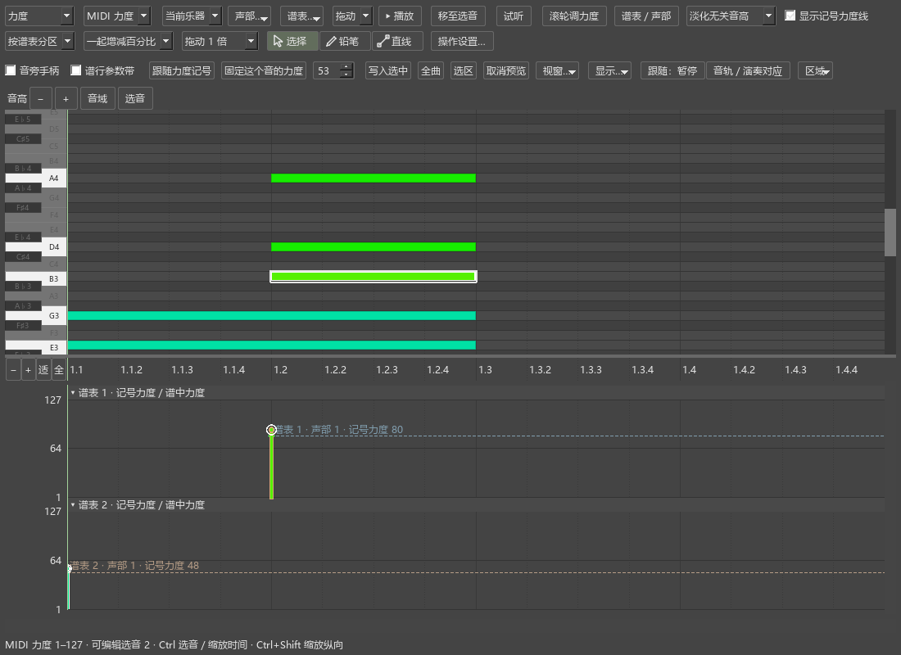
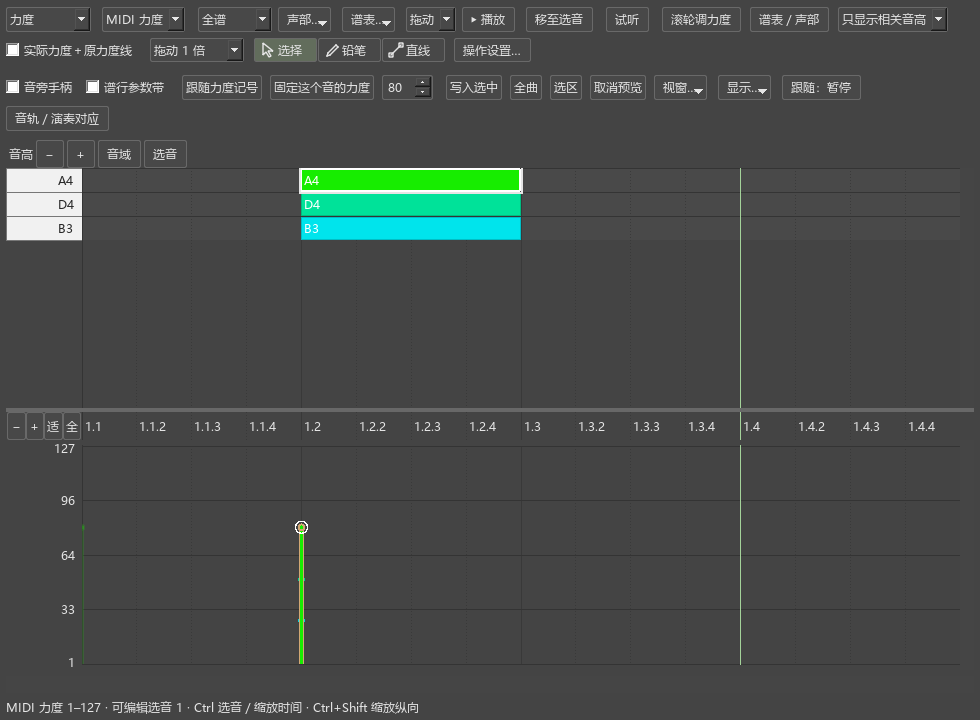
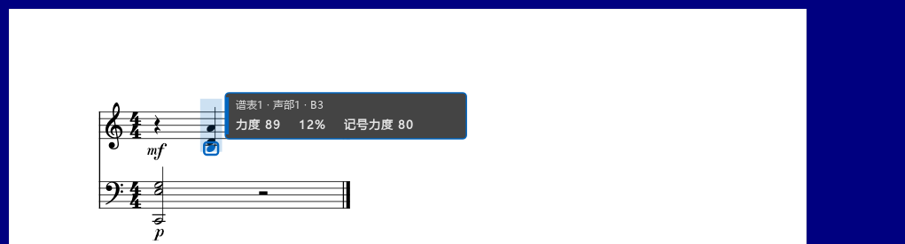
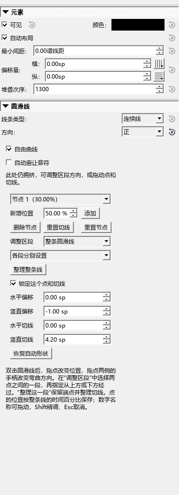
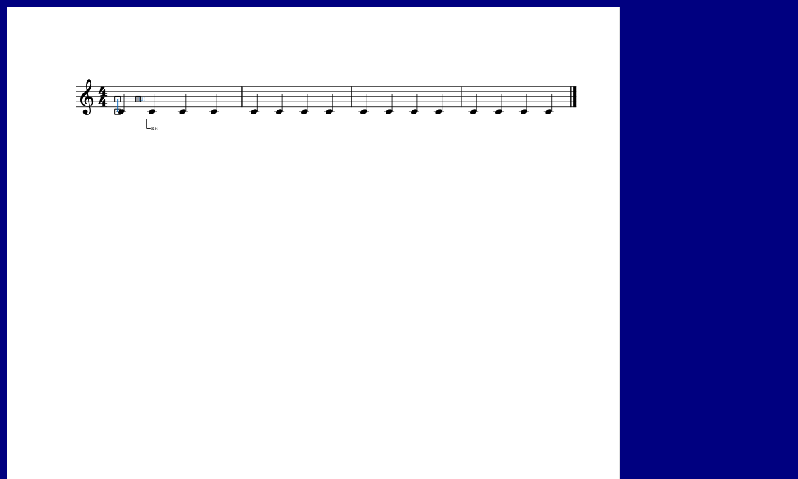
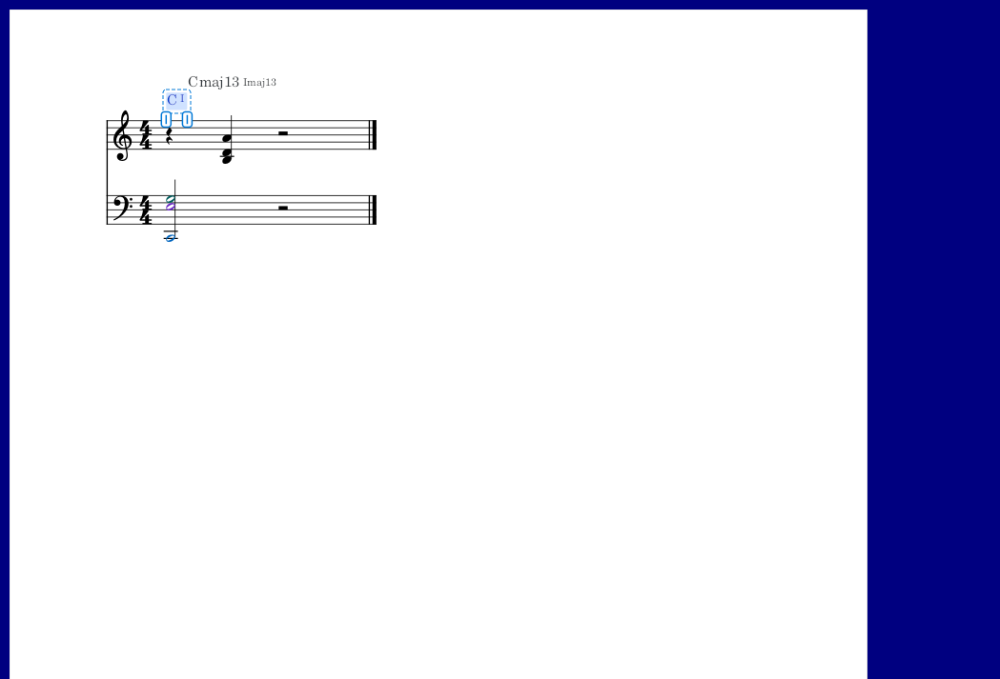
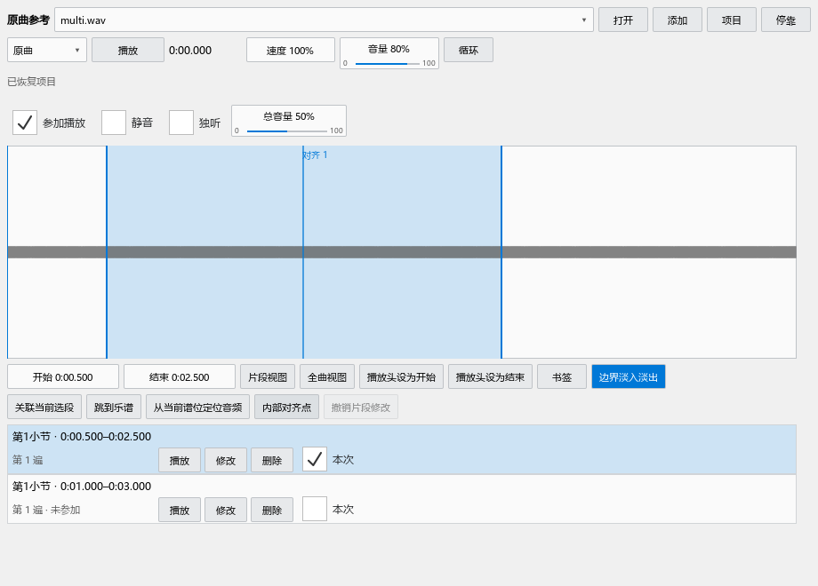
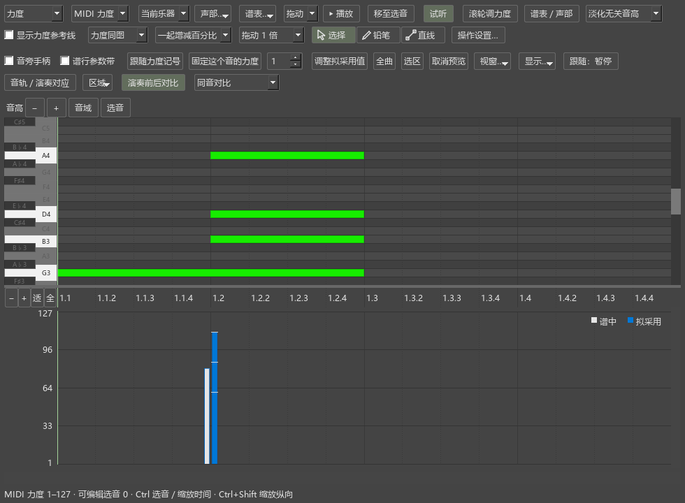

# MuseScore Evolution 个人功能说明

当前个人版本：**0.59.0** · Kumo branch / Freddd13。

这份说明按你编曲时要完成的事情组织。每章先给一个可以照着操作的例子，再解释相关按钮。谱子的修改随 MSCZ 保存；`Ctrl+Z` 可以撤销刚完成的编辑。

本轮操作和九项问题的处理结果见[本轮逐项说明](docs/REPAIR_053_057_DELIVERY.md)。

## 0.59 的频谱扒谱

打开演奏编辑器，点“扒谱”，即可对照原曲频谱听辨、试音和标注，再按当前声部、位置和时值输入乐谱。上下对照与叠加可以切换，标注随 MSCZ 保存。完整步骤见[频谱扒谱使用说明](docs/P2_SPECTRUM_059_GUIDE.md)。

## 0.58 的内置工具

从“视图 → 和弦助手”打开和弦工具；从“视图 → 演奏表达”进入编辑器内的导入、录制、比较和采用操作。原插件菜单入口打开同一个工具。完整步骤和界面见[内置工具使用说明](docs/P2_BUILTIN_058_GUIDE.md)。

## 0.53 的操作修复

插件管理器的“重载插件”会重新读取插件并恢复打开的面板，保留启用状态和快捷键。录制或拖动结束后继续重载。原曲关联在选音、缩放和重新排版后继续有效；小节或拍号变化后，在关联行修改范围。完整操作见[0.53 说明](docs/REPAIR_053_GUIDE.md)。

## 0.54 的记谱操作

自由圆滑线可分别选择两端位置；分手折线的文字可独立拖动和设置字体。速度面板会合并本项目重复生成的入口。操作例子见[圆滑线、渐慢线与分手记号](docs/REPAIR_054_GUIDE.md)。

## 0.55 的和弦与编配检查

和弦范围和文字位置可用 Ctrl+Z 撤销，并随乐谱保存。编配检查增加问题筛选和直接返回全谱的范围选择，低音排列按各音程的参考音区提示。完整例子见[和弦显示与编配检查](docs/REPAIR_055_GUIDE.md)。

## 0.56 的原曲参考

从“视图 → 原曲参考”打开独立播放器。音轨、片段与乐谱关联随 MSCZ 保存；时间滚动条、手形平移和可选联动定位见[完整操作例子](docs/REPAIR_056_GUIDE.md)。

## 0.57 的力度对比

新导入和录制默认采用全部演奏力度，并逐音固定保存。编辑器默认同音对比，可切换真实播放时间；原值与拟采用值用并列实心柱显示。完整操作见[演奏力度说明](docs/REPAIR_057_GUIDE.md)。

## 打开功能

| 想完成的事情 | 从哪里打开 |
|---|---|
| 调整音符力度、速度、踏板 | 视图 → 演奏编辑器（力度／速度／踏板） |
| 在谱行旁调整演奏数值 | 视图 → 谱行参数带（独立显示） |
| 输入时自动整理节奏写法 | 工具 → 自动规范输入时值 |
| 点击测量速度 | 节拍器旁的敲击测速图标 |
| 尝试同一段的不同写法 | 工具 → 分段试写方案 |
| 查看和弦、级数和构成音 | 视图 → 和弦助手 |
| 查看编配提示 | 插件 → Arrangement Check |
| 听原曲、慢放、循环 | 视图 → 原曲参考 |
| 把演奏 MIDI 的力度用于谱子 | 视图 → 演奏表达 |
| 用完整谱副本比较方案 | 插件 → Arrangement Variants |
| 导出适合瀑布流视频的 MIDI | 文件 → 导出 → MIDI → 人性化裁剪 |

第一次使用插件，打开“插件 → 插件管理器”，勾选对应的主文件：`HarmonyAssistant_MS3.qml`、`ArrangementAssistant_MS3.qml`、`ReferencePlayer_MS3.qml`、`PerformanceExpression_MS3.qml` 或 `ArrangementVariants_MS3.qml`。关闭管理器后，从插件菜单运行。插件目录中需保留同文件夹的组件和 `WorkflowCommon`。

右侧工具与检视器等排成标签页；底部工具可与演奏编辑器排成标签页。拖标题栏可换位置，“悬浮”可单独开窗。下次打开会恢复你摆放的位置。

## 1. 演奏编辑器：调好一个音，再调一段

演奏编辑器用于调整力度、速度和踏板。上半部的钢琴卷帘帮助你找到音，下半部显示当前参数。

**先试一个音：**

1. 打开乐谱和演奏编辑器，在谱面点一个音。
2. 下方参数选择“力度”。点“选音”，让编辑器显示刚选的音。
3. 拖这个音的力度柱：向上变强，向下变弱。
4. 松开鼠标完成修改，再播放听效果。
5. 按 `Ctrl+Z` 撤销。拖动中按 `Esc` 可以取消。

亮边框表示选中，播放时的描边表示正在发声，橙色虚框表示等待保存的调整。播放中改值时，停止后会完成写入。

### 力度参考线、谱中力度与一起调整

“力度参考线”显示 mf、p 和渐强渐弱在当前位置给出的数值；音符实际采用的数值叫“谱中力度”。例如右手力度参考线80、左手48：

| 保存方式 | 右手播放力度 | 左手播放力度 |
|---|---:|---:|
| 跟随力度记号，0% | 80 | 48 |
| 跟随力度记号，+10% | 88 | 约53 |
| 固定力度60 | 60 | 60 |

“跟随力度记号”让选音随以后修改的mf、p、渐强渐弱变化。“固定这个音的力度”保存当前MIDI力度。两种方式转换时保持当前听到的力度。

上方的“MIDI力度／相对%”选择显示方式。MIDI力度显示1–127，相对%显示在力度参考线上增加或减少多少。切换显示时，音符继续采用原来的保存方式。

**一起调整左右手：**

1. 选择“MIDI力度”，勾选“显示力度参考线”。两条不同颜色的虚线分别显示右手80和左手48。
2. 在谱面选中要一起调整的音，保持“一起增减百分比”。
3. 拖其中一个音的力度柱。右手从80增加到88时，左手相应增加到约53。
4. 想让所有选音都增加同样的MIDI数值，切换为“相同MIDI差值”。
5. 松开完成，Ctrl+Z撤销整次调整。

“力度同图／按谱表分区”切换两种排法。分区共用时间尺，每个谱表有独立刻度，点标题可收起或展开。谱表／声部筛选同时控制力度柱、力度参考线线和选音。

### 重叠音、筛选和工具

同一时刻有多个音时，先在谱面选好要改的音，再去拖对应力度柱。拖动开始后目标保持固定。`Alt+单击`可轮换重叠候选，右键可按音名、谱表、声部选择。`Ctrl+单击`加入多选；拖多选中的柱子可以一起调整。

点“谱表／声部”打开筛选表：每行一个谱表，每列声部1–4。“全部”“只看选音所在声部”“只看选中谱表”用于快速选择。其它音可以隐藏，或淡化作参考。编辑器、谱行带、音旁手柄共用这份筛选。

“选择”用于点选和拖动。“铅笔”让你划过一段音来画力度；“直线”让一段音逐渐变强或变弱。有选音时作用于选音；没有选音时作用于筛选中的音。一次拖画可用一次撤销恢复。

“拖动1倍”可以改成0.25、0.5、2、4倍。觉得一拖就变化太多，试0.5倍。

“区域”菜单可以分别收起钢琴卷帘、参数区和演奏对应区。拖分隔条调整高度；“恢复区域高度”回到常用比例。软件会记住区域开关和拖动后的高度。

### 看清与缩放

“显示…”里的“一直显示力度（谱面与卷帘）”持续显示数字。按住 `Ctrl+Alt+V` 临时查看附近音的力度，加 `Shift` 查看当前视口全部音；松开恢复。短音的数值放在音符条旁边。

数字轴旁“适”匹配当前内容，“全”恢复完整范围，−／+改变纵向显示范围。滚动数字轴缩放，拖动数字轴移动范围。`Ctrl+滚轮`缩放时间，`Ctrl+Shift+滚轮`调整纵向，`Shift+滚轮`横向移动。

键盘提供完整、淡化无关音高、只显示相关音高三种方式；相关音高来自筛选后的音符。按声部着色默认采用软件的声部颜色，个人配色可以在“配色／力度柱宽…”中设置。

**遇到问题：**先点“全”和“全部”查看完整内容。播放后首次打开时，音符会随当前乐谱显示；状态提示正在准备演奏时，稍等准备完成。需要试听选音，在面板开启“试听”。

## 2. 谱行带和直接调力度

谱行带把力度、速度或踏板放到正在看的谱行旁边。可以单独打开，也可以与底部编辑器同时使用。

1. 打开“视图 → 谱行参数带（独立显示）”。
2. 在谱面点音，选择力度，拖该音旁边的手柄。
3. 在显示设置中选择“跟随选中／播放谱行”或“固定视口底部”。
4. 拖高度边缘改变带的高度；数字轴的缩放和平移与底部编辑器相同。

开启“滚轮调力度”后，把鼠标放到音头或力度手柄上滚动，每格调1，按住 `Shift` 每格调8。连续滚动停下约300毫秒后完成一次修改。

想直接调鼠标附近的音，在谱面按住 **`Alt+Shift+滚轮`**。浮标分两行显示音名、谱表声部、当前力度、增减百分比和力度参考线；被调整的音以声部颜色描边。同一轮滚动保持目标，`Esc`取消尚未完成的调整。音符输入状态也可使用。

在演奏编辑器的“操作设置…”里可将最近音滚轮改为Ctrl+Alt、Ctrl+Shift或关闭。

谱行带设置会记住；演奏数值随乐谱保存。若手柄被筛选隐藏，点“显示选中音”或恢复“全部”。

## 3. 自动规范输入时值

这个功能按拍号整理输入的时值，帮助读谱者看清拍位。例如4/4从第一拍输入附点四分，再输入八分并将它改成四分，程序会在需要的位置拆分并用延音线连接。

1. 勾选“工具 → 自动规范输入时值”。
2. 像平常一样输入音符或改变时值。
3. 检查拍位、延音线和符杠；想采用个人写法，可以手动调整。
4. `Ctrl+Z`撤销这次输入或时值修改。

“允许延音音符跨拍连符杠”控制跨拍延音的符杠连接；“协调自动拆分音符的符干方向”结合延音链和附近符杠决定自动方向。手动指定的方向和符杠继续采用你的设置。

菜单勾选会记住。切换工作区后仍可从“工具”找到这些选项。附点八分＋附点八分＋八分的3-3-2节奏也按当前拍号处理。

## 4. 琶音、小音符与轻重音

**琶音：**添加琶音符号，选中它，在检视器设置每音间隔、整体偏移和对拍方式。选择“首音对拍”让第一音落在拍上；选择“末音对拍”让最后一音落在拍上。拖动参数名称可连续调整，按住 `Shift`细调。

**快速小音符：**添加小音符后，在检视器设置“小音符持续时间”。设成“主音对拍”时，小音符提前，主音留在原拍点。试听时可从前一小节开始，听清它如何接入主音。

**轻重音：**选中发音符号，在检视器设置力度倍率。100%保持原力度，115%略强，80%略弱。可把常用值存为以后添加的默认设置。

这些演奏设置随乐谱保存。改错后可撤销；想回到软件原设置，点相应参数旁的恢复按钮。

## 5. 颤音与震音

选中颤音或震音，在检视器开启逐次力度设置。起始倍率控制第一下，后续／结束倍率控制后面的走势，曲率决定变化快慢；“交替音减弱”可以让来回音形成轻重区别。

先试起始100%、结束80%，播放听这段是否逐渐收弱。屏幕曲线帮助你看变化，最后仍以试听为准。设置随符号保存，`Ctrl+Z`撤销；关闭逐次力度设置可采用原来的演奏方式。

## 6. 渐慢 rit. 与恢复速度 a tempo

指向一段音的 **rit.** 线可以播放渐慢，**a tempo** 可以恢复速度。

1. 从速度符号面板添加 rit.，调整起点和终点。
2. 选中线条，在检视器设起速、终速和曲率。起速0表示采用该处原速度。
3. 在后面的音上添加 a tempo，选择恢复方式，再播放听整段。
4. 在文字和线条设置里修改前缀、续行、结尾文字，以及虚线长短、间隔和粗细。

隐藏线条后，渐慢仍按设定播放。手动摆放的位置随谱子保存；重新开启自动布局可让软件整理位置。rit.和a tempo默认采用速度文字的字体。

需要一个明确恢复速度时，可选择恢复到指定BPM；需要恢复前面的速度时，使用恢复先前速度。发生速度记号相互覆盖时，按提示定位到相关位置再调整。

## 7. 敲击测速：测量与写谱

节拍器旁的图标用于跟着心里的节奏点击。按钮显示测得速度，下拉里可选择点击单位、倍速、半速和重置。

**只测速度：**连续敲至少四拍，查看数值和“起步／不稳定／稳定”。选择“设为独立节拍器”即可用于独立节拍器。

**写进谱子：**选中音符或休止符，在下拉选择“写入指定位置”，核对小节、拍位和拍单位后保存。

**改已有速度：**选中速度记号，在右键或检视器选择“用 Tap 设置速度”。跟着目标速度敲击，窗口和谱面显示预览；点“保存结果”或按回车完成一次修改，`Esc`回到进入前的状态。

每次点击附点四分测得80时，对应四分音符速度为120。窗口会同时说明点击单位和四分音符换算结果。

rit.可以分别用Tap设置起速或终速。a tempo和速度等式按它们的恢复／比例含义显示可用操作；要另设固定速度时，选择明确的写入位置。

## 8. 自由圆滑线与分手折线

### 自由圆滑线

1. 选中圆滑线，在检视器开启“自由曲线”。开启“自动避让音符”后，曲线会结合音头、符干、符杠和变音记号整理外形。
2. 双击线条，拖中间点改变位置，拖两侧手柄改变弯曲。两侧共用一条切线，相邻两段会平滑相接。
3. 想指定整条线从上方或下方经过，在“调整区段”选“整条圆滑线”，再选“从音符上方经过”或“从音符下方经过”。端点也会采用相应的原生方向。
4. 想只改变中间一段，先在“新增位置”输入沿全线的百分比，再点“添加”。在“调整区段”选两点之间的一段，指定上下走向。例如，起点到点1从上方经过，点1到终点从下方经过。
5. 点“整理这一段”，会保持两端中间点的位置，调整共用切线；选整条线时按钮显示“整理整条线”。可以继续拖动节点与切线微调。

拖动一个中间点会锁定它。解除“锁定这个点和切线”后，它可以参加自动调整。若锁定点挡住了所选路线，移动这个点或解锁后再整理。新增点继承所在区段的走向；删除点后，相同走向的两段合并。

“恢复自动形状”重新安排中间曲线。`Esc`取消正在拖动的修改，`Ctrl+Z`恢复上一步。位置、走向和锁定状态随MSCZ保存；跨谱行会在各行延续所选区段。

### 左右手折线

“指法”面板提供左手、右手及各自的结束记号，用于指出某个音或一段音由哪只手演奏。

1. 选中具体音，从面板添加相应分手记号。
2. 双击记号，拖水平端点改横线长度，拖竖直端点改竖线长度。
3. 拖拐点移动整条折线，贴近实际所指的音。
4. 检视器可输入正数长度；“水平反向”“竖直反向”改变朝向。
5. 调好后点“保存为默认形状”，以后添加的同方向记号采用这个形状。

右手标记的拐角通常靠近所指音下方，左手标记的拐角靠近上方；自动布局会结合所指音所在的线、间、加线、邻音与符杠寻找位置。短横靠近所指音，拐角优先放在谱间。关闭自动布局后，可以固定个人摆放。旧字形切到“可伸缩折线”时沿当前外观建立形状。“还原基础折线”恢复简单预设，“使用默认形状”采用你保存的个人设置。

勾选“显示 l.h.／r.h.”可添加斜体手部文字。

一个记号指出所附的音或和弦；开始与结束成对时指出这段分手范围。编配检查会读取这里保存的左右手信息。形状、方向和位置随乐谱保存，可撤销。

升级后，速度面板保留一项可播放rit.与一项a tempo，指法面板保留四种方向的折线。自己制作的符号格子继续保留；这些格子的外观以软件实际符号预览。

## 9. 和弦助手

用它查看当前位置的和弦、级数、转位和构成音，也可以把和弦变化显示在谱面上。

### 第一次使用

1. 打开乐谱，运行“插件 → Harmony Assistant”。面板显示读取和分析进度；完成后显示“已更新”和和弦数量。
2. 点击一个音，查看它所属的和弦。播放时，面板和谱面上的当前记号会一起强调。
3. 开启“谱面上方显示和弦 / 级数”。记号对齐和弦开始的位置，拥挤处上下排列。
4. 暂停后双击一个谱面记号，打开“修改和弦与范围”。问号也可以双击，再选择根音、和弦种类和低音，点“指定和弦”。

### 顶部摘要和右侧详情

设置里的双面板选项可同时显示顶部摘要与右侧详情。“详情”打开对应的详细面板，“靠左／居中／靠右／自定位置”调整摘要位置。两个面板可分别隐藏，再从插件菜单或详情入口打开。

摘要显示“实时”或“所属和弦”。实时根据当前位置的音判断；所属和弦采用这一整段的分析结果。上方“更多 → 摘要外观与调性”可以改主音、大小调、字号、级数大小、和弦与级数的间距，以及左右或上下排列。窗口中的样例会立即更新。“恢复摘要默认外观”可恢复这些设置。

摘要、详情和谱面和弦采用乐谱的和弦字体及音乐符号排版。`C/E`表示C和弦、实际低音E；级数会显示为`I⁶`。详情还写出“第一转位”等中文。各组设置标题可点击收起，方便只留下正在调整的部分。

### 在谱面调整范围和位置

1. 双击记号，勾选“在谱面和面板显示范围手柄”。
2. 拖两端的小手柄，改变这个和弦的起止位置；面板里的范围随之更新。相邻和弦会共用新的分界位置。
3. 拖记号本身，调整它在谱面上的位置。音乐范围保持当前值。
4. 点“恢复记号自动位置”重新自动摆放；“撤销修正／重做修正”可退回或重做范围、和弦和位置调整。

面板中的小范围条也能拖手柄。数值框用于输入精确位置；480 tick相当于一个四分音符。“在当前位置拆分”增加识别边界，“合并前一段”去掉两个和弦之间的边界，“排除此范围”隐藏这一段的分析记号，“恢复自动”重新采用自动结果。

### 识别和显示设置

踏板内可选一个和弦，或允许多个和弦。主音和大小调可手动选择；小调级数可按当前调式或同名大调表示。前后进行会参与比较接近的解释，备选栏保留其它可能。

谱面设置可选仅和弦、仅级数或两者，调整排列、字体、大小和颜色。“避让其它谱面内容”控制自动避让，“记号背景遮罩”控制底色。人工摆放的记号保留你指定的位置。

“恢复原色”结束临时功能着色。配色、标签和显示设置自动保存；人工和弦、范围和位置按乐谱内容保存。导出JSON可保存这份分析，导入JSON可恢复；CSV用于查看和弦表格。

打开新谱后先看总状态。完成分析后仍看不到记号时，检查谱面显示开关、记号列表，以及“优先保留原谱和弦／级数”。修改了乐谱后，人工范围需要复核时，按面板提示确认位置，再应用。

## 10. 编配检查

编配检查会列出和声、声部进行和钢琴演奏中值得听一听、看一看的位置。每条提示会说明涉及哪些音，以及可以怎样调整。

### 检查一段并继续修改

1. 在谱面选中要检查的小节，运行“插件 → Arrangement Check”。
2. 选择“调性钢琴／流行”“严格对位”或“爵士”，点“改查当前选区”。没有选区时检查当前小节；下拉框可改为钢琴全谱。
3. 面板上方显示正在检查的范围。点问题可定位相关音，并短暂标出所在小节。
4. 按提示修改音符。停播约750毫秒后，自动更新这段的结果；也可以点“更新结果”。
5. 点空白、选其它音、换到另一小节后，原检查范围和结果仍保留。需要换一段检查时，再点“改查当前选区”。

“更新结果”继续检查面板上写着的那一段；“改查当前选区”换成你此刻选中的范围。播放时可查看已有结果，停止后继续更新。切换到另一份乐谱，各谱的检查结果分别保留在本次打开的会话里。

### 在谱旁看解释

设置中勾选“在谱面显示问题位置”。同一位置有几条问题，会合成一个“2项”等小记号。双击记号，在相关音附近打开说明；窗口中可切换这几条问题、定位相关音或忽略其中一条。设置里的细线开关可画出提示与相关音的联系。

双击列表中的问题，也能打开谱旁说明。“上一条／下一条”逐条查看，“定位相关音”重新强调位置。“忽略此处”记住这一条；“更多 → 恢复已忽略的提示”可重新查看。

顶部摘要与右侧详情分别关闭。关闭摘要上的×，详情继续保留；从插件菜单重新打开会回到原面板和结果。设置里的“顶部摘要 + 右侧详情”可同时使用两处显示。

### 看懂三类提示

**和声：**持续的半音关系、低音区密集排列，以及指定和弦与持续音的关系。自动识别和弦也参加检查。几个解释都指向同一处摩擦时，会列出相关音；经过音、邻音和已找到级进解决的挂留会结合前后处理。点“更多 → 指定局部和弦…”可以按自己的解释重新检查，或导入和弦助手的JSON分析。

**对位：**连续声部前后的平行五八、交叉、重叠、大跳等。解释会列出前后两组音。严格对位、流行和爵士采用不同的提示重点；分解和弦和加倍可在“声部与左右手”中校正。

**可弹性：**一起按下的音、还需要按住的旧音、踏板保持的声音和下一组音的位置。比如“左手先松开C2，再弹下一组音”，是在说明如何借踏板空出手；“新音跨度过大”需要检查这一组音的写法。详情会给出跨度、同时按键和手位移动的依据。

“声部与左右手”可指定旋律、低音、内声部，校正左右手以及最高音线、最低音线。来源会显示用户指定、分手标记或自动推断。舒适跨度、最大跨度和两端白键条件在设置中按自己的手型调整。

通用设置自动保存。当前范围、角色校正、局部和弦和忽略位置在本次打开乐谱期间保留。需要以后继续采用人工和弦解释，可先在和弦助手中导出分析文件。

## 11. 原曲参考：听片段、循环和多轨

原曲参考可以播放WAV、MP3、FLAC，保调慢放、循环听一段，并把录音中的片段对应到改编谱的小节。

### 先听一个片段

1. 运行“插件 → Reference Player”，点“打开”，或把音频文件拖进面板。多个文件会各自成为音轨；“添加”可继续增加材料。
2. 播放方式选“原曲”，点“播放”。面板有焦点时，空格播放／暂停；点回谱面后，空格继续控制乐谱。
3. 单击波形可定位。直接拖出一段，选区会随鼠标变化；两端的竖线可拖动微调。
4. 开启“循环”，反复听这一段。点“片段视图”放大到选区，“全曲视图”看完整录音。
5. 左右拖动速度数字，或单击输入75%，可保调慢听。按住Shift拖动更细。音量显示0–100%的位置和当前数值。

“开始／结束”显示分:秒.毫秒，也可拖动，或单击输入，例如`0:35.250`。输入纯数字按秒计算。“播放头设为开始／结束”把当前播放位置设为边界。波形滚轮以鼠标位置为中心缩放；按住空格拖动波形可平移，松开后保持原来的播放状态。

### 把片段关联到谱段

1. 在波形拖出原曲片段。
2. 在乐谱中选中对应的小节。
3. 点“关联当前选段”。下方立即出现关联，写着小节名称、音频起止时间和反复后的出现次数。
4. 点这一行查看片段；行内“播放”“修改”“删除”分别试听、调整和删除关联。
5. 点“跳到乐谱”，相关小节会高亮约3秒。“从当前谱位定位音频”将录音播放头移到对应时刻。

选中一条关联后，拖它的波形端点或起止时间会直接更新该片段。“撤销片段修改”可恢复端点、内部对齐点或删除操作。重新在空白波形拖一段会开始新的片段选择，之后可再建立关联。

同一录音片段可以对应改编谱的多个位置，源片段也可以重叠。同一音轨、同一谱位有几种片段时，用“本次”选择这次听哪一条；需要叠加的声音分别放在不同音轨。人声、伴奏等不同音轨可以对应同一谱段。“参加播放”“静音”“独听”用于选择本次听哪些轨；“总音量”一起调节参与的音轨。

### 一起播放

1. 在下方选中一条关联。
2. 播放方式选“一起播放”。
3. 选择跟随方式，再点旁边的“播放”。状态会显示音频准备和播放情况；“停止”同时结束这次播放。

| 跟随方式 | 听到的效果 |
|---|---|
| 开头对齐，各自播放 | 两边从关联起点对齐，之后各自保持速度；适合先比较整体感觉 |
| 音频跟随乐谱 | 原曲按乐谱速度及内部对齐点保调伸缩 |
| 乐谱跟随选中音频 | 所选音频保持节奏，乐谱和其它参加的音轨跟随 |

选“乐谱”后点播放，可以单独听对应谱段。改回“原曲”可以单独听音频。一起播放时，两边分别播放完所选片段，再结束或进入下一轮循环。

### 内部对齐点有什么用

例如，录音片段和谱段的开头、结尾能对上，中间第3拍却提前了：在谱面点第3拍，在波形点录音里对应的时刻，然后点“内部对齐点 → 添加当前两个位置为对齐点”。这样跟随播放时，中间这一处也会对上。

对齐点在波形上显示为细线，可拖动录音一侧的位置；窗口里也可以调时间或删除。按时间先后设置多个点。跳段时，分别建立几条片段关联更容易调整。

### 保存和继续使用

“项目 → 保存工作区”保存音轨位置、片段、书签和关联。下次可从“打开工作区”恢复。音频文件移动后，用“重新定位音频”找到它。编辑器的参考轨与这里使用同一份轨道和关联数据。

没有声音时，先看当前选择的是原曲、乐谱还是一起播放，再检查音轨的静音、独听、音量和输出设备。一起播放提示缺少关联时，选谱段和音频片段，点“关联当前选段”后再播放。文件读取完成后会出现波形和时长；关联提示待核对时，打开“修改”，确认两边范围。

## 12. 演奏表达：把演奏力度用到谱子

用 MIDI 键盘弹一段，或导入一份演奏 MIDI，让谱子采用这次演奏的轻重和速度变化。你可以先听、再改，选好范围后一起应用。

### 第一次使用：把一段演奏的力度用于第9–16小节

1. 在谱面选中第9–16小节，打开 **“插件 → Performance Expression”**。
2. 点 **“导入 MIDI”**。可以直接选全曲文件，软件会在其中寻找这段旋律。重复段出现几个合理位置时，选择带时间的演奏位置。
3. 看 **“已匹配、漏弹、多弹、需核对”**。点后面三种计数，可以查看并跳到具体位置。通常可以先听整体效果，再处理少量对应问题。
4. 点 **“编辑器对比”**。原来的力度区出现两种条形：中性色柱是谱中力度，强调色柱是拟采用力度。时间尺、选音、谱表／声部筛选和播放光标沿用编辑器当前设置。
5. 调 **“采用演奏力度的比例”**。例如谱中为80、演奏为100，50%得到约90，100%得到100。强调色柱也可以直接拖动；多选后一起调整，或用铅笔、直线整理一段。
6. 点 **“谱中效果”** 听当前谱子，再点 **“拟采用效果”** 听新的力度。正在播放时切换，会接着当前拍位听。面板上显示正在播放哪一个效果。
7. 选择 **“使用范围”**，再点 **“使用力度 · …音”**。数字表示这次将更新多少个音；一次 `Ctrl+Z` 可以撤销整次应用。

三种范围的用法：

| 使用范围 | 操作与结果 |
|---|---|
| 选中音 | 在谱面或编辑器选音，只更新选中的已对应音 |
| 当前选段 | 在谱面框选小节，更新其中已对应的音；点空白后沿用正在处理的谱段 |
| 全部已对应范围 | 更新本次已经完成对应的全部音；要处理全曲，可先在“更多 → 读取并对应全曲”中读取 |

应用后，这些音会从待处理列表收起，其余结果可以继续调整。**“更多 → 显示已使用的对应”** 可以再次查看已应用项目。改变某个音的对应后，它会重新进入待处理列表。

### 三种力度各表示什么

- **力度参考线**：mf、p、渐强渐弱在这一拍给出的力度，是音符计算相对增减时采用的数值。
- **谱中力度**：这个音当前实际采用的力度，包含已经做过的逐音调整。
- **拟采用力度**：这次演奏对应后准备使用的力度，可以继续试听和修改。

编辑器的“显示力度参考线”会按谱表、声部画出原有记号的数值。例如右手 mf 为80、左手 p 为48，两条线分别出现在80和48。相对百分比的0%表示沿用各音自己的力度参考线；同图观察两个谱表时选择 **“MIDI力度”** 更直观。

**“保留手动调整”** 用于保留先前逐音设置的力度。默认采用本次对应结果；音符原来按百分比保存，就换算成百分比；原来使用固定力度，就继续保存固定值。

### 试听与继续编辑

**“谱中效果／拟采用效果”** 共用当前谱段和播放位置，反复段也保留播放第几遍。谱面与编辑器保持在原处。点 **“停止”** 暂停，再点其中一个效果继续；点 **“结束比较”** 回到普通编辑。

试听中的实心条仍可调整。新的效果准备好后接着当前拍位播放。初次准备时，状态栏会显示正在准备；听到变化后再决定是否使用。

要同时听参考录音，先在原曲参考选择关联，再打开演奏表达 **“更多 → 试听时播放参考音频”**。参加播放的音轨沿用原曲参考中的设置。

以前自动打开的 `expression-…` 试听页，可通过 **“项目 → 关闭旧试听页”** 整理。你已经编辑过的试听页会保留，方便另存需要的内容。

### 调整两个音的对应

打开 **“更多 → 在编辑器调整对应”**。上排是谱面起音，下排是演奏起音，连接线表示一对音。两排共用编辑器时间尺；指向音点可以看到音名、力度和演奏时间。

1. 点谱面音，再点需要对应的演奏音，使用对应区的连接操作。
2. 要取消一对对应，选中后解除连接；该位置会回到待处理状态。
3. **“固定这一处对应”** 把这对音作为后续对应的参考。例如漏弹一音后位置逐渐错开，可以固定后面弹对的一音，让后续从这里重新接上。

**漏弹** 用 `?` 显示，保留谱中的音；**多弹** 用 `+` 显示，点列表可跳到附近谱位并强调这个演奏音；**需核对** 列出错音或几个可能对应都很接近的位置。修改对应后，力度与速度预览会更新。

### 保存并恢复原来的力度

第一次点“使用力度”时，软件会保存这些音在应用前的力度。正常保存 **MSCZ** 后，这份记录跟随音符保留。

恢复时，先在“使用范围”选择音、选段或全部范围，再点 **“更多 → 恢复应用前力度”**。重开谱子后也能使用；一次 `Ctrl+Z` 可以撤销恢复。

如果已经满意当前效果，想以它开始下一轮比较，选择 **“更多 → 以当前力度为比较起点”**。这项操作也可以撤销。

**“项目 → 保存项目”** 保存演奏 MIDI、对应、人工调整和预览参数。继续这次匹配工作时打开项目；保存乐谱则保留已应用的力度和恢复记录。

### 直接用 MIDI 键盘录一遍

1. 连接键盘，在 **“编辑 → 偏好设置 → 输入／输出”** 选择 MIDI 输入，并打开工具栏 MIDI 输入开关。
2. 选中谱段，打开演奏表达，保持 **“手动停止”**，点 **“录制”**。
3. 按想要的节奏和力度弹奏。面板显示录制时间、收到的音和力度。弹完点 **“停止录制”**。
4. 等待对应完成，点“编辑器对比”，试听并使用力度，操作与导入文件相同。

“到时停止”按旁边设置的秒数结束。“弹完选段停止”根据末尾音序、松键和停顿结束；重复音型较多时，手动停止更容易控制。在“设置”中可以选择录制时听到键盘声音。

### 使用演奏中的速度变化

勾选 **“Rubato（全声部速度）”**，调整速度强度，在编辑器选择速度区查看原曲线与拟采用曲线。点“拟采用效果”听完，再按所选范围点 **“使用速度”**。

谱内速度在同一位置影响全部声部。“保持这段时长和两端速度”适合将细微快慢带入已有编配；已有速度记号和曲线会参与计算，出现冲突时按提示调整对应或范围。

### 遇到问题时怎么继续

- 位置对应不合适：先看演奏位置的时间候选，点“需核对”，再固定一处能确定的对应。
- 按钮上的音符数为0：检查“使用范围”和已使用项目；选择一组待处理音，或显示已使用的对应。
- 谱子改了：点“重新对应”，读取当前谱段后继续。项目里的 MIDI 和人工对应可继续使用。
- 试听没有声音：检查软件的声音设备、混音器静音和音量，按面板提示继续。

试听旁的“循环”会反复播放当前比较范围，谱中效果与拟采用效果都采用这一设置。片段最后有休止时，也会经过完整拍数再开始下一遍。结束比较后，原来的预备拍和乐谱循环设置会恢复。

## 13. 分段试写：同一段保留A、B几种写法

例如，你想比较第9–12小节的左手，用稀疏和弦还是分解和弦。先保存A，再试写B，随时切回来听。

### 第一次建立A和B

1. 在谱面选中第9–12小节，打开“工具 → 分段试写方案”。
2. 点 **“保存为A”**，核对起止小节，勾选参加的谱表和声部。给这段起名，例如“副歌左手”。
3. 点 **“增加写法”**，输入“B · 分解和弦”。新写法立即打开；直接在谱面修改。
4. 在面板点A或B切换。也可点小节上方的按钮，从菜单选择写法。
5. 点 **“从同处听”** 比较当前写法。试听会包含进入这段所需的前文，用乐谱播放按钮或空格停止。
6. 按 `Ctrl+S` 保存MSCZ，以后打开继续切换。一次切换可用 `Ctrl+Z` 撤销。

面板写明范围、谱表、声部和“正在编辑”的写法。切换前自动记住刚才的修改。同一时间的其它声部、其它段落可以分别建立A/B。

### 同时看两种写法

勾选 **“显示差异”**，在旁边选择另一种写法。当前写法正常显示，另一写法以淡色叠在谱上；边框指出当前写法中有变化的位置。下方列表分别写出音高、节奏、增删音、力度及标记变化，点一行就定位到对应音。

例如，B的低音由C改为D并加强力度，选择与A比较后，谱上会同时看到当前D和淡色C；列表写着“音高、力度”。关掉“显示差异”即可专心编辑。

### 快速切换和保存组合

- 鼠标放在小节上方的写法按钮上，按 `Ctrl+滚轮` 切换。鼠标放在其它谱面位置时，仍按原来的操作缩放。
- 勾选 **“试听比较：切换后从同处听”**，每次切换后自动从这段的相同起点试听。关闭后，切换用于普通编辑。
- 先选好各段、各声部的写法，再点 **“保存组合…”**，例如保存为“稀疏伴奏＋旋律B”。从组合列表选择名称，所有相关组一起切换，`Ctrl+Z` 可一起恢复。
- 用相同名称保存会更新该组合。组合列表随当前选择更新；手动改成其它搭配后，列表显示“选择组合…”。

“更多 → 谱上显示切换按钮”控制谱面入口。关闭后可继续从面板切换，显示选择会自动记住。

### 连线和跨段内容

延音线和圆滑线随每种写法保存。延音线按同音和位置接回，圆滑线按原来所指的音接回；链接分谱会一起更新。改动了谱段外的连线端点时，面板指出小节和拍位，方便检查两边的位置。

滑音、连音组、跨谱表符杠等完整对象需要一起参加方案。建立时勾选相应声部；“更多 → 扩大范围”可以把前后小节加入各写法。各写法保持相同的总拍数、拍号和谱表结构。音符力度随写法保存，速度、踏板、调号及谱表力度记号由各写法共同使用。

### 直接保存和导出普通版副本有什么区别

**直接保存MSCZ就能保留全部写法和组合。** 每组通过“更多 → 设为主方案”指定普通MuseScore打开时看到的写法。普通版读取这些主方案组成的完整乐谱；本分支打开时恢复你上次正在编辑的组合。屏幕上的当前组合用于打印和常规导出。

**“更多 → 导出普通版副本”用于分享。** 可以选择当前组合或主方案，生成只含这份乐谱的文件。例如你正在比较B、希望发给别人看，就选当前组合导出。完整A/B文件继续在本分支中保存；普通软件重新保存文件时，附带的其它写法可能被丢弃。

旧“Arrangement Variants”插件保留完整谱副本方式。旧JSON工作区可继续打开，也可从“更多 → 导入旧写法”选取其中的谱段。

## 14. MIDI松手处理：让音长更接近实际弹奏

谱上写满的音可以借踏板继续发声，手指往往会提前松开去弹下一组音。MIDI松手处理调整导出文件里的按键长度，方便制作钢琴瀑布流视频。

### 第一次导出并比较

1. 文件 → 导出，选择MIDI。
2. 勾选 **“人性化裁剪：保守踏板模式”**，选择钢琴、小节范围和声部。
3. 在设置中选择是否保护旋律、最短按键时间、自然变化幅度和随机种子。
4. 点 **“查看对比”**，再点“匹配内容”，看清这一段音符。
5. 点一个音，下方会写出原按键时长、导出时长和松手原因。
6. 点 **“听原长度”／“听新长度”** 比较声音。两个按钮从当前拍位切换，播放光标与乐谱保持对应；“停止”停在当前位置。
7. 勾选 **“导出采用图中的新长度”**，点“返回导出”完成保存。“同时导出未裁剪版本”会额外生成原长度文件。

### 看懂对比图

- **细虚线轮廓：原按键长度。** 它的右边是原松手位置。
- **强调色实心条：拟采用的长度。** 实心条的右边是新松手位置。
- **灰色实心条：保持原样。** 详情会解释保留原因。
- **下方踏板轨：踩下至抬起的范围。** 选中音后，淡色区域显示可以调整的松手位置。
- **下一组音的虚线框：需要空出手来弹的音。** 详情会写出时间、音名以及自动安排前后的按键数量和跨度。

例如，左手C2在谱上写满一小节，踏板也保持着；后面要弹中区和弦时，可以先松开C2，再移动手去弹。图上保留C2的完整轮廓，并用实心条显示提前松手的位置，原因写为“为弹下一组音提前松手”。

### 放大、拖动和手动调整

“叠加”把原长度和新长度放在同一行；“上下分列”分开显示。用“全部／已缩短／保留”筛选音符。

- `Ctrl+滚轮`：以鼠标位置缩放时间。
- `Shift+滚轮`：调整音高行高度。
- 普通滚轮：上下浏览；中键拖动：移动视图。
- **“匹配内容”**：显示整段时间，保留可读的音高行；音域较宽时上下滚动查看。
- 拖实心条尾端：调整这个音在这一次导出中的松手点，按Esc取消当前拖动。
- 右键点音符：选择“恢复自动松手”或“保持原长度”。

拖动范围采用当前踏板、最短按键时间和保护设置。若把松手点拖到自动建议之后，详情会提醒检查下一组音的手位。反复出现的音分别显示，调整其中一次就只作用于这一次。

### 在演奏编辑器里看大图

点 **“在演奏编辑器调整…”**，打开可拉大、缩小的“演奏编辑器 · 导出音长”窗口。这里使用同一份音符、踏板、手动调整和试听结果。点“完成调整，返回导出”，回到原来的导出设置；原演奏编辑器恢复此前的显示。

### 自然松手、保护和保存

没有按键困难的音，采用“自然松手变化”：同一只手、同时弹下的一组音安排接近的松手时间，各音再加很小的差别。固定随机种子使相同谱子和参数重复导出得到相同结果。关闭随机可以比较确定的长度。

保留音会写明具体原因，例如跨越抬踏板、手工演奏事件、用户保护、连续踏板变化或长度太短。新音同时按下就跨度过大时，详情指出需要调整跨度、指法或分手。

处理参数会自动记住；手动松手点保留在本次打开的导出设置中。乐谱内容改变后，重新打开“查看对比”再安排松手。最终MIDI采用当前预览的参数和手动位置，谱面音长照常保留。试听需要已启用的声音设备和音源；也可以导出前后两个MIDI，在常用播放器中比较。

## 15. 字体、音源和保存

个人字体可在谱面样式中选择。Kumo Engrave／Kumo Piano字体草案与谱面字体分别设置；和弦助手默认读取谱子的和弦字体。

大型SF2在合成器中加载。加载时等待音源准备完成，再从相同片段试听；音源路径变动时重新选择文件。

乐谱中的演奏、净谱、分手标记和方案随MSCZ保存。插件的显示设置自动记住；音频、演奏表达和旧方案工作区使用各自的“保存项目／保存工作区”。建议把项目文件与素材放在同一个文件夹，便于以后重新打开。

本版提交定位：`personal-v0.52.0`。版本修改和提交记录见[开发日志](CHANGELOG.md)。此前说明和历史安装信息收在[早期说明记录](docs/USER_GUIDE_HISTORY_20261014.md)。当前操作请按本页和软件里显示的按钮进行。

## Codex 钢琴编曲与 MCP 桥接（2026-10-08）

个人 `mcp-musescore` 桥版本 **2.1.0**，提交定位 **41aea0bf9c8337ba269582c9fee1d2a2ef33b053**，分支 `codex/musescore-evolution`（仓库 Freddd13/mcp-musescore）。它为 Codex 提供当前乐谱的结构化读取、音符/和弦/休止/连音/歌词、小节/选区/导航、拍号、速度和撤销工具，合计 30 项。没有修改 MuseScore 原生源码或个人版本号；本机既有演奏编辑器和和声助手保留。

1. 在 `E:\programming\funcodes\mcp-musescore` 运行 `pwsh -NoProfile -File scripts\install-codex.ps1`，准备 Python 3.13 环境、注册 Codex MCP 并安装 skill；可先加 `-WhatIf` 预览。skill 与 MCP 配置是两个步骤。
2. 将该项目的 `musescore-mcp-websocket.qml` 放入偏好设置中的插件目录，在插件管理器启用；打开谱，从 **插件 → MuseScore API Server** 运行。
3. 在新 Codex 聊天使用 `$mcp-musescore`，例如“分析当前钢琴谱第1–8小节的和声、手跨度和声部进行，先给建议”。连接先 ping，再读取能力与乐谱；小节从 1 开始，谱表/声部从 0 开始。

Windows 安装需要同 SDK 的 QtWebSockets QML 模块和 `Qt5WebSockets.dll`。本机 `msvc.install_performance_0_10_x64/bin` 与 `msvc.install_performance_0_11_x64/bin` 已补齐缺失 DLL，SDK/安装 Qt5Core 哈希完全一致；未覆盖旧 DLL。插件只绑定本机 `127.0.0.1:8765`，Codex 通过 Python stdio 接入，不是 HTTP MCP 地址。

限制：目前可读取存储力度类型/偏移、cent 调律偏移和逐音延音，但没有力度/踏板曲线、SF2、Mixer、调律或净书样式的 MCP 写入工具。旧 `set_staff_mute` 在 MS3 缺少可见性属性，会报不支持，不能用于音频静音；音色接口只打开人工对话框。用现有原生演奏编辑器调节力度/速度/踏板，用 HarmonyAssistant 看临时和声。批处理失败保留前面已完成的动作；写响应丢失时先读谱，不可盲目重复。VexFlow 预览不画延音线/连音括号，最终排版仍在 MuseScore 验证。

验证：17 项 Python/MCP/WebSocket/stdio 测试通过；0.10/0.11 的隔离静音宿主验证加载、读谱保持选中、选区、批处理和撤销、速度。0.11 另验证实际速度图值及音符写入。未验收用户桌面长期交互、真实声卡听感或 Codex 内 MCP App 展示。安装细节与后续钢琴分析/提示/演奏润色/净书路线见相邻 MCP 仓库 `docs/CODEX_SETUP.md` 和 `docs/ARCHITECTURE_AND_PIANO.md`，开发细节见该仓库 `CHANGELOG_PERSONAL.md`。

## AI 音乐分析与写作的数据规划（2026-10-09，尚未实现）

后续智能分析、钢琴编曲、演奏润色与净书采用“本地完整乐谱模型＋按任务提供上下文”的路线：乐谱事实、原生播放语义、音乐解释、用户目标和原曲参考分开保存；AI 读取全曲结构摘要、当前片段及跨边界的延音/踏板/乐句，必要时展开证据。

本次仅规划，没有新增菜单或 MCP 工具，不改软件版本与安装，**无需重新安装/配置 MCP、skill 或 QML 插件**。现有使用入口仍为上面的 Codex MCP 桥和原生演奏编辑器/和声助手。

实现优先级：准确分段读取与版本校验 → 旋律/动机/和声等视图与局部建议 → 受约束草稿、原生试听/净书副本预览 → 全曲、原曲与录音对应。主逻辑放插件与 Python，确需最终演奏/几何或个人属性读取时才补最小通用本体 API。

限制：当前桥尚不能完整提供踏板/标记作用域、所有个人演奏参数、可靠工程版本或净书几何；ScoreObserver 的和声去重视图不是完整声部模型，fingerprint 不是全谱版本。新功能实施后必须另作运行验收，不能把此规划当作已发布功能。

完整方案见 [相邻 MCP 项目的 AI 上下文设计](../../../mcp-musescore/docs/AI_SCORE_CONTEXT_DESIGN.md)。提交定位：`Freddd13/mcp-musescore` 的 `codex/musescore-evolution` 分支，`7fd37be`（`docs: design score data and AI task context`）。本次查看的软件版本为 `059ddd720` / personal 0.18.0，未修改原生源码。

## AI 上下文补充规划：可选资料与实时交互（2026-10-10，尚未实现）

写作时默认从 MuseScore 当前内存谱直接读取，包含已提交但未保存的改动，不要求先保存或导出 MusicXML。参考谱/原曲和弦/歌词、用户知道的旋律与结构解释均可选、可局部提供，缺少原曲仍能分析当前编曲；缺失、未读取、软件不支持、计算失败及过期结果分别报告。

未来交流应区分“这里理解为 Em7”（解释层）、“谱上加 Em7 标记”（原生和弦标记）与“伴奏改成 Em7 配音”（实际音符修改）。先交流或选候选不改谱；明确授权范围内的修改再通过版本/旧值检查、原生执行、读回和撤销验收。

外部材料和模型通过适配器进入共同的本地上下文服务，保留来源、部分覆盖与对应关系；模型结果不会自行获得改谱权限。既有和声助手人工区间/结果交换可作为后续对接起点，当前尚未自动接入。

完整修订见 [可选信息、实时取谱与外部交互契约](../../../mcp-musescore/docs/AI_CONTEXT_INTEGRATION.md)。提交定位：`Freddd13/mcp-musescore` / `codex/musescore-evolution` / `01fdca2`，本次只读核查软件 `4c04ca711` / personal 0.22.0。只改设计与用户说明，无新增菜单/可调用工具，不改软件版本或安装；**无需重装/重配 MCP、skill、QML 插件**。

本批版本定位：`personal-v0.58.0`。

本批版本定位：`personal-v0.59.0`。
