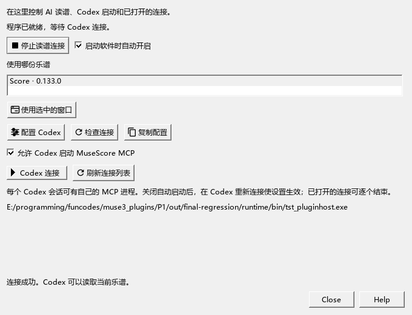
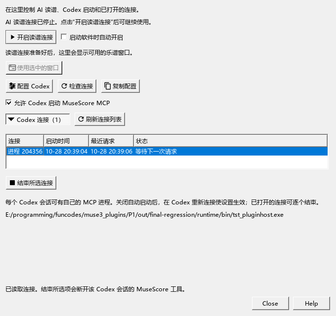

# AI连接：开启、停止和管理MCP进程

适用于0.133及之后版本 · Kumo branch / Freddd13。当前随包工具版本和首次连接见[AI连接说明](WORKSPACE_063_GUIDE.md)。

## 从哪里打开

选择“视图 → AI连接”。上方控制乐谱读写，下方控制Codex的启动设置和MCP连接。

## 暂时停止AI读谱

点击“停止读谱连接”。按钮变为“开启读谱连接”，当前程序暂停接收AI读写请求。关掉窗口再打开，仍显示停止状态；点“开启读谱连接”可继续。

“启动软件时自动开启”决定下次打开MuseScore的行为。希望平时手动开启时，取消这项。当前版本保留原来的自动开启默认值。

## 让Codex平时少开MCP

1. 取消“允许Codex启动MuseScore MCP”。这会保存Codex中MuseScore这一项的开关，其它MCP及个人配置继续保留，原配置在旁边备份。
2. 在Codex重新连接，使启动设置生效。
3. 已经打开的进程仍在列表中。展开“Codex连接”，点击“刷新连接列表”。
4. 选择需要结束的一行，点“结束所选连接”。这会断开对应Codex会话里的MuseScore工具。需要继续时，在Codex重新连接。

第一次使用先点“配置Codex”。已经主动关闭启动的用户，再次更新程序路径时仍保留关闭状态。

## 为什么会有几个MuseScoreMCP.exe

Codex可为不同会话分别启动连接工具，每个进程有自己的通信和任务资料。列表显示本程序包的进程、启动时间、最近请求和状态。

- “等待下一次请求”：已收到过请求，目前等待继续操作。
- “正在处理任务”：当前正在执行请求，结束按钮暂时不可用。
- “旧连接 · 活动状态待核对”：旧版工具没有记录请求状态，可按自己的使用情况选择结束。
- “未记录”：这份连接尚未提供请求时间。

点击“刷新连接列表”读取最新状态。仅凭启动时间长，无法判断某一会话是否还需要连接。正常结束通信后，MCP会退出；这次检查中，从关闭通信到退出约0.3秒。

## 重新开始读谱

1. 点“开启读谱连接”，打开要讨论的乐谱。
2. 第一次使用或程序目录发生变化时，点“配置Codex”。确认“允许Codex启动MuseScore MCP”已勾选。
3. 在Codex重新连接，然后输入：“检查MuseScore连接，告诉我当前谱名和选区。”
4. 使用多个MuseScore窗口时，在列表选中谱名，点“使用选中的窗口”。

“检查连接”会实际询问当前程序。“复制配置”用于自行管理Codex配置。更完整的首次操作见[AI连接说明](WORKSPACE_063_GUIDE.md)。

## 关闭窗口、保存与更新

关闭AI连接窗口会收起这张面板，当前读谱状态继续保持。需要停用时使用上方的停止按钮。

读谱启停、自动开启和详情折叠保存在个人设置中；Codex开关保存在Codex配置文件中。它们各自控制当前连接、下次软件启动及Codex启动。

新版连接工具放在程序包的版本目录，已打开的旧会话可以继续使用。点击“配置Codex”会更新今后的启动路径。更新程序时保留现有Codex配置，由你选择何时切换连接。

现在可读取原生谱图、当前谱标题与完整编配资料；可以从[比较两种写法](AI_WORKFLOW_144_GUIDE.md)继续。当前检查及后续任务见[完整进度](REWORK_PROGRESS.md)。
