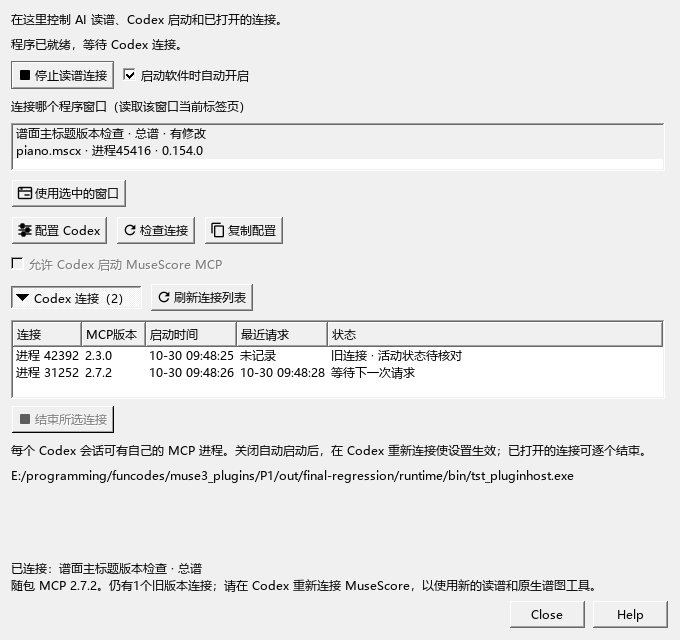

# 更新Codex连接与读取实际谱图

适用于0.154.0及之后版本 · Kumo branch / Freddd13；随包MCP2.7.2。

## 第一次连接，或更新程序后继续使用

1. 在MuseScore打开要讨论的乐谱，选中相关小节。
2. 打开“视图 → AI连接”，点“配置Codex”，确认“允许Codex启动MuseScore MCP”已勾选。
3. 在Codex的MCP设置中重新连接musescore。可以关闭再开启这一项；如果当前对话仍显示旧工具，退出并重新打开Codex后继续原对话。
4. 回到MuseScore点“刷新连接列表”，展开“Codex连接”。每行分别显示进程、MCP版本、启动时间、最近请求和状态。
5. 点“检查连接”，确认下方显示当前谱名。到Codex输入：“确认当前谱名和选区，读取这一段的MuseScore原生谱图与音符。”

程序包附带MCP运行文件，可直接使用。移动程序目录后，重新点“配置Codex”即可更新启动路径。

如果Codex提示“请打开MuseScore”，先启动本分支程序并打开要讨论的谱，再到“AI连接”点“检查连接”。这一步会显示当前谱名；随后在Codex重新连接并继续读谱。

## 为什么更新了程序，Codex仍缺少工具

“配置Codex”保存下次启动使用的程序位置，已经打开的连接继续运行自己的版本。列表同时出现2.3.0和2.7.2时，使用2.3.0的会话仍会看到旧工具。

刷新列表和检查连接都会提示仍在运行的旧版本。重新连接后，再让Codex读取一次。当前工具包括`get_score_identity`、`get_score_image`和`refresh_arrangement_context`；Codex还可通过`get_capabilities`返回的`mcpClient.version`确认自己的版本。

有多个会话时，可在列表选中自己已结束使用的连接，点“结束所选连接”。正在执行请求的连接会显示“正在处理任务”，完成后可以操作。连接数量、活动状态及独立开关见[管理连接](AI_CONNECTION_133_GUIDE.md)。

## 让Codex看到与屏幕相同的谱

先确认当前谱面标题、文件及总谱／分谱，再读取所选段落。原生谱图保留MuseScore当前的字体、延音、连音组和手动摆放，并附带同次读取的音符位置。

可以直接这样说：“保留右手旋律，对照这四小节的实际谱图，给我两种更轻的左手写法。”随后在“编配建议”比较、试听和采用；按Ctrl+Z撤销，保存沿用原来的乐谱保存操作。

`get_score_image`提供MuseScore原生PNG；`show_score`提供按音符数据绘制的简略示意图。需要判断净谱和手动位置时，使用原生PNG。完整操作见[原生谱图](AI_IMAGES_141_GUIDE.md)和[比较两种写法](AI_WORKFLOW_144_GUIDE.md)。

## 保存与关闭

配置前会保留原配置副本，其它MCP和个人设置继续保留。已有的“允许Codex启动”关闭状态也会保留。

查看谱名和谱图保持乐谱的选音、播放位置与保存状态。关闭“AI连接”只收起窗口；“停止读谱连接”控制本程序是否接收读写请求。

Codex本机MCP的配置方式见[OpenAI官方说明](https://developers.openai.com/codex/mcp/)。
