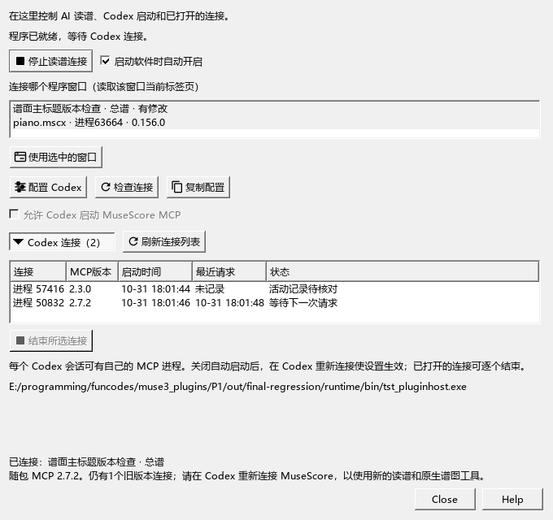

# 当前Codex读谱与采用检查

日期：2026-10-31。任务E2-W2。当前安装0.155；0.156已编译并完成本批软件操作检查，等待退出程序后安装。

## 当前对话的实际调用

- 工具目录44项，实际能力报告MCP2.7.2。当前对话直接调用身份、原生谱图与继续任务三个新入口。
- 当前真实乐谱的谱面标题与旧作品信息分别返回；读取前四小节得到35音、5休止、5踏板，保留跨谱表位置、延音与跨范围圆滑线。
- 原生PNG为1403×380，35个音符引用与图片位置对应。首次图像43.9716毫秒；刷新后复用图像0.7845毫秒。
- 继续任务保留原四小节和任务说明，GUI读取每批最长3.2563／2.7909毫秒。读谱前后的选区、当前谱与保存状态保持。

## 独立测试谱

用单独的钢琴与单簧管小谱完成：打开 → 读16音及演奏数据 → 提交一音力度80→57 → 查看差异 → 采用 → 保存 → 读取MSCZ → 撤销 → 重做。

采用后的实际起音力度为57，其它15个起音保持；保存文件包含一个力度57及原踏板。撤销恢复原来的相对力度0%和实际80，重做恢复57。测试结束保存恢复后的独立谱并关闭，再返回原来的用户谱，主谱仍为未修改。

保存过程中发现空VST设置在查询时新增了空slots字段，普通保存因此多出一条音源撤销。0.156改为读取已有字段，增加重复查询、重复保存和已有空配置检查。

## 连接面板

实际面板把2.7.2连接显示为“旧连接”，而同一exe的命令行能读到对应请求记录。已核对启动的实际exe、版本、进程身份及资料文件。0.156让面板子进程明确使用宿主的资料目录，并将缺少活动记录的状态写为“活动记录待核对”；版本由独立版本列和旧版本提示说明。

两组共13项操作通过：空音源重复查询与保存、双版本连接、服务与Codex开关，以及已有的建议采用、标题／分谱、完整记谱／演奏读取、任务刷新、共用音源与切回SF2。测试进程使用独立设置，实际刷新、检查、开关、采用与撤销均经过界面入口。

空配置检查首次链接到了尚未重编的audio库，仍复现旧问题；编译VstSynth实际所属的audio目标后重新链接，重复读取及保存通过。正式程序保留Kumo branch／Freddd13标识；SHA-256为`343cd2e525cdf4499bec8a4144dcd5c5ddb8688e0c25ea8c7986ac4c3438bd47`。

## 剩余实际使用检查

CFX厂商按钮和焦点按用户安排暂缓。实体MIDI录制、真实声卡音乐听感，以及Synthesia／常用DAW中的最终MIDI继续分别核对。完整顺序见[当前进度](REWORK_PROGRESS.md)。
