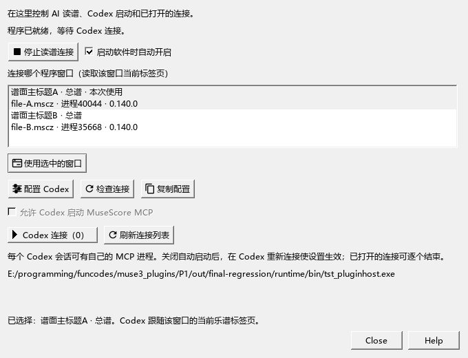

# Codex当前读取哪份乐谱

适用于0.140.0 · Kumo branch / Freddd13；随包连接工具MuseScoreMCP 2.5.0。

## 从打开程序到确认当前谱

1. 打开要讨论的乐谱，选择正在编辑的总谱或分谱标签页。
2. 打开“视图 → AI 连接”，点击“开启读谱连接”。窗口列表显示当前谱面标题、总谱／分谱、文件名和进程；有修改时会标明。
3. 第一次使用或更新连接工具后，点击“配置 Codex”，再在Codex重新连接。勾选“允许 Codex 启动 MuseScore MCP”后即可使用。
4. 点击“检查连接”，核对显示的谱名。到Codex输入：“读取当前MuseScore，告诉我谱面标题、作品信息标题、文件名，以及当前是总谱还是哪份分谱。”

连接工具随程序提供，普通使用直接运行附带的exe。配置步骤依据[Codex官方MCP说明](https://learn.chatgpt.com/docs/developer-commands#codex-mcp)。

## 为什么会有几个标题

谱面上方可编辑的标题、作品信息里的标题、文件名可以各自修改。例如屏幕写“练习曲”，作品信息写“钢琴改编”，文件保存成“第三稿.mscz”。

Codex默认用谱面可见标题称呼这份谱，同时获得另外两项及名称来源。没有谱面标题时，依次采用作品信息、标签页或文件名。多行标题和副标题分别保留。

“有修改”表示乐谱当前有尚未保存的编辑。新建谱尚未保存文件时也能读取，程序会标明当前状态。

## 多窗口、标签页和分谱

打开多个MuseScore窗口时，在“AI连接”列表选择要使用的一行，点“使用选中的窗口”。Codex随后跟随这个程序窗口当前的乐谱标签页。

在该窗口切到另一份谱或钢琴分谱后，再次读取会返回新的当前谱信息。总谱与分谱分别标识，并保留它们属于同一份文件的关系。另存后显示新的文件位置；关闭再打开会建立新的读谱会话。

## 在Codex怎样继续编配

先确认当前谱，再选择要讨论的小节，例如：“保留旋律，帮我比较第9—12小节的两种左手写法。”当前选区和内存中的修改会直接读取。已有的局部建议、比较、试听、采用和撤销沿用原来的入口。

连接工具的`get_score_identity`用于轻量确认当前谱；`read_arrangement_context`读取完整选段，`get_score_data`提供结构音符，`get_score`保留LilyPond音符文本。它们共用本次标题和谱的身份。

原生选段图及更完整的AI编配过程接着按E2实现。当前音符示意图的入口仍在原有位置。

## 保存、开关与恢复

查看当前谱保持原选音、播放位置和保存状态。标题仍在谱面、作品信息和“另存为”各自的原位置编辑。

暂时停用或管理多个MCP进程，见[AI连接的开启、停止与连接列表](AI_CONNECTION_133_GUIDE.md)。移动程序目录后，重新点“配置 Codex”更新工具路径；已有的关闭设置继续保留。
