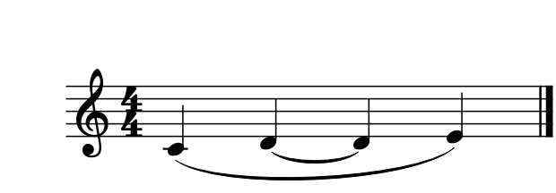
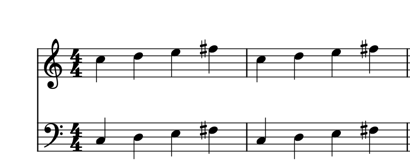

# 让Codex对照实际谱图读谱

适用于0.141.0 · Kumo branch / Freddd13，随包MCP2.6.0。

## 从打开到看到谱图

1. 在MuseScore打开乐谱，选中想讨论的几小节。
2. 打开“视图 → AI 连接”。升级后点“配置 Codex”，然后在Codex重新连接。已有的关闭设置可用“允许 Codex 启动 MuseScore MCP”开启。
3. 在Codex输入：“确认当前谱和选段，读取音符与MuseScore原生谱图，帮我看看这一段的左手安排。”
4. Codex取得的图片沿用这份谱当前的字体、音符、延音、连音组和手动位置。较长范围分成几张图，按需要继续查看。

多个程序窗口、总谱与分谱的选择见[当前谱与连接窗口](AI_IDENTITY_140_GUIDE.md)。

## 比较与使用建议

例如：“保留旋律和这段长度，把左手减轻一些，给我两种写法。”

Codex先读取选段，再结合原生谱图提出少量建议。“编配建议”中可以查看差异、试听、使用这版或存为另一种写法。采用后按Ctrl+Z撤销，重做可恢复刚采用的内容；保存仍使用原来的乐谱保存操作。

你继续改谱后，让Codex重新读取这一段。新图和新音符会一起更新。和弦解释、分手、踏板和参考录音关系继续由同份选段资料提供。

## 图片里怎样找到对应音

图片附带所在小节、谱表／声部和每个音的图中位置。跨谱表音按它在纸上的真实位置对应；装饰音保留自己的引用。AI讨论到某个音时可以进一步读取和定位。

第一次读取会准备图片，重复查看复用已有结果。乐谱播放时先暂停，再让Codex取图；已有文字分析和已读资料可以继续查看。

## 连接工具的入口

`get_score_identity`确认当前谱。`read_arrangement_context`读取选段，返回`contextId`。`get_score_image`使用这个`contextId`返回原生PNG与音符位置，`image_index`从0开始，较长范围按`nextImage`继续。

`get_score_data`读取结构音符，`get_score`提供LilyPond音符文本，`show_score`保留简略音符示意图。默认编配过程采用原生图片和同版本选段。

## 保存与恢复

查看图片保持当前谱面选择、播放位置和保存状态。采用的修改随乐谱保存；原生图片缓存保存在程序内存中，关闭程序后释放。连接的启停、多个MCP进程与重新连接见[连接管理](AI_CONNECTION_133_GUIDE.md)。

更新后先按[当前连接步骤](AI_CONNECTION_154_GUIDE.md)核对正在运行的MCP版本，再读取当前谱和原生图。
