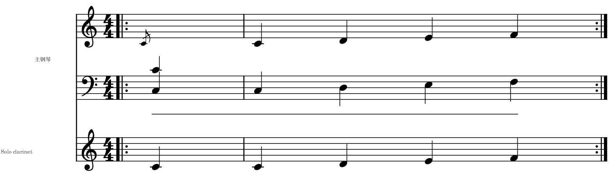

# 让AI读清当前选段，并继续编配

适用于0.143.0 · Kumo branch / Freddd13，随包MCP2.7。

## 第一次使用

1. 打开乐谱，选中想讨论的几小节。
2. 打开“视图 → AI 连接”，确认当前谱名。升级后点“配置 Codex”，在Codex重新连接MuseScore工具。
3. 例如输入：“保留这段旋律，把左手安排得轻一些。先看这段音符和原生谱图，再给我两种写法。”
4. AI会读到实际乐器和谱表名称、各声部音符、调号、延音和踏板，并附上这一段已经关联的参考资料。
5. 在“编配建议”选择写法，查看差异、试听，再使用喜欢的版本。采用后Ctrl+Z可撤销。

连接配置与程序选择见[当前谱与连接窗口](AI_IDENTITY_140_GUIDE.md)，看图方法见[原生谱图](AI_IMAGES_141_GUIDE.md)。

## 按正在做的事读取

直接描述目的即可：

| 你想做什么 | 可以这样说 | 读取的重点 |
|---|---|---|
| 看和声、配音或声部 | “看看这段低音与旋律怎样衔接” | 音符、声部、调号、延音、分手和已有解释 |
| 核对力度、琶音或踏板 | “按实际播放看看，哪些音先响，踏板什么时候抬” | 原生播放的起音、松键、力度、踏板与每次反复 |
| 调整净谱 | “看原生谱图，整理这两个跨谱表音的位置” | 当前排版中的音符位置及原生图片 |

演奏数据中，松键与抬踏板分别列出；踏板可在松键后继续留声。谱上的音名、实音和播放音高也分别提供。例如降B单簧管谱上的C4，实音可以是Bb3。

## 改谱后继续刚才的任务

例如，讨论第9–12小节时，点其它音看看，随后说：“继续刚才那四小节，保留旋律，再试一种左手。”AI会继续读取原来的范围及要求。

你自己改过音符或布局后，AI可更新这份任务，取得新的音符引用和谱图。当前乐谱切到另一份时，回到原谱即可继续。

## 使用已经提供的资料

原曲参考中与这段关联的录音片段、内部对齐点和反复遍次会一起提供。比如同一段人声对应两处不同改编，本次任务只取正在讨论的位置。录音路径、文件身份和原来的其它关联继续随谱保存。

你可以补充：“这里的主题在左手”“这段采用E小调解释”“保留原曲这四个和弦”。这些说明保留自己的来源和范围，帮助AI比较写法。需要留到下次使用时，可以明确说“把这条解释保存到谱里”。保存资料可撤销。

## 工具名称，供接入和维护

`read_arrangement_context`的`purpose`可取`analysis`、`performance`、`engraving`。默认分析；演奏用途读取实际音符事件和CC64踏板，净谱用途增加位置。

`refresh_arrangement_context(context_id, task_brief)`更新原任务，沿用原谱和范围，可补充要求。`get_score_image`使用更新后的`contextId`读原生图。

音符的`noteName/notatedPitch`表示当前记谱，`concertPitch`是实音，`soundingPitch`包含八度线等播放处理。原有字段继续兼容旧工具。每次反复保留自己的展开位置与秒数。
