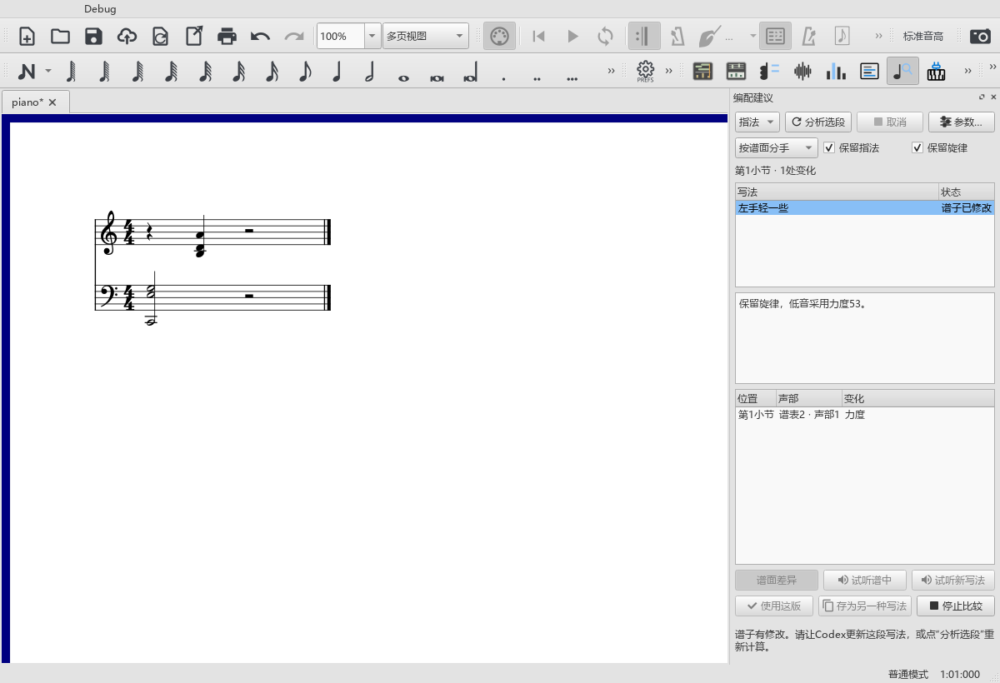

# 用AI比较、试听和采用一段写法

适用于0.144.0 · Kumo branch / Freddd13；随包MCP2.7.1。

## 一次完整操作

1. 打开乐谱，选中要编配的两小节。
2. 在Codex说：“读这两小节和原生谱图，保留旋律与踏板。给左手一版八分分解，再给一版较疏的和弦。”
3. 打开“视图 → 编配建议”，选择A或B。选中的变化会显示在原谱上，下面列出具体位置。
4. 点“试听谱中”听原写法，点“试听新写法”比较。状态写出实际从哪小节开始；包含前文时会标明，便于听进入这段的衔接。
5. 喜欢这一版时点“使用这版”。列表显示“已采用”，然后按Ctrl+S保存乐谱。Ctrl+Z撤销这次采用，Ctrl+Y重做。

本轮实际例子：第2–3小节有Am、F及两条踏板。A改为16个八分起音，B为四组和弦；采用A后，旋律和踏板继续保持，一次撤销回到原写法。

## 自己改谱后继续比较

乐谱有修改时，旧建议显示“谱子已修改”。告诉Codex：“按现在的谱更新刚才两种写法”，即可继续同一段。也可点“分析选段”取得传统算法建议。

撤销采用后，列表会随实际乐谱更新。已经使用的内容与等待更新的建议各有明确状态。分析尚未开始时，“取消”保持灰色；分析过程中可以取消。

## 工具缺项时怎样更新

在“视图 → AI连接”点“配置Codex”，然后在Codex的MCP设置重新连接MuseScore。新版的get_score_identity、get_score_image和refresh_arrangement_context分别用于确认当前谱、查看原生图和继续原任务。

配置、连接工具和已打开的Codex会话各有自己的状态。更新启动路径后，新连接会载入对应版本的工具；原来的会话可在连接列表中管理。配置方法见[AI连接说明](AI_CONNECTION_133_GUIDE.md)及[Codex官方MCP配置](https://developers.openai.com/codex/mcp)。

更详细的资料和音高含义见[AI读谱与继续任务](AI_TASK_143_GUIDE.md)。
