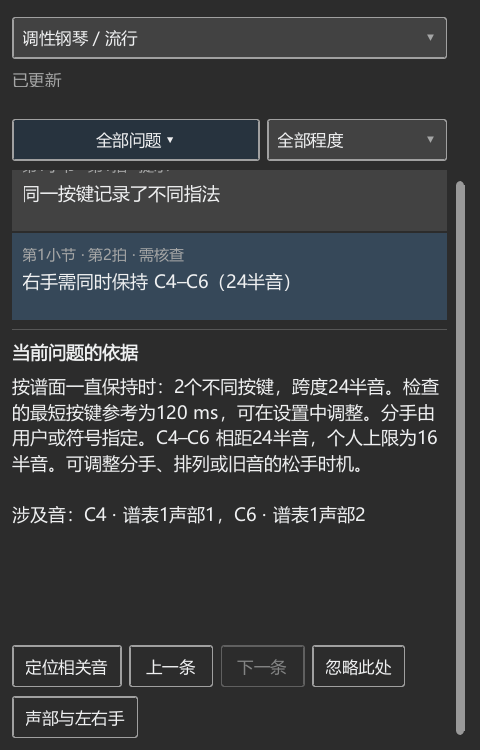
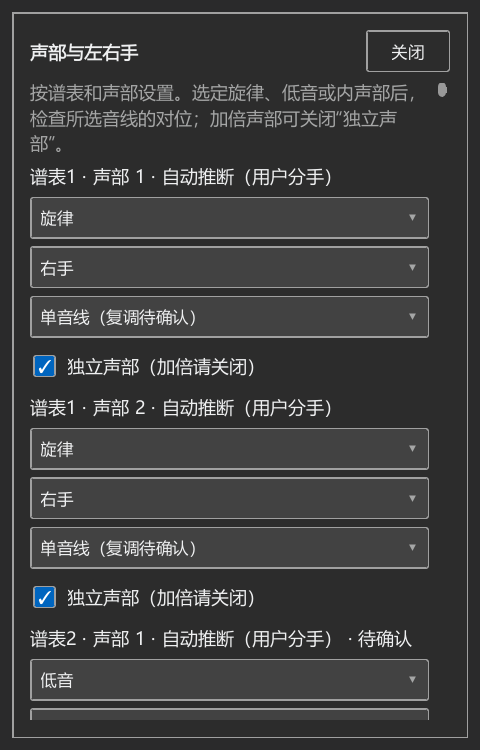

# 编配检查的具体片段与完整操作

对应个人版本0.83.0。

## 已复现的情况

- 选择复调声部中的旋律或最高音线后，原先仍沿用“独立声部关闭”，使这条线跳过对位检查。
- 两个声部同时加倍同一对低音时，同一个小二度列了四遍说明。
- 右手C4保持到后面出现C6，左手C2同时写了1、2两个指法。实际后台算法和真实谱面检查均漏掉右手跨度；有踏板时也漏掉了可提前松开C4的说明。

复现日志：arrangement-083-low-duplicate-reproduced.txt、arrangement-083-reproduce-pluginhost.txt。单纯替代后台接口的测试未覆盖第三种情况；本批直接运行程序使用的JS包和原生手位计算。

## 操作与检查

使用项目自己的arrangement_083.mscx。第一小节包含保持音、右手下一组音、左手指法疑问及低音半音；第二小节保留空白，用于检查范围与结果保持。

1. 从插件菜单打开，设置明确的左右手，点击“更新结果”。
2. 核对右手保持音跨度、左手指法疑问与低音排列；列表与谱面位置相互对应。
3. 选到另一小节，结果及原范围继续保留。
4. 筛选可弹性，点击谱面位置查看说明，核对仅显示当前筛选的问题，窗口避开相关音。
5. 再次更新后，保留当前查看的同一条提示；切到钢琴全谱后覆盖两个小节。
6. 后台分别检查有踏板、无踏板及同音分手疑问的情况，读取实际跨度与松手结果，并核对输入资料保持。

## 已完成的检查与截图发现

- JS规则52项、提示位置与筛选检查、编配候选10项通过。
- 实际后台和面板完整操作通过，包含有无踏板、同音分手、指法疑问、修改后自动更新及撤销恢复。首组日志为arrangement-083-complete-flow-pluginhost.txt。
- 已有后台隔离与取消、按键与松手2项，范围和独立窗口2项，正常主窗口4项操作通过；日志分别为arrangement-083-related-p0native-run.txt、arrangement-083-related-p1native-run.txt、arrangement-083-related-nativeui-run.txt，各组另含准备和结束。
- 查截图发现谱旁说明正文为空，窗口的内容项首次显示仍为0×0，原先的可见性检查漏掉了这一点。正文布局现直接采用窗口的实际大小，并补充正文高度及实际点击关闭的检查。诊断记录见arrangement-083-theme-inspect-pluginhost.txt；原截图保留在P2/out/arrangement-083-nearby-before.png。

正文、实际鼠标关闭、深色主题及150%显示缩放已检查，日志为arrangement-083-final-pluginhost.txt及arrangement-083-dpi150-pluginhost.txt。短窗口进一步检查发现整页缺少滚动，以及设置关闭入口需要保持可见；已补齐滚动、预留滚动条宽度和设置顶部关闭按钮，具体结果见下面的最终界面检查。

## 音乐资料

低音排列的音程、音区参考继续使用[好和弦原文](https://nicechord.com/post/low-interval-limit/)。本批修正重复引用及提示方式，参考值保持。

[钢琴指法研究](https://arxiv.org/abs/1904.10237)讨论连续演奏、个人差异与指法评估；本项目目前使用可调跨度、按键占用和有限候选计算。本批修正分手和指法疑问影响检查范围的问题。

完整31类使用过程继续按USABILITY_REWORK_20261019.md逐项处理。

## 最终界面检查

完整后台与面板操作、原有选音与播放显示、版本及开关共5项，加准备与结束共7项通过，日志arrangement-083-scroll-close-verified-pluginhost.txt。最后调整滚动条显示后，完整面板操作又在正常及150%缩放下各通过1项（每组另含准备与结束），日志arrangement-083-scrollbars-final-pluginhost.txt、arrangement-083-scrollbars-dpi150-pluginhost.txt。

已实际检查正文高度和文字、鼠标关闭谱旁说明、更新当前结果、选到其它小节、改查全谱、修改音高后的自动更新与撤销。在320×500窗口中滚动到下面，打开声部设置，分别用鼠标关闭和Esc收起。深色主题读取实际颜色并查看截图。最后两份日志中新增布局循环与页面读取错误为0条，原有Connections写法提示仍记录在日志中。

