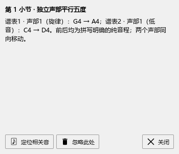
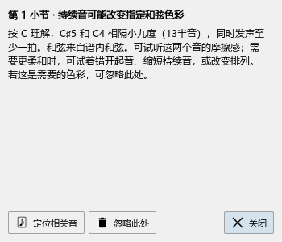
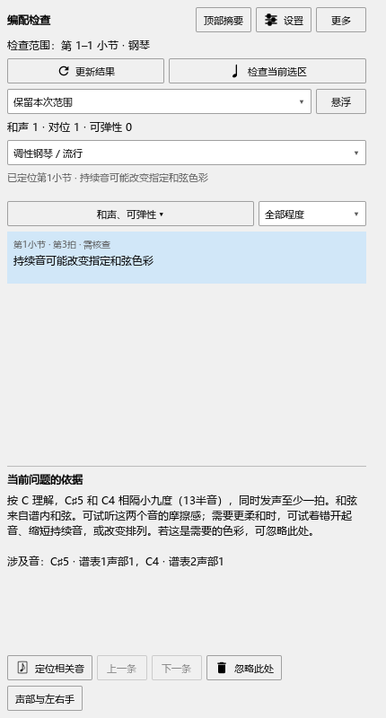

# 看懂和声与声部提示

适用版本：0.115.0 · Kumo branch / Freddd13。

## 检查两条音线

例如，旋律从G4走到A4，低音从C4走到D4，想检查两条线怎样配合：

1. 框选这段，打开“插件 → Arrangement Check”，点“检查当前选区”。首次使用先在插件管理器启用`ArrangementAssistant_MS3.qml`。
2. 点“声部与左右手”，把相应声部设为“旋律”和“低音”，开启“独立声部”。一组和弦里要看最高音或最低音时，选“最高音线”或“最低音线”。
3. 点“更新结果”。这个例子会列出平行五度，说明中分别写出G4→A4、C4→D4，以及各自的谱表和声部。
4. 点列表里的提示定位，双击在谱旁查看。相关的前后音一起提供给定位和显示。
5. 按自己的写法调整音符，停播后等待更新，或点“更新结果”。范围继续保留。

加倍同一旋律时，可以关闭这条线的“独立声部”。风格选择保留“调性钢琴／流行”“严格对位”“爵士”；设置里还能分别选择平行五八、反向五八、交叉等项目。

## 看一处持续音怎样影响和弦

例如，谱上写C和弦，同时保持C4和C♯5。提示会写清两音相隔小九度、同时持续多久，再给出缩短、错开或改变排列的建议。

自动识别的和弦也参加检查。提示会说明采用的解释来自自动识别、谱内和弦、导入还是手动指定。

经过音、邻音和保持后解决的音会结合连续音线判断。重复同一个音、隔着休止的位置和另一条音线分别检查。若想保留提示中的色彩，点“忽略此处”；“更多 → 恢复已忽略的提示”可以取回。

## 和弦助手与编配检查一起用

同时打开和弦助手，在“修改和弦与范围”里指定解释，再查看编配检查的更新结果。修改和弦或撤销后，两边会更新；检查范围保留。

例如，把上例C改成C7(♭9)，C♯已经包含在指定色彩中，相应的持续音提示会收起。按Ctrl+Z恢复C解释后，提示重新出现。人工解释按和弦助手的正常方式随谱保存。

## 只看当前需要的问题

“全部问题”下拉可以组合勾选和声、对位、可弹性。数量统计整次检查，列表按选择显示。点空白或选到别的音后，结果继续保留。

实际改动乐谱后，Ctrl+S保存，Ctrl+Z撤销。检查、定位和筛选保持乐谱内容；本次范围和角色设置的保存方式见[完整说明](../USER_GUIDE.md#10-编配检查)。
