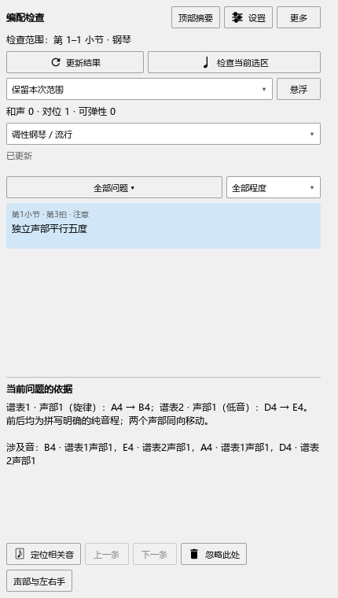
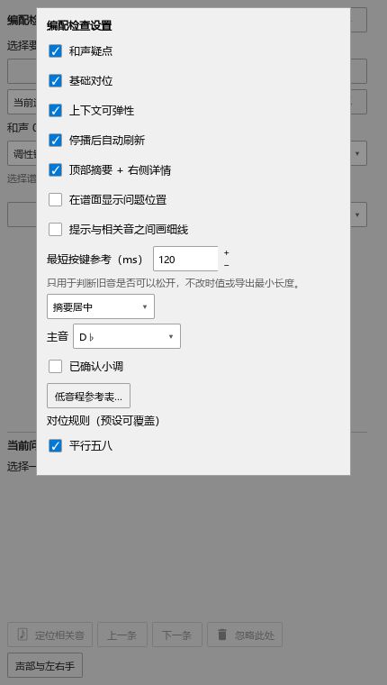

# 复音、装饰音与主音设置

适用版本：0.116.0 · Kumo branch / Freddd13。

## 一段里既有和弦，也有单音旋律

框选谱段，打开“插件 → Arrangement Check”，点“检查当前选区”。复音结束后，清楚的单音段会继续检查两条音线的关系。装饰音与主要音分别读取。

例如，右手先弹一个和弦，随后单音A4→B4；低音同时D4→E4。这两组音形成平行五度，提示会列出四个音。开头的装饰音保留在谱上，后面的声部检查按主要音进行。

想检查一组和弦中的特定音线，点“声部与左右手”，指定旋律、低音或内声部，再选择“最高音线”或“最低音线”。加倍同一条旋律时，关闭相应的“独立声部”。按自己的写法改音后，停播会更新，也可点“更新结果”。

## 设置已确认的主音

1. 点“设置”，在“主音”下拉中选择当前段的主音。例如D♭。
2. 小调再勾选“已确认小调”。选择会记住，关闭面板再打开仍保留D♭的写法。
3. 返回列表，点“更新结果”，查看导音的后续进行。D♭调中的C与C♯调中的B♯分别按其拼写判断。

主音选择保持“调性未确认”时，先看声部运动和实际音程。确认主音后，检查还会参考导音去向；同音反复会结合后续音，休止两侧按不同句子处理。

## 各自使用自己的和弦解释

不同钢琴的调号、谱内和弦和当前音符分别读取。给一架钢琴指定C和弦，会用这架钢琴的音检查色彩。其它钢琴保留自己的解释。和弦助手的人工修改、导入及撤销继续按[上一批的操作](ARRANGEMENT_115_GUIDE.md)使用。

点提示定位，查看前后音，再按编配意图决定怎样修改。音符改动照常Ctrl+S保存，Ctrl+Z撤销。检查设置会记住；检查、筛选和定位可继续用于阅读乐谱。
