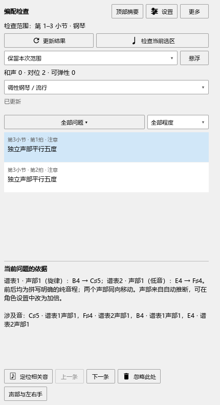
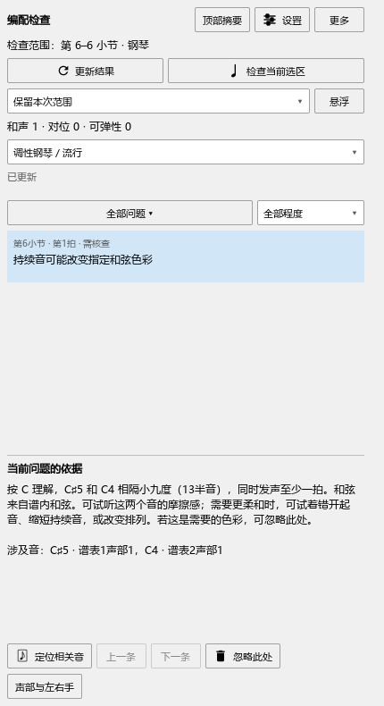

# 伴奏转旋律，以及前面仍有效的和弦

适用版本：0.117.0 · Kumo branch / Freddd13。

## 先弹分解和弦，后面变成旋律

框选包含这两段的范围，打开“插件 → Arrangement Check”，点“检查当前选区”。音型会按所在位置判断；分解伴奏转回清楚的旋律或低音后，继续检查声部运动。

例如，左手先弹分解伴奏，后面E4→F♯4；右手B4→C♯5，会在相应位置列出平行五度，分别写出四个音。

如果这段分解音本来就是要独立检查的旋律，点“声部与左右手”，指定角色并开启“独立声部”。加倍同一旋律时关闭相应开关。你指定的角色优先采用，操作见[声部与主音设置](ARRANGEMENT_116_GUIDE.md)。

## 和弦写在选段前面

前面仍有效的谱内和弦会自动用于当前选段。例如第二小节写了C，检查第六小节时，仍按C解释持续音，详情会注明“和弦来自谱内和弦”。

修改较早的和弦后，停播会更新；也可以点“更新结果”。删除当前有效记号后，会采用前面仍有效的解释。Ctrl+Z撤销时，结果随之恢复。

“检查当前选区”用于换范围；“保留本次范围”方便边改边看，“钢琴全谱”用于检查这架钢琴的完整乐谱。普通选音继续用于编辑和定位。检查结果会保留到更新或换谱。

实际改音或修改和弦后按Ctrl+S保存。检查设置会记住，乐谱修改照常撤销；保存、重开与分析文件操作沿用[完整说明](../USER_GUIDE.md#10-编配检查)。
