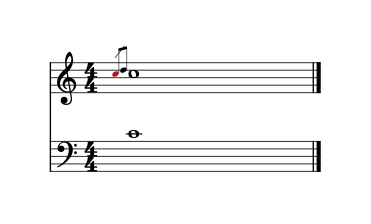
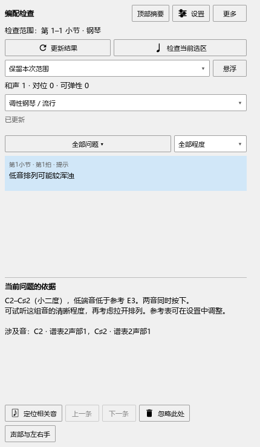

# 装饰音对应与低音排列提示

对应0.118.0。本次修复沿用原来的入口、设置和布局。

## 把演奏力度用到含装饰音的乐谱

1. 在乐谱中选中要处理的一段，打开演奏编辑器的“演奏表达”。查看页面上方的目标谱段。
2. 导入演奏MIDI，或完成录制。查看对应音和前后力度。
3. 选择需要采用的音及“使用力度”。一次采用可以用Ctrl+Z撤销。
4. 保存乐谱，重新打开后继续编辑。

装饰音现在只出现一次，保留自己的力度和对应位置。装饰音与主要音同音高时，也能分别选中、强调和采用。旧表达项目中的装饰音编号继续可用。

下图中红色的是正在查看的装饰音，主要音保留原来的颜色。

## 检查低音排列

1. 打开“插件 → Arrangement Check”，选择范围后点“更新结果”。
2. 点“低音排列可能较浑浊”，查看相关音名、音程和参考音区；点“定位相关音”查看谱面。
3. 调整乐谱后再次更新。自动更新开启时，停播后会更新保留的范围。

设为“不播放”的音从低音排列提示中排除。恢复播放后重新参加检查；撤销与保存重开使用同样的设置。

mf、p和渐强渐弱分别按各谱表读取。修改记号或逐音力度后，再读取的数值与当前MIDI播放值对应。播放准备中，检查面板会显示等待状态，自动更新开启时随后继续。

低音程参考表保持现有数值。共同发声时长、力度对提示顺序的影响，以及重复提示合并，继续列在C2-C；后续顺序见[进度与完整计划](REWORK_PROGRESS.md)。
