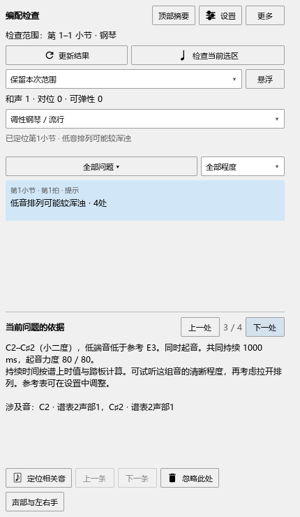

# 查看低音排列的持续、力度与反复位置

对应0.119.0。

## 一条提示，逐处查看

1. 打开“插件 → Arrangement Check”，选好检查范围后点“更新结果”。
2. 同一架钢琴反复出现相同的低音排列时，列表会合成一行，例如“低音排列可能较浑浊 · 4处”。上方“和声”数字按合并后的条数计算。
3. 点这一行，先定位第一处。在“当前问题的依据”旁点“上一处／下一处”，查看各次出现的音、位置和依据。
4. “上一条／下一条”切换不同提示。“忽略此处”处理当前这一处，其余位置继续保留。
5. 需要重新查看已忽略的位置时，打开“更多 → 恢复已忽略的提示”。

打开谱面提示后，每次出现的位置都保留入口。问题类别和程度筛选继续作用于全部位置。

## 怎样读依据

例如：C2–C♯2，共同持续1000 ms，起音力度80 / 20。

- C2–C♯2是需要听辨的两个音；后面列出低音程参考位置。
- 1000 ms表示这两音按谱上时值与踏板共同保持的时间。速度变慢后，同样的拍数会持续更久；先后起音从两音都出现时开始计算。
- 80 / 20分别是两个音的MIDI起音力度，较轻的音仍保留自己的数值。
- 依据会写明同时起音、先后起音或含踏板保持。同一处有多对音时，先列持续较久的，再按两音力度排列。

修改音符、播放设置或速度后，自动更新开启时会更新保留的检查范围；也可以点“更新结果”。若只想听其中一处，先点“定位相关音”，再按平常方式播放。

乐谱修改照常保存和撤销，忽略列表由工具保存。低音程参考表及个人设置继续沿用。后续的手调音长、起音偏移与演奏踏板核对见[当前进度](REWORK_PROGRESS.md)。
