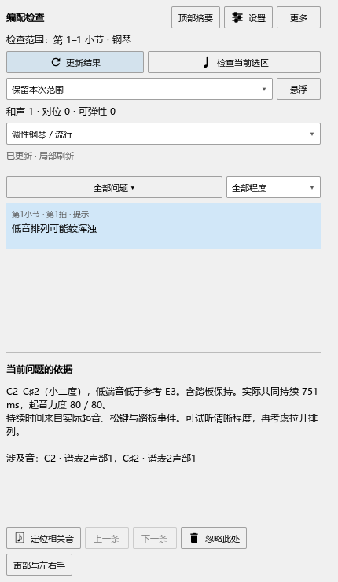

# 实际起音、松键与踏板检查

0.122.0，2026-10-25。最终编译和检查通过，准备安装；当前安装版本见进度页。

## 实际面板操作

在独立钢琴谱中打开“编配检查”，点“更新结果”。最初的C2–C♯2提示共同持续479／960秒；把C2缩到23tick结束、C♯2延到240tick开始后，提示消失。

给这段加踏板，提示恢复，实际共同持续721／960秒，约751ms。再设钢琴方式、80ms音后踩下，C2已经松开，提示再次消失。逐次撤销恢复各状态；重做、保存、重新打开后，面板和已保存事件一致。

保持原有的范围、布局、角色和个人设置。完成13项原生与界面检查，含准备和结束共15项，记录playback-122-native-final-pluginhost.txt：

- 独立检查正常MIDI的重触、重复松键、同音加倍、控制器去重及18号通道。
- 分页读取与正常渲染逐条比较实际tick、通道、音高、力度和松键处理。
- 手调音长、起音、SF2／钢琴方式、静音及声部播放开关更新后，旧资料及时失效。
- 反复遍次、提前起音及装饰音保留各自身份；256小节跨块、相接踏板、提前起音和反复与完整正常渲染一致。
- 原有逐处查看、忽略、类别筛选、局部更新、变速、共享和弦、对位、音型及保存操作继续通过。

256小节共1536条音符事件，本次读取总21ms，最长一批1.0052ms，首次准备0.8723ms。前一轮为16ms／0.6069ms／0.4872ms，均保留为这份独立谱例的记录。

## 播放与鼠标操作

SF2、Pianoteq、CFX各输出原有与钢琴踏板两份音频，共6份，实际起音和松键事件保持一致。每份约2.1–4.0秒完成离线导出，全部样本为有效数值且有声音输出；测量保存在P2/out/playback-122-audio。

同一轮继续操作原曲参考、符号面板和尺寸拖动，6项声音／界面检查通过，含准备和结束共8项。记录playback-122-sound-final-pluginhost.txt。

CFX最初两次在受限环境中超时，独立扫描停在厂商初始化。改用正常权限后扫描及两份声音导出均完成。早期记录继续保留；实际声卡与实体键盘按B5／F继续检查。

## 独立算法核对

九组JS检查通过。实际演奏18项包含短音无重叠、实际起音力度、踏板先后、CC64阈值、持续按键、同音重触、加倍、不同钢琴／通道、静音、选区中途开始、反复、变速、旧忽略记录、局部资料替换及后台计算一致性。还从真实Qt快照重新计算，得到同一751ms结果。

记录playback-122-final-test-*.txt。既有上下文32项、调号与音线26项、连续音型23项、低音14项、规则52项、发声6项、建议10项及显示分类均通过。

7项编辑器操作通过：正常鼠标编辑、独立选音与定位、普通演奏与换谱、踏板中断，以及全部原曲播放入口、互停设置和反复定位；含准备和结束共9项，记录playback-122-release-editor-pluginhost.txt。

早期面板截图继续保留作对照：[初步窗口](images/review-20261025/arrangement-actual-panel-122.png)。只读接口与时间口径见[开发说明](ARRANGEMENT_PLAYBACK_API.md)。

## 发布收尾

源码同步与编译前曾遇自动权限审核超时，用户再次授权后已执行成功。正式程序、原生与编辑器检查已完成，准备安装并记录提交。版本由personal/VERSION生成，保留Kumo branch／Freddd13标识。

操作见[按实际播放检查低音排列](ARRANGEMENT_122_GUIDE.md)。本批完成C2-C3，下一项C3连续手位与可弹性，再按C4、D、E、F推进。
