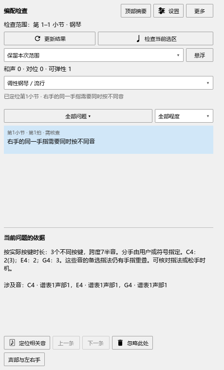

# 编配检查：备选指法和连续琶音

这项修复已包含在 **0.129.0**，使用步骤如下；发布与后续检查见[当前进度](REWORK_PROGRESS.md)。

## 让备选指法参加检查

指法文字写成`2(3)`，表示这个音可用2指或3指。检查会连同其它同时按住的音一起安排可用手指。`[4]`按4指参加判断，谱上的括号外观继续保留。

例如，C4写`2(3)`，E4写`2`，G4写`3`：三个不同琴键只能使用2、3两个手指，仍会出现指法重叠。把G4改成4指后，这组音可以分别使用3、2、4指。

1. 在谱面选中音，添加或编辑指法文字。
2. 打开“插件 → Arrangement Check”，在“声部与左右手”核对这组音由哪只手弹。
3. 点“更新结果”，再点对应提示。在“当前问题的依据”查看具体音与指法。
4. 点“定位相关音”回到谱面修改，再更新结果。Ctrl+Z可撤销刚才的修改。
5. 按Ctrl+S保存，重新打开后继续检查。

同一个琴键在几个声部中同时出现时，只算一个按键；各声部写出的指法会一起核对。要表示可选择的指法，可以直接在一条指法文字中写`2(3)`。

## 连续琶音怎样检查

连续琶音按每次实际起音检查当时仍按着的键。已经松键、由踏板继续保持的声音参加音响检查。

如果演奏编辑器把几个旧音的按键时间延长了，这些音会继续占用手指。踏板允许提前松开时，提示会指出可以先松哪些旧音；持续按住后再弹新音有困难时，会说明需要保持的琴键或跨度。

修改演奏音长、踏板或分手后，点“更新结果”重新检查。演奏设置仍在原来的编辑器中调整，检查窗口负责提示和定位。

## 接下来的完善

同一音头上的`1-3`表示按住期间换指，起音与后续时机见[同音换指说明](ARRANGEMENT_SUBSTITUTION_GUIDE.md)。已明确写在后续延音音头上的指法，按[后续换指与松手](ARRANGEMENT_REQUIRED_GUIDE.md)中的方式检查。

备选与换指的含义参照[Steinberg指法输入说明](https://download.steinberg.net/downloads_software/Dorico/1.2.10/Dorico_1.2.10_Version_History.pdf)，两者的分别保存也见[MusicXML指法定义](https://www.w3.org/2021/06/musicxml40/musicxml-reference/elements/fingering/)。实际操作结果见[本批记录](ARRANGEMENT_ALTERNATIVE_CHECKS.md)。
