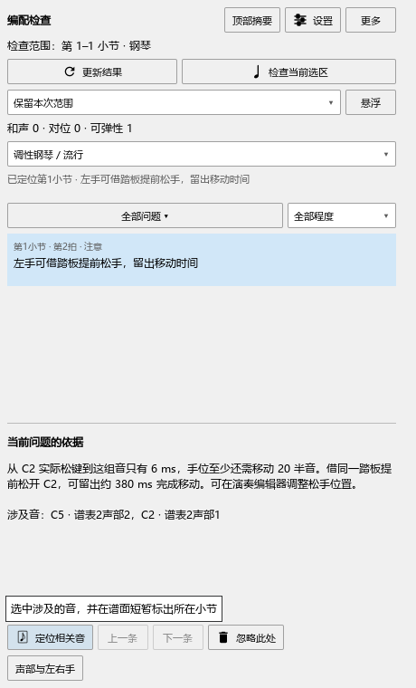

# 编配检查：松手与移动手位

本批源码已经检查，尚未安装。当前程序仍为0.128.0，发布情况见[当前进度](REWORK_PROGRESS.md)。

## 看懂这类提示

“移动时间”从旧音实际松键后开始计算。例如左手先弹C2，下一拍弹C5：如果C2一直按到下一拍前，手移动的空隙就很短。把C2的播放长度缩短，或借踏板提前松手，可以留出更多时间。

提示会列出旧音、新音、剩余时间和最少需要移动的键距。键距按你的最大跨度计算，用来找出值得试弹的位置。

## 完整操作例子

1. 选中这段小节，打开“插件 → Arrangement Check”。
2. 点“声部与左右手”，将C2和后面的C5都指定给左手，再点“更新结果”。
3. 点列表里的移动提示，再点“定位相关音”。谱面会选中下一组音；下方说明同时列出旧音。
4. 下面这份例子中，C2松开后约6毫秒就要弹C5。踏板能继续保持C2，若提前松手，可留出约380毫秒。
5. 打开演奏编辑器，选中C2，缩短它的播放长度，让手有时间移动。回到检查面板点“更新结果”，查看新的提示。
6. 按Ctrl+Z撤销刚才的音长调整，再更新，原来的提示会恢复。

## 踏板与多个旧音

同一只手同时按过几个音时，各音的松键时间分别参与计算。较早松开的低音可能允许先移动一部分，最后还按着的音会限制后面的移动。说明会指出限制最紧的那个音。

开关式延音踏板能够保持旧音时，提示会给出提前松手的办法。连续踏板、声道不同或提前抬踏板时，按原来的保护设置处理。最短按键参考仍在“设置”中，使用你已有的值。

同一处既需要松旧音又需要移动手位时，相关说明合在一条提示里。一次点击就能查看这处需要怎样处理。

## 保存与恢复

在演奏编辑器中调整的播放长度随乐谱保存，谱面时值保留。按Ctrl+S保存；重新打开后，点“更新结果”按保存的演奏方式重新检查。检查本身保持乐谱内容和撤销位置。

实际检查与下一项工作见[本批记录](ARRANGEMENT_MOVEMENT_CHECKS.md)。
