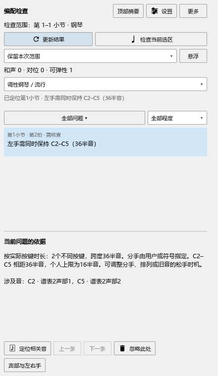

# 编配检查：哪些音还需要按住

本轮源码已加入这项修复，安装版仍为0.128.0。发布与安装状态见[当前进度](REWORK_PROGRESS.md)。

## 怎样检查

1. 选中要检查的小节，打开“插件 → Arrangement Check”。
2. 点“检查当前选区”。要看整首，在范围框选择“钢琴全谱”，再点“更新结果”。
3. 点“声部与左右手”，核对左右手。跨谱表演奏的音也可以指定到实际弹奏的那只手。
4. 在“全部问题”中保留“可弹性”，点击一条提示查看相关音；“定位相关音”会在谱面选中问题发生处的音。
5. 修改音符或演奏设置后，点“更新结果”。开启自动更新时，停播后也会继续检查原来的范围。

## 一个例子

左手C2写了全音符，下一拍又出现C5，两音都分给左手。

- C2仍按着时，会提示“左手需同时保持 C2–C5（36半音）”。说明列出这两个音和你的跨度上限。
- 在演奏编辑器中把C2的播放长度调短，让它在C5起音前松开，再更新结果，跨度提示随之消失。手位仍需移动时会单独说明距离和两组音的间隔。
- 踏板继续保留C2的声音时，和声检查仍会考虑这个声音。手指已经松开的C2会退出按键数量和手指跨度的计算。
- 需要一直按住的C2若可以借踏板提前松开，会提示“左手先松开C2，再弹下一组音”。踏板需要能够保持到原来的松手位置。

## 其它显示

手动延长的音会一直参加检查，直到实际松开。同音多声部共用一个琴键，同时保留每个谱面音的定位。关闭演奏或静音的音退出按键检查。

已有的左右手符号和指法会一起读取。叠加放在其它符号上的分手结束记号也会参加范围判断；点提示定位时，仍指向它所附的音。装饰音上的分手符号单独记录，主音保留自己的分手。

反复播放的两次出现分别检查。起音偏移和速度变化参与时间计算，提示仍指向原来的谱面音。

“设置 → 最短按键参考（ms）”决定何时开始考虑借踏板提前松手，默认120毫秒。左右手的舒适跨度和最大跨度继续使用你的个人设置。

## 修改、保存和恢复

检查后在乐谱或演奏编辑器修改，按Ctrl+Z撤销，按Ctrl+S保存。再次打开乐谱后，点“更新结果”按保存的演奏设置重新检查。

如果提示的分手与你的弹法不同，先在“声部与左右手”校正，再更新结果。点空白和选其它音会保留本次检查范围。

实际检查和后续工作见[本批记录](ARRANGEMENT_PHYSICAL_CHECKS.md)。

下一组音的时间判断见[松手与移动手位](ARRANGEMENT_MOVEMENT_GUIDE.md)。

延音中的指法和分手见[延音中的换指与换手](ARRANGEMENT_TIED_GUIDE.md)。
