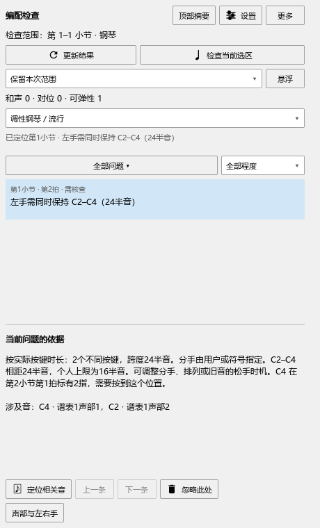

# 编配检查：后面还有换指时，什么时候能松手

这项修复已包含在 **0.129.0**，使用步骤如下；发布与后续检查见[当前进度](REWORK_PROGRESS.md)。

## 检查会怎样判断

一条延音线后面的音头如果写了换指或分手，检查会把它当作继续按住这个琴键的安排。在那个位置之前，计算会保留这个音，并说明需要按到哪里。后面的说明超出本次检查范围时，也会一起考虑。

例如，左手C4延续到下一小节，并在下一小节第一拍标了2指；本小节第二拍又要弹C2。检查会指出同时保持C2—C4的跨度，并补充：“C4在第2小节第1拍标有2指，需要按到这个位置。”这样可以结合谱上的换指安排，考虑换手、滚奏或调整配音。

## 操作例子

1. 选中需要检查的小节，打开“插件 → Arrangement Check”。
2. 在“声部与左右手”中核对实际分手，然后点“更新结果”。
3. 点一条跨度提示，在“当前问题的依据”查看相关音和后续换指位置。
4. 点“定位相关音”，到谱面查看这组音。修改指法、分手或音符后，再点“更新结果”。
5. 按Ctrl+Z撤销修改，再更新，提示会按恢复后的内容计算。

## 提前松手与保存

后续指定位置之后，可以继续结合踏板、实际松键和最短按键时间寻找松手办法。移动手位的可用时间也从符合这些安排的位置算起。

反复的每次出现分别检查。只检查延音中间的一段时，会读取前面已经生效的指法和分手。

指法和分手沿用乐谱原来的记号。按Ctrl+S保存，重新打开后点“更新结果”即可继续检查。实际播放音长仍在演奏编辑器中调整。

连续琶音与备选指法见[操作例子](ARRANGEMENT_ALTERNATIVE_GUIDE.md)，该批源码已检查，尚未安装。同音换指组合的时机继续完善；后续保持位置的检查见[本批记录](ARRANGEMENT_REQUIRED_CHECKS.md)。
