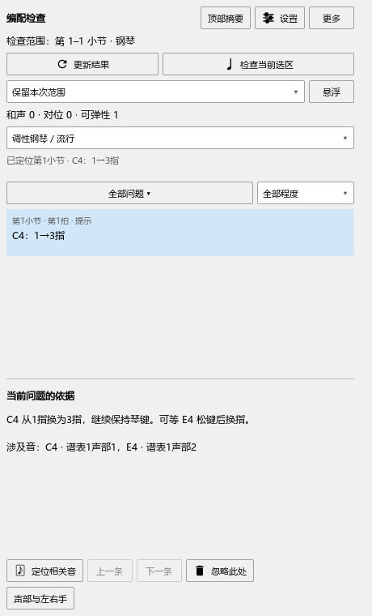

# 编配检查：同一个音上写1-3，怎样安排换指

本批源码已检查，尚未安装。当前程序仍为0.128.0，发布情况见[当前进度](REWORK_PROGRESS.md)。

## 看懂谱上的指法

| 文字 | 含义 |
|---|---|
| `1` | 用1指弹这个音 |
| `2(3)` | 可选2指或3指 |
| `1-3` | 起音用1指，按住琴键时换成3指 |
| `1-2-3` | 按住琴键时依次换指 |

检查会先看起音手指是否可用，再找后续换指的位置。另一根手指还按着音时，可以等那个音松键；需要借踏板腾手时，会把松手和换指放在同一条说明里。

## 一次完整操作

例如右手C4保持半音符，上面写`1-3`；另一声部先用3指弹短E4，稍后用1指弹G4。

1. 在C4的指法文字中输入`1-3`，给E4、G4分别标3指、1指。
2. 选中这一小节，打开“插件 → Arrangement Check”。在“声部与左右手”核对这两个声部都由右手弹。
3. 点“更新结果”。选择“C4：1→3指”，在“当前问题的依据”查看安排：C4等E4松键后换成3指，腾出1指弹G4。
4. 点“定位相关音”查看C4和E4。修改后再点“更新结果”；Ctrl+Z恢复刚才的修改。
5. 按Ctrl+S保存。重开后点“更新结果”继续检查。

## 换不过来时怎样处理

提示会写出哪根手指还在按哪个音。可以检查分手、改相关指法，或者在延音线后一个音头标出明确的换指位置。

如果准备借踏板先松开某个音，可以到演奏编辑器调整它的播放音长。检查中提出的松手与换指是一套建议，谱上的记号和播放设置由你在对应位置修改。下一组音也使用目标手指时，检查会继续比较等待的位置。

同一个琴键在多个声部出现时，共享这次按键和换指。两种不同的分手或指法同时写在这个键上时，可先核对相应记号，其余明确的音继续检查。

更长段落的指法路线、换手和配音比较接着在C3-B3处理。具体结果见[本批记录](ARRANGEMENT_SUBSTITUTION_CHECKS.md)。指法含义参照[Steinberg的指法输入说明](https://download.steinberg.net/downloads_software/Dorico/1.2.10/Dorico_1.2.10_Version_History.pdf)。
