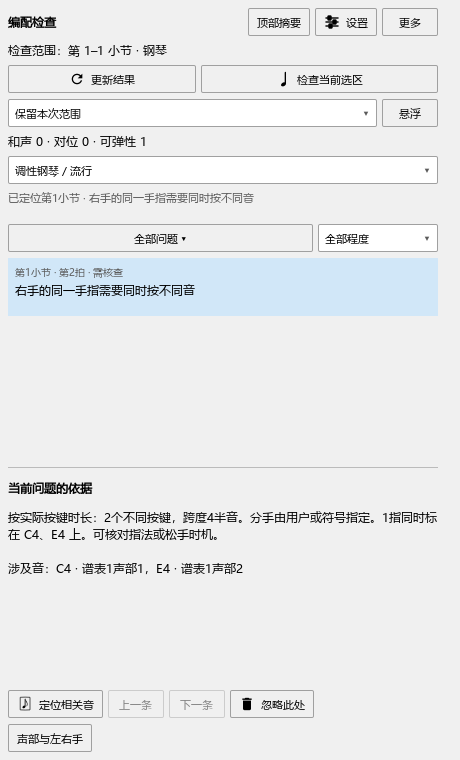

# 编配检查：延音中的换指与换手

本批源码已经检查，尚未安装。当前安装版仍为0.128.0，发布情况见[当前进度](REWORK_PROGRESS.md)。

## 延音中途换指

两个音头用延音线连着时，钢琴上是一次持续按键。你可以在后一个音头标新的指法，检查会从那里开始使用新数字；后面没有再标数字时，继续沿用前一个。

例如C4从1指换成2指，同时右手用1指弹E4，这两个手指可以分别工作。如果后半个C4也标1指，检查会提示“1指同时标在 C4、E4 上”。

1. 在后一个C4音头添加或修改指法。
2. 打开“插件 → Arrangement Check”，点“声部与左右手”核对分手，再点“更新结果”。
3. 点相关提示和“定位相关音”，谱面会选中后一个音头。
4. 改好数字后再次更新。按Ctrl+Z可以恢复刚才的指法。

## 延音中途换手

在后一个音头添加对应的分手记号，检查会从该位置使用新的分手。被交给另一只手的音，会退出原来那只手的占用记录。

这项变化保留原来的起音和松键；延音中的新数字或分手记号用于说明手怎样继续按着琴键。实际播放长度仍由演奏编辑器中的设置决定。

## 保存与查看

按Ctrl+S保存乐谱，重新打开后点“更新结果”。指法和分手保存在原来的乐谱记号中，反复的每次出现分别检查。点选段从延音中间检查时，也会读取前面已经按下的音。

同一按键上的连续跨度问题合在一起显示。换指位置、具体音名和定位使用对应的音头，方便直接修改。

后续换指与提前松手的配合见[操作例子](ARRANGEMENT_REQUIRED_GUIDE.md)，该批源码已检查，尚未安装。接着完善连续琶音和特殊指法文字。延音位置读取的结果见[本批记录](ARRANGEMENT_TIED_CHECKS.md)。
