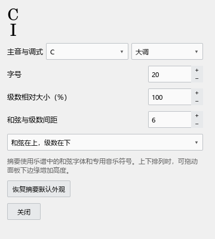

# 0.50 辅助面板与片段播放检查

## 这批操作

和弦助手：打开新谱后等待“已更新”，双击谱面记号打开修改区。拖记号主体改变显示位置；拖两端手柄改变音乐范围。检查面板同步、修正撤销和乐谱原有撤销记录。顶部与右侧分别打开，测试横排、上下排、外观窗口及屏幕边缘的“更多”菜单。

编配检查：点“更新结果”后点谱面空白、选其它音，再切到另一谱、返回。检查原检查范围与问题仍在。点击同位置的多个问题，谱旁浮窗逐条显示。关闭顶部摘要后右侧继续可用；关闭右侧后顶部继续可用；从插件菜单重新打开时恢复同一份结果。

原曲参考：导入音频，单击定位、拖出片段、拖数字改变速度、按空格播放暂停、按住空格拖波形平移。建立两条关联，选择“本次”采用的片段，直接删除并撤销。打开“内部对齐点”，选谱面音符、定位音频后添加，删除并恢复，再保存和重开项目。

试听：谱中效果与拟采用效果沿用同一拍位；开启循环，检查末尾休止也完整经过。一起播放分别检查音频先结束、乐谱先结束、两边结束后循环，以及停止后节拍器预备拍和乐谱循环原设置恢复。

## 界面截图

## 算法与声音输出检查

自动和弦参加持续冲突检查；共同的摩擦音、备选解释、经过音、挂留和短音用43个规则例子核对。和弦转位、人工范围和相邻范围调整由原有和弦测试共同检查。

八轨音频片段在同一个输出时钟混音，准备约82毫秒，检查过程最长输出回调约14微秒，缓冲共9437184字节。总音量在输出时应用，准备完音频后继续拖音量能立即改变结果。440 Hz测试音变速后约440.4 Hz。真实声音设备的八轨输出与循环检查通过。

这些数字来自本机短测试材料；长曲目的读取、密集谱面和实际钢琴录音仍需要分别观察。测试同时保留音频数据、时间位置和输出状态，声音细节可在日常材料中继续试听。

## 保存和文件

谱面和弦范围、手动位置保存在和弦助手分析中；音乐范围变化同步到面板和谱面。编配检查保留本次打开各谱的结果。音频关联与内部对齐点保存在工作区JSON中，音频文件保留原处。官谱与用户原始材料全程只读。

提交位置：personal-v0.50.0。窗口检查123项全部通过：演奏编辑器56项、P0导出23项、P1工具44项；另有12项音频检查和10份JS规则检查文件。

## 缩放耗时

| 谱中音符 | 关闭谱行带 | 开启谱行带 |
|---|---:|---:|
| 10080 | 19.098 ms | 20.153 ms |
| 50064 | 20.079 ms | 20.475 ms |

窗口大小和乐谱与0.48、0.49检查相同，数字包含原生谱面刷新。

## 安装后检查

独立0.50安装完成后，123项窗口检查再次通过，界面日志无未定义值错误。帮助中的个人版本和作者标识已核对；38份说明、310个本地链接和277处源码位置检查通过。
