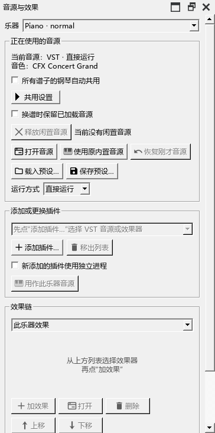

# 0.157 音源面板与 CFX 实际操作检查

日期：2026-10-31。固定任务 F-CFX；独立测试谱，用户原谱保持原样。

## 实际厂商操作

在正式安装的0.156中，实际点击CFX的PIANO、MAIN、STUDIO页，拖动厂商窗口，从谱面选音后返回厂商窗口，并拖动STUDIO主音量。窗口持续响应，页面及音量发生相应变化。

从面板实际载入Compact的00_Default.ariax，等进度结束后显示Player (Compact)。切回内置音源成功；恢复CFX后，保存的通道和插件设置正确，原面板仍显示SF2，关开面板后才显示CFX。截图见[操作说明](CFX_PANEL_157_GUIDE.md)。

## 复现与改动

- 谱行菜单：启动构造期间全局主窗口尚未赋值，菜单栏的上一层才是主窗口。旧检查得到两个入口；修正后沿控件父级找到所属主窗口，继续复用已保存的菜单和用户动作。
- 音源显示：旧定时检查只对插件版本、乐器列表和共用设置变化更新。原生通道的音色切换未触发这些条件，面板保留旧值。新增检查直接跟随选中通道的音源、音色和实例变化。
- 初次简化CFX检查及加入播放器后的恢复均通过；再加入正式MIDI事件入口与原生音色切换，旧实现的“打开音源”仍可用，重现状态遗漏。原始记录保留在P2/out/ui157。

## 修复后检查

修复后5个场景通过，Qt报告7项通过（含开始与结束）。覆盖启动菜单归属、CFX加载／SF2／恢复、原生音色改变与撤销、真实范围锁行、两件乐器分别恢复，以及厂商窗口和参数改变时保持同一实例。用的是正常Windows绘制。

新0.157程序再次实际点击“使用原内置音源 → 恢复刚才音源”。加载结束后原面板直接显示CFX，打开按钮可用；点击后出现00_Default、Player (Compact)，主音量保持此前调整的位置。保存后标题星号消失，文件通道为KumoVST，配置中为CFX。视图菜单实际只显示一个“谱行锁定”，原始标识消失。

编译使用原E盘目录，音频引擎及MCP继续沿用现有组件。复现日志ui157-before-pluginhost.txt、ui157-before-patch-pluginhost.txt；通过日志ui157-after-pluginhost.txt。

## 后续实机项

Synthesia长片段的暂停重播已补查。Mi Monitor上的SF3、CFX实际输出、停止与曲尾见[声音检查](AUDIO_OUTPUT_157_CHECKS.md)。实体MIDI录制和真实音乐的连续听感继续按[完整进度](REWORK_PROGRESS.md)安排。

## 完整包与原目录安装

完整包2706个文件逐项校验通过，带MCP2.7.2和235份操作说明。独立路径启动后，随包exe在PATH中没有Python的环境完成连接检查、44项工具目录、16音完整读取、实际演奏、原生谱图与继续同一范围。

MIDI为599字节，与原安装0.156逐字节相同；PDF为18760字节、一页，与此前文件摘要相同。导出检查第一次启动早于测试谱准备，提示文件尚不存在；准备完成后正常导出并完成核对。

用户退出后，原安装目录已更新到0.157。主程序SHA-256：`aa1b151f2507c9a51f8145191b1cb34531f51e76ae366b6ae2541c32ad7029ee`。kumo.ini、Qt5Qml、Qt5Quick、MCP指针与运行程序保持原校验值；原0.156已备份。

ZIP为128941072字节，SHA-256：`72add866743a7e47b5782a22c3cfaba4842aba07f79b38a06e062c69b5213c06`。0.156包保留；本次源码定位personal-v0.157.0，打包记录定位personal-stable-v0.157.0。安装及独立路径记录在P2/out/ui157与P2/out/releases/0.157.0/checks。
