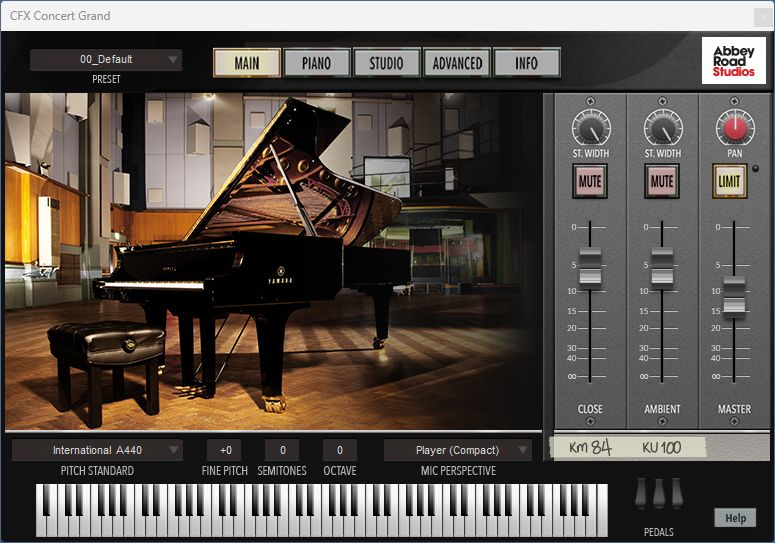

# CFX、内置音源与当前面板

适用版本：0.157.0。打开“视图 → 音源与效果（VST）”，在最上方“乐器”中选钢琴。

## 载入 CFX 并调整声音

1. 点“添加插件…”，选 CFX 的 x64 DLL；列表选中 CFX 后点“用作此乐器音源”。
2. 点“打开音源”进入厂商窗口。第一次需要载入钢琴，可点本面板“载入预设…”，选择 `02- Compact/Player/00_Default.ariax`。
3. 等待钢琴载入后，厂商窗口显示 `00_Default`、`Player (Compact)`。MAIN、PIANO、STUDIO 是厂商提供的页面，可直接点击和调节。
4. 拖动厂商窗口标题栏可移动窗口。回到谱面选音后，再点击厂商窗口可继续调整。
5. 保存 MSCZ，保留当前音源和参数。

## 切回内置音源，再恢复 CFX

点“使用原内置音源”，当前乐器改用先前的 SF2／SF3 音色。上方会显示“内置 SF2／SF3”，厂商窗口关闭。

点“恢复刚才音源”，重新载入这件乐器刚才的 CFX 和设置。上方显示“VST”与 CFX 名称后，可继续点“打开音源”。恢复完成后面板会自动更新，保持当前窗口位置。

每次切换可用 Ctrl+Z 撤销、Ctrl+Y 重做。保存后重开，按谱里保存的音源继续使用。共用钢琴的操作见[所有乐谱共用钢琴](COMMON_PIANO_108_GUIDE.md)。

## 本次更新与程序位置

0.157补齐原生音色改变后的面板更新，同时整理“视图 → 谱行锁定”的启动入口，保留原来的音源与窗口布局。

原安装位置继续使用：`msvc.install_repair_current_x64/bin/MuseScore3Evo.exe`。完整包与检查结果见[本次记录](CFX_PANEL_157_CHECKS.md)，0.156稳定包继续保留。

提交定位：personal-v0.157.0。
