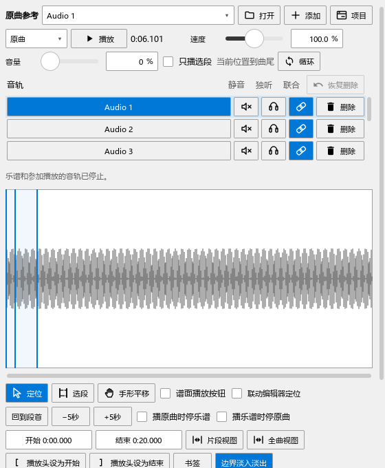

# 多谱播放、和弦显示与扒谱区域

0.126修复反复显示和弦积累内存、打开原曲声音设备时界面停顿的问题。演奏编辑器、滚轮力度、和弦显示和原曲的原有操作继续使用。

## 一边看谱，一边听原曲

1. 打开“原曲参考”，选择一条录音，用“原曲”播放它。准备声音设备时会显示“正在打开声音输出…”，此时可以继续选音、缩放和操作面板。
2. 需要比较谱段时，选择已有的关联，再用“一起播放”。再次点击停止，之后可以从同一片段重新开始。
3. 普通听原曲使用“定位”工具；要改变选段时切换“选段”。“只播选段”和“循环”分别控制范围与重复。详细步骤见[原曲操作](PERFORMANCE_REFERENCE_123_GUIDE.md)。
4. 随时可停止。准备过程中停止后，原任务会取消；再次播放使用这一次选定的材料。

图中八条测试音轨可分别参与联合播放；普通播放从当前音轨的位置继续。“定位／选段／手形平移”和互停开关在波形下方。

## 扒谱时保留力度区

在“扒谱”页点“区域”，展开“力度／速度／踏板”，勾选“显示这个区域”。之后切到“演奏编辑”再回来，会保留扒谱页的开关。关闭方法在同一位置；各区域仍能拖动分隔条、移出和放回。

## 多谱与和弦

可以继续在多份谱之间切换、画力度和缩放。和弦显示现在及时释放生成文字和图像时用的临时资料。演奏试听、另一写法对比和编配建议的独立副本也在结束后释放各自的临时资料。

关闭整个和弦助手，使用“视图 → 和弦助手”或对应工具栏按钮；摘要、详情、谱面记号及着色一并结束。再次打开恢复个人显示设置。[关闭与恢复的步骤](PERFORMANCE_REFERENCE_123_GUIDE.md#关闭和弦助手)。

检查数据与尚在继续的性能工作见[本轮记录](COMBINED_GUI_126_CHECKS.md)，完整顺序见[当前进度](REWORK_PROGRESS.md)。
