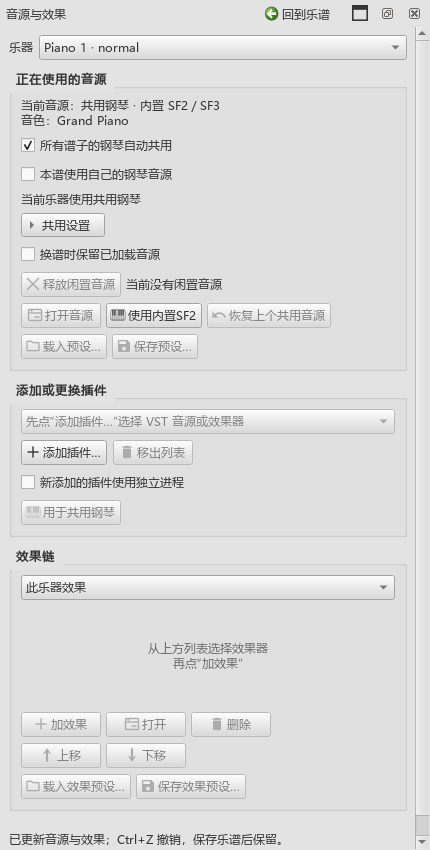

# 0.108共用钢琴检查

## 实际操作

本批完成B5-S2：各谱钢琴自动共用声音，每份谱可切回自己保存的音源。操作见[共用钢琴](COMMON_PIANO_108_GUIDE.md)。

在两份独立测试谱中实际打开原生面板，勾选共用、换谱、切回本谱、保存、关谱、重新读取，并撤销重做。多架钢琴同时弹同音后分别释放，另核对踏板及闲置期间的处理次数。非钢琴继续使用自己的音源。

混音器继续使用原音色框，显示当前共用音源。从弹出列表选择其它音色后，本谱改用自己的声音；一次撤销恢复共用和原音色。长名称的窗口最小宽度没有增加，隐藏后重新打开也会更新。

## 发现并修复的问题

CFX保存预设时，两个带名称的混响附件会交换顺序。内容和参数相同，但原先的比较把它们当成不同预设，导致换谱时重新创建第二架钢琴。本批按附件名称核对内容，保持实际效果链顺序、参数及声音数据；参数变化仍会正常更新。

CFX参数修改、撤销、重做、保存、导出准备和A→B→A之后，两架钢琴的实例均保持。原厂窗口在参数操作后仍可继续使用。

旧操作补查还发现：读取独立音源的所属关系时，误写了一个空字段，造成连续保存增加撤销记录。现已让查询保持资料原样，连续两次保存后撤销位置保持，CFX窗口和音源实例继续可用。

共用音源路径缺失时，面板给出原因并继续用本谱音源；“使用内置SF2”恢复共用，“恢复上个共用音源”和撤销都已检查。失败实例没有进入闲置列表，失败声音也没有写成已成功使用的快照。

## 声音、文件和速度

| 检查组 | 结果 |
|---|---|
| 共用实例、面板、混音器、缺失恢复、效果导出、CFX连续保存、版本 | 10项通过，0失败，69.365秒 |
| Pianoteq／CFX预设保存载入、SF2切回和恢复、换谱及窗口 | 4项通过，0失败，63.408秒 |
| Pianoteq／CFX独立进程、按键踏板、换谱和独立导出实例 | 4项通过，0失败，64.724秒 |
| 关闭个人扩展后普通SF2播放与保存 | 3项通过，0失败，6.494秒 |
| 原有SF2／VST选择、效果预设、参数与乐器列表 | 8项通过，0失败，82.844秒 |
| 每谱实例保留、尾音清理及两种进程方式 | 12项通过，0失败，60.595秒 |

各组数量包含Qt的初始化和收尾。

Pianoteq在独立进程检查中首次准备约5294ms、换谱4ms；CFX约8087ms、94ms。另一次程序内CFX准备3571ms、换谱92ms。计时对应本机、两架钢琴和测试预设；实例身份、输出声音与预设另外读取核对。

实际从面板添加、排序、删除效果，调增益、保存和载入效果预设。增益为零时，正常音频导出的峰值为零；恢复预设后有声音。导出期间当前播放实例保持，普通MIDI前后字节一致。

乐谱文件读回共用声音快照、本谱原音色与自用选择；正常保存保留撤销位置。普通3.6.2打开并重新保存测试MSCZ后，音符、时值和MIDI音符事件一致，源文件校验值保持。

原始结果保存在插件工作区：`P2/out/common-108-final-pluginhost.txt`、`common-108-preset-pianos-pluginhost.txt`、`common-108-isolated-pluginhost.txt`、`common-108-off-pluginhost.txt`和`common-108-stock/report.json`。

## 剩余检查与顺序

原有音源和实例保留操作已复查。本批声音读取来自实际软件输出；实体键盘、声卡听感和完整音乐片段继续放在B5／F。之后依次处理C音乐判断、D记谱、E AI与分享、F完整编曲过程。
