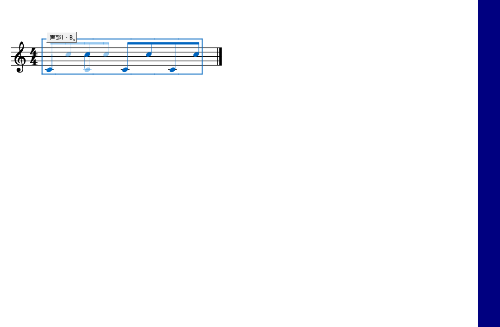

# 0.52 写法和MIDI音长比较检查

2026-10-17，Windows x64、Qt 5.15.2。安装目录：msvc.install_repair_0_52_x64；提交标签：personal-v0.52.0。

## 写法对比与组合

实际打开面板，勾选显示差异，点变化列表定位，再用谱面按钮上的Ctrl+滚轮换写法。音高和力度变化出现在列表，另一写法以淡色叠加；缩放后按当前谱面的音符位置绘制。符杠各段使用对应起音位置。

两个声部分别保存A/B，保存组合、切换组合、整组撤销和重做均通过。保存MSCZ重开后，组合仍在。另行读取MSCZ中的普通乐谱入口，确认它显示主方案；本分支重开恢复正在编辑的组合。导出普通版副本读回后只有所选乐谱。

试听比较使用真实Seq与可记录输出的测试设备。切换后从同一谱段开始，B的指定力度112进入播放事件；标签页数量保持。

## MIDI音长编辑与试听

鼠标拖动实心条尾端后，当前导出设置得到手动松手点；快速拖动后立即松开也保存最终位置。保护音、踏板边界、最短按键时长、恢复原长度和固定种子重复计算均检查通过。手动恢复原长度后，详情会更新对下一组音的说明。

打开演奏编辑器音长窗口，再返回导出，原编辑器父窗口和可见状态恢复。整个操作保持原谱内容、撤销位置和标签页数量。最终MIDI与按相同参数、手动点独立生成的文件逐字节一致。

原／新试听核对了实际播放事件：起音帧一致，候选的松手帧提前；切换保持当前拍位。反复出现的音使用各自导出位置匹配。顺带修复P键盘从未打开时清理播放音符的崩溃。

## 整组检查

演奏编辑器62项、P1工作流49项、P0工具23项，共134项窗口与文件检查通过。P0使用当前SF3渲染两段材料，处理前后最大样本差为0。完整输出位于插件仓库Repairs/out/repair-052-final-*。

说明第13、14章按新按钮重写；本轮0–12项答复见[逐项说明](REPAIR_048_052_DELIVERY.md)。

## 安装后复查

安装版再次通过134项检查。关于窗口显示Kumo branch / Freddd13 · v0.52.0。另有8份JavaScript规则检查通过。

返回导出窗口后，新长度继续使用清楚的强调色；图像检查核对选中音与背景的对比。叠加开启后，停着不操作时保持空闲。

四分音符与八分音符的写法叠加、缺少起音处的插值位置、符杠、窗口大小变化和Ctrl缩放已用独立乐谱检查；源谱内容与撤销位置保持。对比绘制按可见谱行取变化，当前几何位置在绘制时读取。

| 谱中音符 | 关闭谱行带，Ctrl缩放95%耗时 | 开启谱行带，Ctrl缩放95%耗时 |
|---|---:|---:|
| 10080 | 19.610 ms | 16.722 ms |
| 50064 | 19.247 ms | 17.879 ms |

这些数字包括原生谱面刷新，使用与前几批相同的乐谱和窗口大小。初次写法对比会建立排版副本，内容未变时继续复用；缩放读取当前可见谱行。
