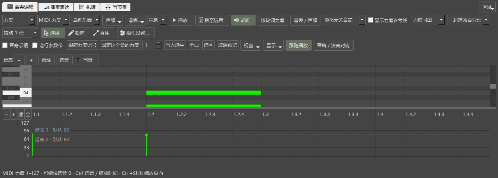
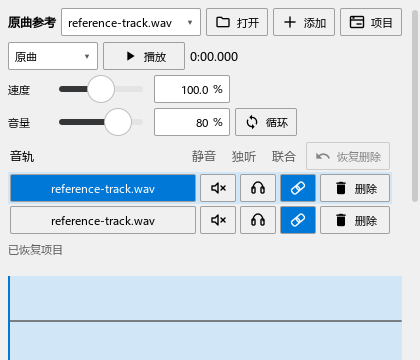

# 组件图标和音源面板检查

日期：2026-10-23。版本：0.92.0；发布定位personal-v0.92.0。

## 图标与加载

补齐编辑器播放、定位、试听、选择／铅笔／直线，扒谱、写节奏、卷帘草稿、原曲、演奏表达、和弦修改、编配检查／建议、试写、AI连接和MIDI音长对比的常用操作图标。主要文字和原有动作保留。

优先复用MuseScore已有图形；录制、停止、独听、静音、手形和窗口等在独立的toolicons模块提供。原生按钮随所属面板调色，QML按钮采用同一图标来源和主题颜色；图标没有后台分析任务。

实际截图发现窗口图标用了程序标志、手形用了播放平移符号，已分别改成窗口和手掌。原曲“恢复删除”加图标后文字被截短，改为按完整名称给宽度。

第一次QML同步写到了未被程序读取的位置，截图仍是旧按钮。已把本轮误写的五份文件移至E盘检查目录，修正为share/workflow/panels中的真实页面，并同时更新保留插件所用的公共控件。实际页面中的静音、独听与参加播放属性加入检查。

实际加载还发现循环开关收到按钮专用属性、图标颜色与来源互相触发更新，均已修复。最终页面检查未出现属性错误、图标读取失败及更新循环。

## 正常窗口操作

按用户要求使用正常显示大小，检查常用窗口及较窄窗口。

- 原曲：实际点击静音、独听、参加播放，删除和恢复两条音轨；拖速度、音量滑块，窄窗继续可见并可滚动。
- 演奏表达：目标范围、MIDI输入、设置、导入和录制入口实际加载；停止、使用结果与数量保持原来的状态逻辑。
- 和弦：人工范围在设置折叠时可用，外观、双窗口和恢复设置继续检查。
- 编配检查：读取选段、筛选、定位、谱旁说明、忽略和返回全谱继续检查。
- 写节奏、扒谱：按自然宽度排列；区域移出、放回、切页及高度保持继续检查。
- 完整谱试写：另存后的路径与保存、A/B切换和删除恢复继续检查。

12组操作及准备、结束共14项通过：`P2/out/components-092-final-pluginhost.txt`。图标中英文含义见[操作说明](COMPONENTS_092_GUIDE.md)。

组合窗口另行回查：编曲、DAW、雕版、后处理往返两次后，编辑器仍为523像素，内部比例仍为0.400；原曲、和弦和混音器共同打开时保持可用。日志：`P2/out/components-092-layout-pluginhost.txt`。

## 音源与导出回查

音源面板分成当前音源、添加或更换插件、效果链三组；切回内置音源与恢复位于第一组。空列表仍提供添加入口，当前音源明确显示内置SF2／SF3或VST及音色。

6组音源操作及准备、结束共8项通过：逐乐器切回和恢复、效果预设、参数窗口、首次扫描及声音、主输出范围、乐器增删。SF2切回前后实际输出峰值为0.990011与0.99。日志：`P2/out/components-092-sources-pluginhost.txt`。

MIDI音长窗口按原来的拖动、试听、撤销和返回步骤回查，见`P2/out/components-092-export-p1native-run.txt`。

更深入的音乐片段、真实键盘、音源共用与踏板继续按B5推进。A4剩余部分是密集数字与谱行带的正常使用整理，之后进入B组。
