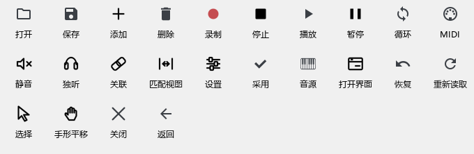
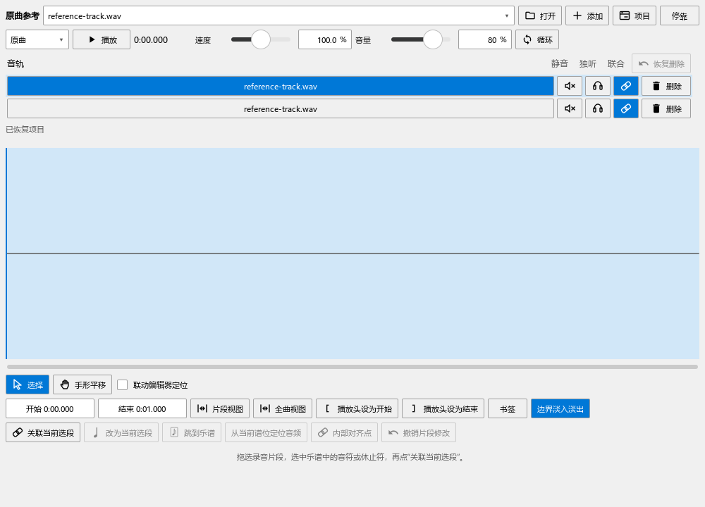
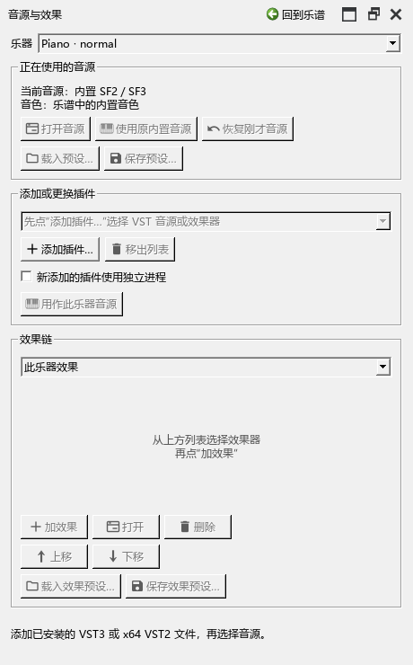

# 工具图标与音源面板

适用版本：0.92.0。菜单、快捷键和各工具原来的操作继续使用。

## 通过图标找到常用操作

文件夹用于打开文件，软盘用于保存；圆点是录制，三角是播放，两条竖线是暂停，方块是停止。箭头用于恢复，垃圾桶用于删除，勾号用于使用结果。窗口图标打开另一个操作界面，滑杆图标打开设置。

编辑器、扒谱、写节奏、原曲、演奏表达、和弦修改、编配建议、试写和MIDI音长对比采用这套含义。主要按钮保留文字，指向按钮可查看原有操作说明。

## 原曲音轨上的三个小按钮

- **喇叭带叉：静音。** 点一次收起这条音轨的声音，再点一次恢复。
- **耳机：独听。** 联合播放时只听被设为独听的音轨；再次点击取消。
- **链环：参加联合播放。** 蓝色表示这条音轨参加“一起播放”；再次点击退出。

右侧“删除”移除这条音轨，“恢复删除”放回刚刚移除的内容。选择、手形平移和循环继续在波形附近操作。完整的关联与播放步骤见[原曲比较](REFERENCE_081_GUIDE.md)。

## 音源面板按三块操作

打开“视图 → 音源与效果（VST）”，先在最上方“乐器”选钢琴。

1. **正在使用的音源：**查看当前音源和音色，打开音源窗口，载入／保存预设。想用回改选VST前的内置音色，点“使用原内置音源”；“恢复刚才音源”放回刚才的VST设置。
2. **添加或更换插件：**点“添加插件…”选择本机VST文件；选列表里的钢琴，再点“用作此乐器音源”。这里也能添加稍后要用的效果器。
3. **效果链：**选择“此乐器效果”或“主输出效果”，然后添加、打开、排序或删除效果。预设按钮对应本组中选中的效果。

当前使用的音源显示在第一块，插件列表用于选择接下来要载入的内容。每次切换可用Ctrl+Z恢复，保存MSCZ保留声音设置。完整例子见[使用Pianoteq、CFX和效果](VST_088_GUIDE.md)。

面板可以悬浮、全屏和返回原位置；窗口较小时滚动查看各组。关闭面板后，乐谱继续使用当前声音。
