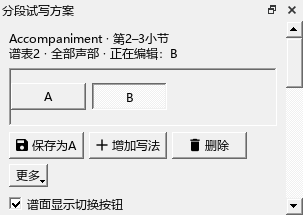

# 连续编曲与分段试写 · 0.147.0

## F-C1-A实际过程

使用一份独立八小节钢琴谱，以及《如果有来生 release5》的只读副本，连续完成：

1. 打开编辑器，在有音符的钢琴下谱表建立两小节A/B。
2. 在编辑器把A中一个音设为固定力度74；在B里升高该音，并改为93。
3. 反复点A/B，逐音核对音高、拼写、时值、逐音演奏、指法及实际MIDI；踏板保持。
4. 从这一段播放，再停止；切DAW及编曲视图，依次打开编辑、表达、扒谱和写节奏页。
5. 另存MSCZ，关谱重开，再切A/B。把B的力度改为86，撤销、重做，再切写法及正常保存。
6. 分别导出A/B的MIDI，检查文件位置与当前谱保持；再次核对谱面按钮、面板当前项和编辑器数值。

真实谱有六个谱表，主要音符位于中间两表；检查按实际声部位置进行。源文件SHA256始终为4a62cc33723b1c19a207102f27425c983e9fd40d570a2ff65d7a818b82ac91ad。

## 找到并修复的界面问题

原侧栏在303像素宽时出现17像素横向溢出，部分按钮需要横向滚动。主要操作、组合及试听行改为自然宽度并按组换行。实际检查回到相同303像素宽度，横向溢出为0。

截图还暴露较矮侧栏中A/B切换排在下方的问题。当前范围和A/B切换已放到顶部；已有方案时收起首次使用说明，“更多”保留使用说明入口。新建第一份写法名为A，当前状态由实际选择显示。旧名称继续保留。

## 最终文件与普通版

独立读取两个MIDI：独立谱64个音、2个踏板事件；实际谱2310个音、310个踏板事件。A中所改音的力度为74，B为86；其它控制事件相同。

普通MuseScore3.6.2实际打开、重存两份MSCZ，再导出MIDI。主方案的音高、时值、力度及控制事件与本分支导出的A一致。RPN与反复选项统一后逐项比较。原MSCZ文件校验保持。

普通版显示指定的主方案。本分支保存全部写法与当前选择；分享时仍可从“更多 → 导出普通版副本”选择当前组合或主方案。

## 其它检查与下一项

默认绘制下，两份连续流程、工作视图、删除整组与恢复、帮助操作共7项通过；原有踏板、链接分谱、跟随和完整播放6项通过。原始记录为插件仓库P2/out/composition147-ready-pluginhost.txt、composition147-regression-pluginhost.txt及composition-compatibility/report.json。

F-C1-A完成后接F-C1-B：把写法同处试听、演奏对应、参考音频、频谱和和弦放入同一流程，继续核对范围、声音对象、再次播放和保存；F-C1-C再连贯检查排版、打印与后处理。SF3首次样本准备、实体键盘／声卡／CFX及当前进度中的E2-W2、E4选择、F-W144继续保留。

## 安装

0.147已更新到原程序目录；正式程序导出PDF为7446字节、MIDI为181字节。个人配置、Qt绘图组件和MCP2.7.1保持。
