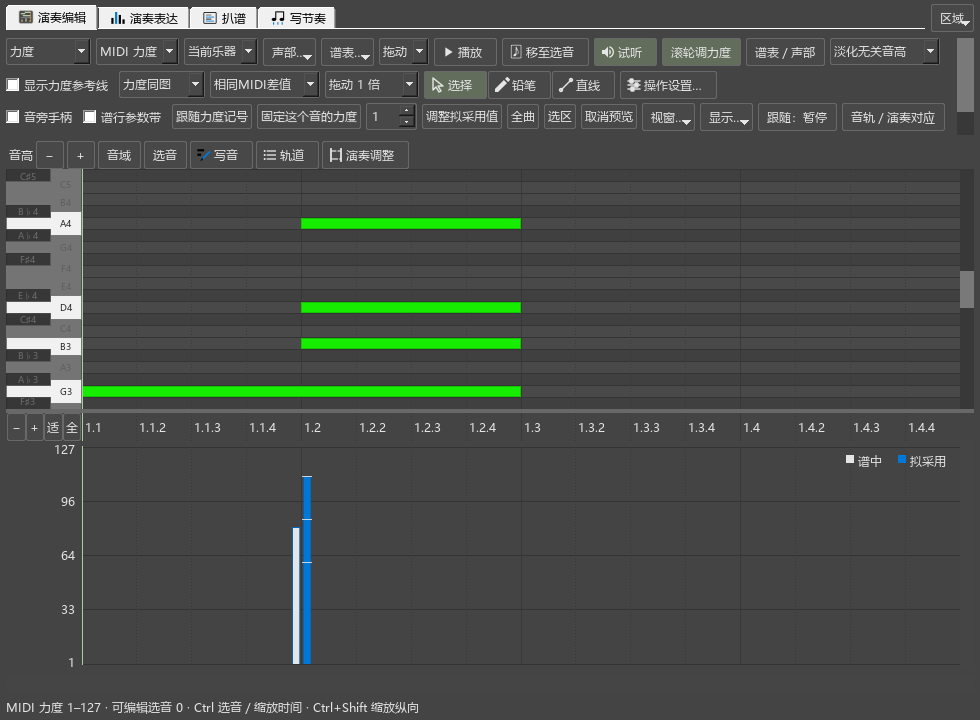
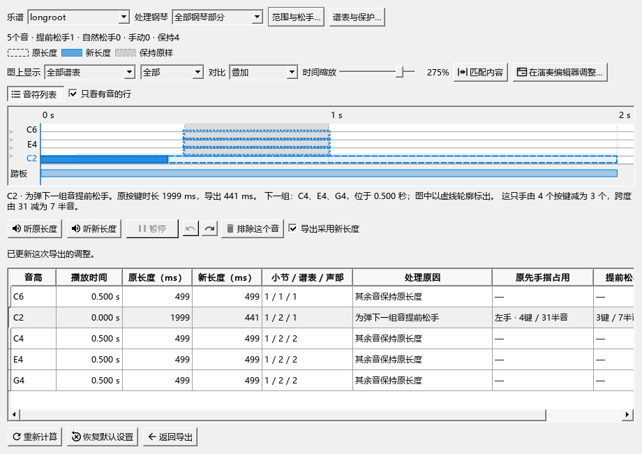
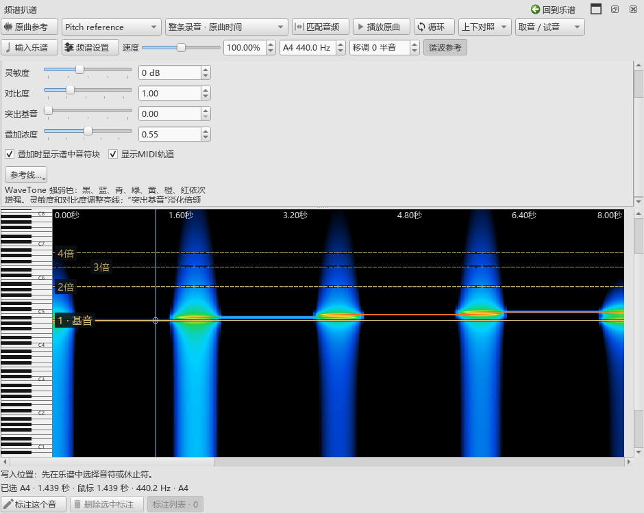

# 全部近期功能的使用检查

2026-11-08，从0.166.0开始检查，首次工作视图修复进入0.167.0。范围包括此前01—33项和最近N1—N9。

## 这次找到并修正的问题

上次保存“后处理”视图，启动期间明确打开“编曲”和编辑器，随后延后的启动恢复又切回后处理，编辑器随之隐藏，第一次力度操作无法生效。

现在，明确选择视图后就采用这次选择。启动恢复只在尚未选择时运行。已有的各视图布局、区域开关和个人比例继续保留。

使用独立钢琴谱和《如果有来生》只读副本，分别完成第一次打开、改音高和力度、A/B切换、踏板增改、播放停止、视图往返及保存重开。两份写法和踏板均保留，第一次选定的编曲视图保持显示。源码在 `mscore/workflow/workspaceviews.cpp`，发布定位为 `personal-v0.167.0`。

## 检查怎样进行

使用完整原生窗口、当前发布页面和媒体模块；将个人编辑器／工作视图设置复制到独立目录。通过实际控件完成选音、拖动、试听、采用、撤销和保存，结合截图、重新读取的乐谱、MIDI及声音输出核对结果。用户原谱和工作区只读，检查文件保存在E盘。本轮未使用桌面自动操作。

## 此前01—33项

| 项目 | 本轮实际过程与结果 |
|---|---|
| 01 工作视图、停靠和尺寸 | 修正上述首次恢复问题；编曲／DAW／雕版往返保留侧栏宽度、编辑器高度和内部比例；编辑器展开超过半屏，拖分隔条、浮动及放回可用。 |
| 02 图标、主题和入口 | 核对菜单与工具栏动作、图标来源及工具页；查看浅色原生窗口和深色编辑器画面。主要按钮按内容宽度排列，长设置可滚动。 |
| 03 编辑器选音 | 连续编曲、重叠目标、筛选、Esc及换谱后的选择与谱面对应。直接拖动和后续修改保存到所指音。 |
| 04 力度显示和同时调整 | 不同谱表按各自参考力度换算；同图显示、原值／新值实心柱、固定和跟随保存、采用与撤销一致。 |
| 05 音旁力度与滚轮 | 连续多音滚轮后换音、继续修改、提交和撤销；播放中输入与Home操作；Alt+Q按住持续显示，自动重复松键保留显示，真正松开后按设置收起。 |
| 06 谱行带 | 跟随选中谱行、密集数值、改力度及拖高度；带与音符位置对应，原生选音保留。 |
| 07 MIDI导入和对应 | 实际巴赫演奏547组专家对应全部接上；肖邦第17—20小节115组中108组位置正确，80组可直接采用，直接采用部分未出现错误对应。装饰音和需核对的位置可点选校正。 |
| 08 实时录制 | 软件输入完成录制、停止、显示16个对应结果、采用及撤销；既有跨谱录制和最近录音找回记录继续保留。实体键盘见下方安排。 |
| 09 表达试听、采用和恢复 | 谱中／拟采用效果同拍位切换，按音和选段采用力度／速度，剩余项目继续处理；保存值与候选一致。 |
| 10 原曲单轨和多轨 | 当前面板与连续编曲一起使用；多轨混音、静音独听、删除恢复和保存沿用已有实际输出记录，当前联合播放与停止再次操作。 |
| 11 片段和谱段关联 | 谱段范围、反复次数、音频位置与内部对齐点共用资料；谱面范围和控制按钮已操作，关联在播放后仍可使用。 |
| 12 一起播放 | 编辑器、原曲和谱面联合试听，手动停止、再次播放及控件间交叉停止；停播后符号面板和原曲按钮可点击。 |
| 13 频谱显示和听辨 | 当前轨道、共同时间尺、设置滑块、琴键强调和有编号的倍频线已查看；整首／片段、缓存和调律沿用已有结果，右键试音路径回查。 |
| 14 频谱标注和输入 | 标注音高、目的谱位及输入；连续写入、撤销、调律和MIDI叠加对应当前时间。 |
| 15 和弦识别和编辑 | 直接打开、换谱、所属／实时切换；三／七和弦转位、低音变化、踏板残音及拼写例子；名称与级数读取同一解释。 |
| 16 和弦显示和着色 | 顶部／详情／谱面、稳定高度、独立关闭；范围拖动撤销、记号主体移位与范围分离。关闭全部显示后清理谱面临时内容。 |
| 17 编配检查 | 使用实际音长与角色分析，查看范围、分类数量、具体音名和谱旁说明；持续音、踏板释放及低音程提示分别呈现。 |
| 18 指法、分手和建议 | 生成配音候选、选中查看差异、采用、撤销和重开；改变分手／角色设置后，当前可采用状态及时变化。 |
| 19 分段写法与完整谱写法 | 两类写法均完成修改、切换和重开；组合、差异、删除恢复及链接分谱回查。原有和新加踏板保存。 |
| 20 MIDI松手及左右手导出 | 实际窗口改手、撤销重做、恢复自动、导出文件；松手前后形状、踏板、提前释放原因、排除恢复及最终参数一致。 |
| 21 给定音高写节奏 | 原音长、休止、延音和三连音；修改草稿、连续采用及撤销，录制资料可找回。 |
| 22 卷帘写作和草稿 | 画音、实际起止、独立音长、声部和跨拍写谱；保存重开与连续修改已检查。 |
| 23 VST与SF2 | 本机Pianoteq首次扫描、载入、实际声音及切回SF2；共用钢琴、播放中切换运行方式和同拍位继续。CFX厂商窗口与Mi Monitor输出沿用0.157实机记录。 |
| 24 效果与预设 | 当前乐器效果／主输出范围、参数、预设及撤销；切回SF2后的声音和配置保持。 |
| 25 自动规范时值 | 从实际输入动作建立两个4/4例子，检查附点四分后的改时值、3-3-2、延音、符杠和符干；手动设置、撤销和保存保留。 |
| 26 Tap、rit.、a tempo | 读取用户旧工作区副本，连续载入后rit.和a tempo各一个；Tap拍单位、预览取消和保存；六种rit.范围覆盖行末、跨行及谱尾，实际拖端点和重开。 |
| 27 自由圆滑线 | 两端异侧、跨谱表、途中换表和密集多行；节点与切线拖动、锁定、整理、撤销和重开；查看实际曲线形状。 |
| 28 分手记号 | 四方向默认、音后结束位置、线间／加线与和弦内音；文字独立操作、检视器、拖点、撤销和保存。 |
| 29 琶音、小音符、轻重音、颤音／震音 | 检视器、预览与提交、原生演奏值和保存；本轮补查琶音、倚音和轻重音，颤音／震音沿用未改变的整段MIDI记录。 |
| 30 字体和锁行 | 当前锁行动作及范围；真实谱的原生输出、普通版往返、字体与PDF沿用0.138／0.153及0.166原图比较。 |
| 31 AI与Codex | 当前身份、原生谱图及候选状态、采用和撤销；随包2.7.2与当前Codex44项工具的连接记录继续使用。用户程序关闭时连接显示未连接。 |
| 32 扩展开关与插件 | 重载用户插件；关闭扩展、保存带写法／演奏／踏板／原曲资料的谱，再开启读取；音符、各写法及关联保留。 |
| 33 说明和发布 | 实际帮助窗口的章节、返回与查找；累计说明和本轮结果随0.167提供，安装保留个人配置。 |

## 最近N1—N9

| 项目 | 结果 |
|---|---|
| N1 日常操作 | 倚音间距、长按力度、键盘鼠标释放、Home与连续滚轮已核对。 |
| N2 原生混响 | Kawai SF2在普通合成器和独立乐器效果两条路径，CC91最小／中间／最大值均改变实际混响尾音。 |
| N3 上游适配 | 本轮未扩大合入范围；已批准的五项及57项提交报告保留，原有播放和导出共同回查。 |
| N4 多轨MIDI | 导入／新建、编辑、偏移及内部对齐、实际声音、删除恢复、保存与采用草稿已操作。 |
| N5 演奏起止 | 移动起音、改松键、恢复与实际MIDI对应；记谱时值保留。 |
| N6 频谱 | 固定块、显示设置、共同时间、倍频／键盘及MIDI叠加已查看；已分析图像复用原有数据。 |
| N7 关联控件 | 分体播放／停止、选择、范围、移位及撤销；停播后再次操作可用。 |
| N8 动态乐谱 | 实际工具入口、正常及较小窗口的预览、拖时间、定位、关闭重开；0.166真实谱原图比较和MP4／透明MOV输出继续有效。 |
| N9 AI实现说明 | 完整44项工具、内存谱与原图、候选及采用已有专章；本轮回查原图和建议状态。 |

## 实际画面

同音力度对比：原值与拟采用值在同一谱位显示，采用按钮与候选数同步。

MIDI松手窗口：原长度、拟采用长度、踏板及下一组音同时显示，详情解释具体释放原因。

频谱设置：控件按作用分组，倍频线和编号位于图像上层。

## 对检查记录的修正

旧检查有几处准备与当前界面不同：个人卷帘已收起；原曲与编辑器已放进同一个标签组；各视图分别保存宽度；独立净谱操作需要先建立完整窗口。已按实际打开顺序准备，再执行对应操作。长按检查补齐了设置窗口关闭后的Windows焦点恢复。

这些调整保留了产品中的个人布局和真实失焦处理。首次工作视图覆盖则已修改产品代码。开发原始资料位于插件仓库 `P2/out/usability-167`，包括画面、乐谱、MIDI、声音数据和分组记录。

## 接下来的固定安排

1. 实体MIDI键盘接入后，补查连续录制、实时位置、设备断开和延迟；按用户此前安排继续等待连接。
2. 使用当前音源检查真实音乐的表达、踏板与较长多轨片段听感。机器输出及已完成的CFX／Mi Monitor操作继续保留。
3. 在现有AI报告上讨论数据组织及下一批交互。自动音符候选、音频和弦、自由演奏转谱、完整雕版与后处理按原计划继续；淡化非旋律音量保留待讨论。

0.167.0已更新原安装目录，个人配置保留。实施提交`58e4dd62cba2be53c699f52cd88e1523ca9a2a5d`；程序SHA-256为`4169f9185b0bade595c0805ab69ab17cc35013a3a3ff0558e144cb2f31d14f3b`。累计功能说明与本轮完整检查已随程序更新。
