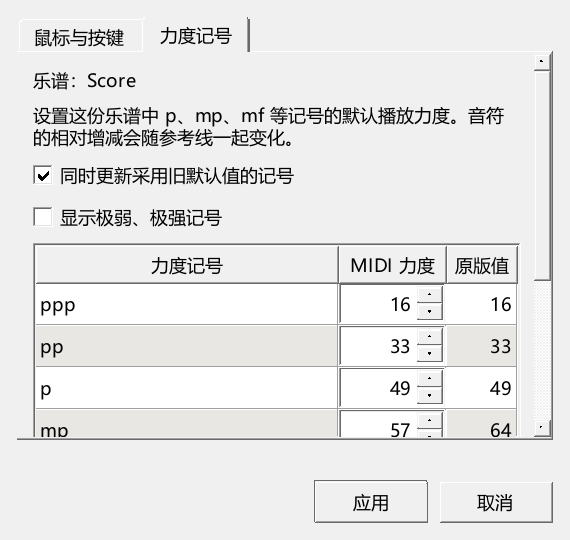

# 力度默认值与设置窗口检查

对应0.82.0，材料、输出文件和临时目录均放在E盘。用户原谱与官谱保持原状。

## 按实际操作核对

| 操作 | 结果 | 插件仓库P2/out中的日志 |
| --- | --- | --- |
| 两谱表默认值、逐音固定／相对力度、旧文件、旧面板格子、文件重开、撤销和重播，原有滚轮与力度显示 | 11项操作通过，含准备与结束共13项 | dynamics-082-palette-verified-performanceeditor-run.txt |
| 正常主窗口首次显示、内嵌／悬浮表达保存、原曲关联 | 4项操作通过，含准备与结束共6项；绘图警告0条 | dynamics-082-release-window-nativeui-run.txt |
| 统一滚动后的窄窗、浅深主题、悬浮焦点与输入、保留旧值选项 | 3项操作通过，含准备与结束共5项 | dynamics-082-scroll-final-performanceeditor-run.txt |
| 150%缩放下的窄窗、浅深主题、浮窗输入 | 2项操作通过，含准备与结束共4项 | dynamics-082-scroll-dpi150-performanceeditor-run.txt |
| 原有选音与播放显示、个人版本及实验开关 | 3项操作通过，含准备与结束共5项 | dynamics-082-tools-pluginhost.txt |

另从旧格式MSCX文件读取mp64、手动mp43，完成保留旧值、新增记号、再次更新与撤销；最终记录见dynamics-082-real-legacy-file-performanceeditor-run.txt。

### 播放与保存

两个谱表分别使用mp、p：默认值64、49改为58、37；相对+10%的音实际输出63，固定力度音仍为99，手动mp43保留。压缩保存后重新读取，再改默认值，核对记号继续采用新值。

真实播放器依次输出64、58、64、58，分别对应原值、修改、撤销与重做。这里读取播放器交给音源的MIDI事件。

### 旧谱与更新范围

旧格式文件中的mp64可以随默认值更新，手动mp43保留。取消“同时更新采用旧默认值的记号”后，原数值继续采用；新加入的mp使用新默认值。重新打开设置保留该勾选状态。“鼠标与按键”页应用按键设置时，原有记号继续保持。选择更新旧默认值后，可将仍采用原版值的记号一起更新，一次撤销恢复。

### 窗口

浅色、深色和150%缩放均查看了实际截图。设置窗口从悬浮编辑器打开后保持焦点，鼠标点击和键盘输入有效；展开极弱、极强列表，取消后乐谱数值保持。窄窗只有整页滚动，应用、取消留在下方。

## 旧符号面板与拖入

已复现旧mp格子仍加入64、当前乐谱已设置58的情况，记录见dynamics-082-palette-reproduced-performanceeditor-run.txt。修复后实际经过符号面板加入和拖动数据读取，均采用58；自定义43的格子继续采用43。普通乐谱复制到另一份谱时保留原先的实际力度。结果见dynamics-082-palette-verified-performanceeditor-run.txt。

## 官方3.6.2对照

运行P2/check_dynamic_defaults.py，用官方程序打开、另存MSCZ并导出MIDI。mp58、手动mp43、p37保留；六个起音的拍位、通道、音高与力度和本分支完全一致。原测试文件哈希保持。结果在P2/out/dynamics-compat-082/result.json。

## 检查过程中修正的地方

- 初次设置窗口继承了编辑器文字颜色，浅底说明太淡；改由主窗口提供原生主题，浮窗仍与编辑器保持正确窗口关系。
- 窄窗曾同时出现表格与整页滚动条；现按可见行显示表格，使用整页滚动，重要选项放在表格前。
- 最初检查将计算后的力度当成内部保存值。现通过改变默认值、再次播放和重新读取验证实际行为。
- 主窗口检查原先强制软件绘制，出现8次绘制开始警告及后续大量警告。记录调用后，用正式启动的方式对照，绘图警告为0；检查程序现使用相同方式。首次生成工作区的文件提示与QML旧连接写法提示分别保留。

完整31类使用检查继续按USABILITY_REWORK_20261019.md推进，真实键盘和声卡的操作仍在对应项目中核对。
