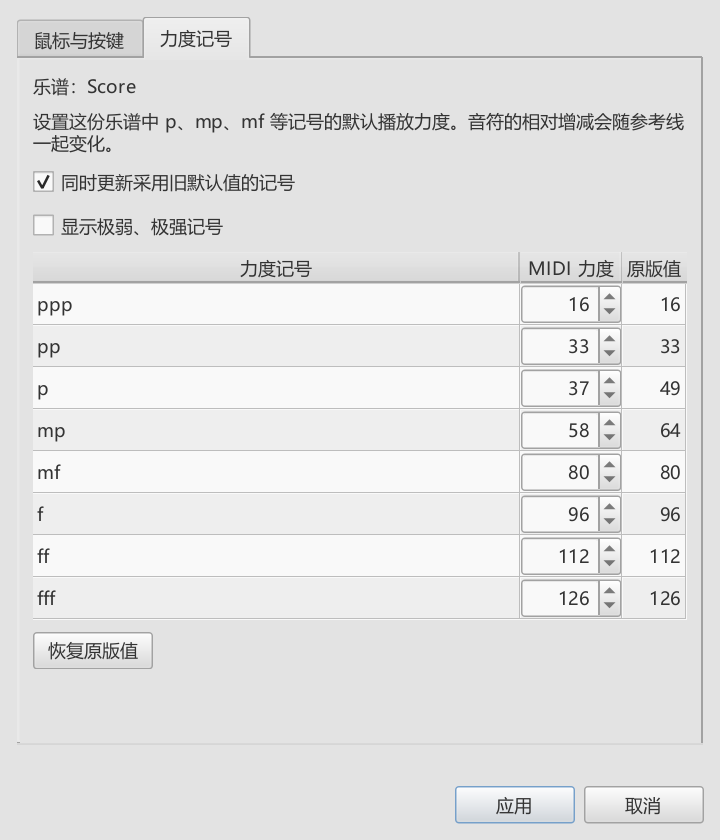
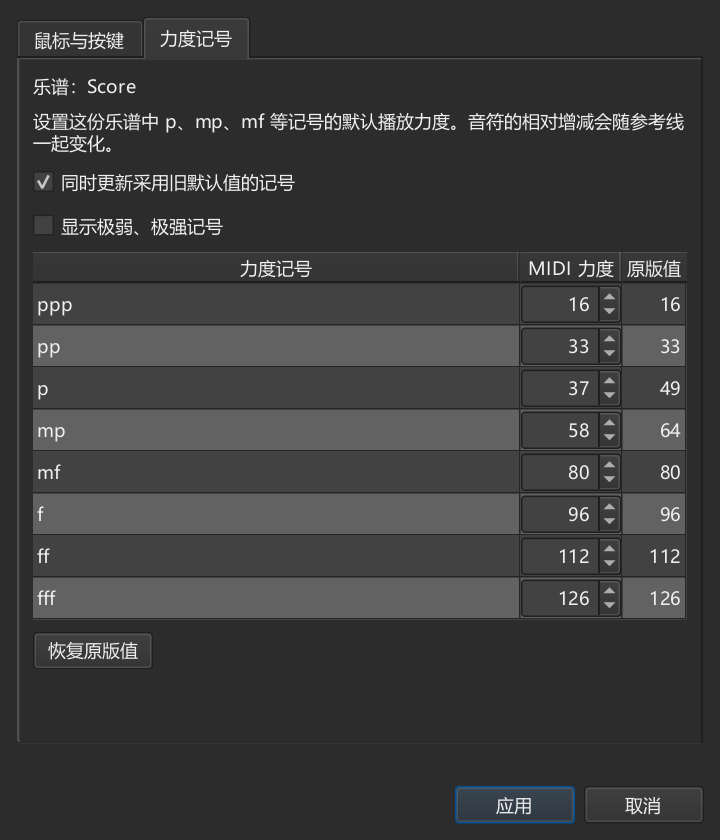

# 设置 mp、mf 等力度记号的播放力度

对应个人版本0.82.0。

## 调整这份乐谱的力度默认值

例如，想让 mp 采用58、p采用37：

1. 打开“视图 → 演奏编辑器”，点“操作设置…”。
2. 切到“力度记号”。上方显示当前乐谱，表格列出记号、当前默认MIDI力度和原版值。
3. 将mp改为58、p改为37。保留勾选“同时更新采用旧默认值的记号”，点“应用”。
4. 查看力度参考线或播放乐谱。高低谱表分别按各自的力度记号计算。
5. 按Ctrl+S保存。重新打开后，这些默认值继续生效。

MIDI力度范围为1—127，数值越大，按键越重。mp原版值为64，mf为80；“恢复原版值”会把表格恢复到软件原来的数值，点“应用”后生效。

## 哪些音会跟着改变

这份乐谱里使用默认值的mp、p等记号，以及以后加入的同类记号，都会采用这里的设置。勾选“同时更新采用旧默认值的记号”时，旧谱里采用原版值或上一组默认值的记号也一起更新。例如原先mp为64，改成58后，现有mp64会改为58；设成其它数值的记号，如43，继续保留。取消勾选后，原有的固定数值继续使用。

从旧工作区的符号面板加入mp时，也会采用当前乐谱的默认值。你自己制作并设成其它数值的格子继续使用保存的数值。

“跟随力度记号”的音继续按相对百分比计算。例如mp为58，一个音设为+10%，播放使用整数MIDI力度，这个例子输出63。设成“固定这个音的力度”的音继续采用保存的数值，例如99。

渐强、渐弱沿用原来的范围和曲线，按两端力度记号给出的数值演奏。可以打开“显示力度参考线”观察各谱表的参考位置。

## 保存、取消和恢复

- 设置窗口可以保持打开，主窗口仍可操作。播放时可以先调整表格，停播后再点“应用”。
- “取消”或关闭窗口保留乐谱原来的设置。
- 每次应用可用Ctrl+Z撤销，也能重做。恢复原版值同样先在表格中预览，点“应用”才写入。
- 极弱、极强记号可勾选“显示极弱、极强记号”后调整。
- 常用数值可随乐谱模板或MSS样式保存，供以后建立乐谱时使用。

普通MuseScore读取文件时，已有力度记号保存了对应数值，可以继续按这些力度播放。完整的默认值表由本分支保留。

“鼠标与按键”页继续设置临时查看力度的按键和最近音滚轮组合键。

窗口变窄或变矮后，用右侧滚动条查看其余设置；“应用”和“取消”始终放在窗口下方。

