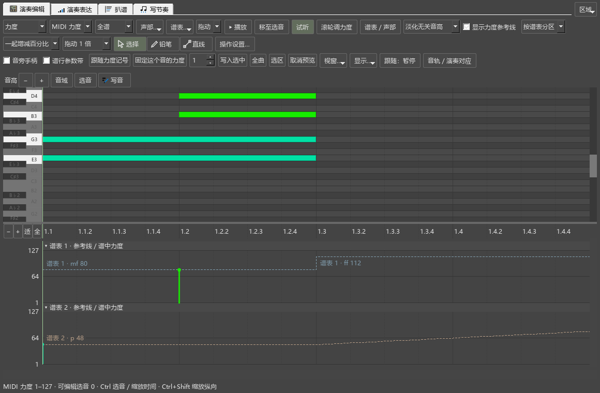
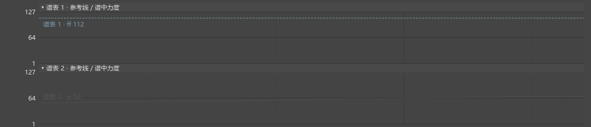
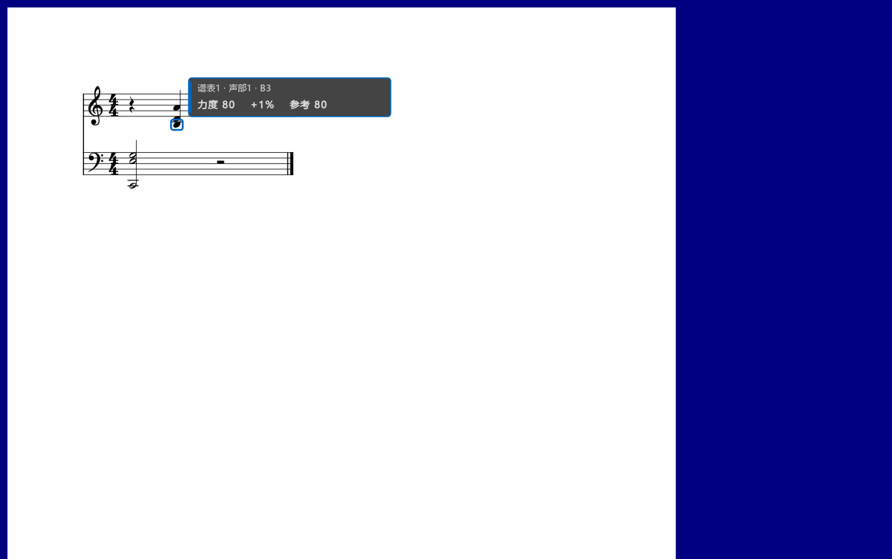

# A2力度操作检查

对应0.90.0。正常显示大小，使用E盘独立测试谱和设置；用户原谱保持原样。

## 已复现和修复

1. 滚到上下谱表都在休止的位置，开关“显示力度参考线”画面完全相同。旧实现只沿可见音符起点画线；现在随音符资料读取各谱表的数值曲线，长音和休止中间继续显示。记录：`dynamics-090-rests-before-performanceeditor-run.txt`。
2. 卷帘悬浮后，Ctrl+Alt+Shift+V没有显示力度。旧判断只接受编辑器内部控件；现在同时识别移出的卷帘和参数区。松开恢复、一直显示和放回均已检查。记录：`dynamics-090-detached-before-performanceeditor-run.txt`。
3. 分区显示采用相同的谱表／声部筛选；开启淡色参考时，过滤外谱表保留淡色分区及参考线，关闭后隐藏。

## 完整操作与结果

| 操作 | 看到或读回的结果 |
|---|---|
| mf 80／p 48，滚到休止中间 | 两条参考线分别保持80、48 |
| 在休止处加入ff112、低谱表渐强 | 上方改为112，下方按实际力度曲线继续上升；没有新起音的位置也显示变化 |
| 只改一个谱表、隐藏／淡化其它谱表、同图／分区 | 显示与可编辑范围对应，原来的谱面选择保留 |
| 选两个谱表的音，一起按百分比拖动 | 上方约80→88，下方约48→53；原来的固定／相对保存方式保留 |
| 改用相同MIDI差值 | 两个音分别约80→88、48→56，实际MIDI与图中采用值一致 |
| 转换固定／跟随、输入相对10%、筛选后继续写入 | 转换保留力度；直接输入10%得到88、52；过滤外的音保持原值 |
| 保存MSCZ再打开 | 两谱表的保存方式和数值一致 |
| 悬浮卷帘按住显示、松开、常显、放回 | 数值按当前显示方式出现和恢复，乐谱内容及撤销位置保持 |
| Windows投递Alt+Shift和滚轮，编辑器关闭 | 固定力度64→65，谱面位置保持，一轮滚动形成一次撤销；相对+1%取整后仍显示所存+1%；显示声部颜色的音符轮廓与提示 |

新操作组日志：`dynamics-090-new-workflows-performanceeditor-run.txt`，5项操作加准备、结束共7项通过。原有主窗口、选音、重叠音拖动、灵敏度、输入状态、谱行带和真实演奏器检查另行运行，日志`dynamics-090-original-flow-performanceeditor-run.txt`，9项操作加准备、结束共11项通过。

最终程序的组合窗口和个人版本另查，日志`dynamics-090-windows-branding-pluginhost.txt`，含准备与结束共4项通过。工作视图两次往返均保留523像素的编辑器高度和0.400的内部比例；关于与启动图显示Kumo branch／Freddd13和0.90.0。

Windows输入检查先确认前台属于测试程序，分别核对固定、相对力度；结束后恢复按键、输入语言与鼠标位置。旧检查有相互承接的打开顺序，本轮按完整顺序单独运行；新增流程分别准备自己的乐谱。

## 画面和耗时

已查看普通窗口中的两谱表参考线、分区、渐强、淡色参考、悬浮卷帘数值和谱面滚轮提示。

两谱表的小谱例连续绘制30次，参考线关闭时中位数0.229ms、95%位置0.291ms；开启时0.260ms、0.493ms。曲线仅按可见宽度取点，平移和绘制复用已读取的数值。大谱和完整编曲过程继续在总计划F核对。

本次只改变上述显示及快捷键所属判断。原有拖动灵敏度、显示选择、音符保存方式和软件声音计算继续沿用。下一批A3检查真实谱段的写法保存；各组件工具图标及密集数字排版保留在A4。
