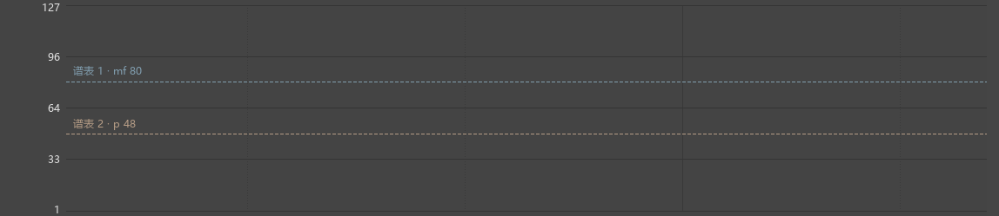
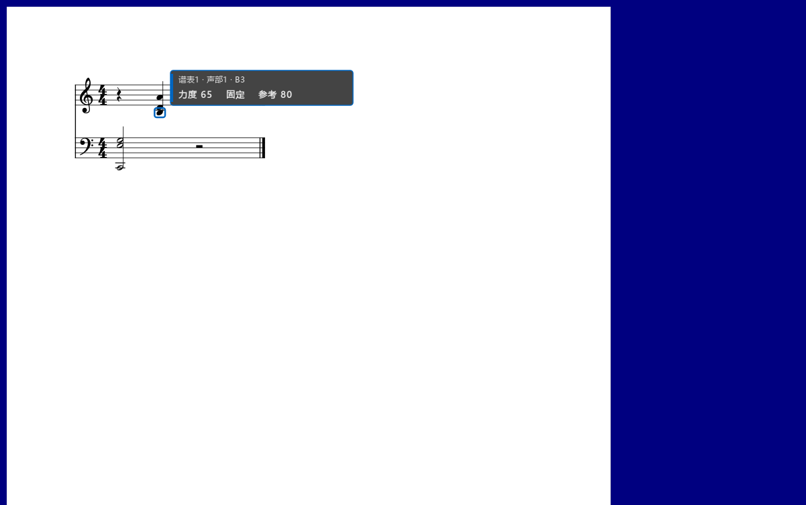
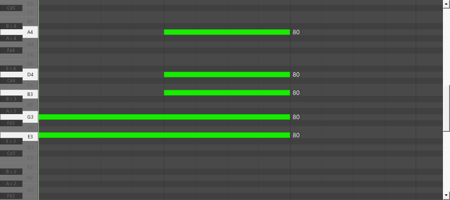

# 同时调整高低谱表的力度

适用版本：0.90.0 · Kumo branch / Freddd13。

## 看清每个谱表原来有多响

1. 打开“视图 → 演奏编辑器”。左侧参数选择“力度”，显示方式选择“MIDI 力度”。
2. 勾选“显示力度参考线”。虚线旁会写出谱表、力度记号和数值，例如“谱表1 · mf 80”“谱表2 · p 48”。
3. 用“力度同图”把两条线放在一起比较。选择“按谱表分区”，可分开查看高低谱表；点击分区标题可收起、展开。
4. 用“谱表／声部”选择本次要改的音。勾选“淡化其它音符为参考”后，其它音保留淡色显示；取消后隐藏。

参考线沿用当前位置的 p、mf、渐强渐弱。滚到长音或休止中间，仍能看见它。改变谱上的力度记号后，参考线随之更新。

## 一起改多个音

1. 在乐谱中选中要改的音，也可在卷帘框选。
2. 选择“一起增减百分比”，拖动其中一个已选音的力度柱。高低谱表分别按自己的参考力度增减，原来强弱的关系继续保留。
3. 选择“相同MIDI差值”，可让所有选音一起增加或减少相同数值。
4. 松开鼠标保存这次调整。Ctrl+Z 撤销整次拖动，重做可恢复。

音符继续使用它原来保存的相对或固定力度方式。过滤掉的音继续保留谱面选择，本次拖动只修改筛选允许的音。

## 相对、固定和显示方式怎样配合

“MIDI 力度／相对%”选择图上怎样显示。

- **MIDI 力度**：直接看最后采用的数值，适合比较两个谱表。
- **相对%**：看各音增加、减少的比例。0%表示保持各自的力度，所以 mf 80 与 p 48 在0%时仍分别播放80、48。

“跟随力度记号／固定这个音的力度”决定音符以后怎样播放。

- **跟随力度记号**：按这个音的增减比例计算，以后改 p、mf 或渐强渐弱，这个音跟着变。
- **固定这个音的力度**：保存当前力度，以后可直接逐音调整。

转换时保留当前力度。MuseScore的比例和MIDI力度使用整数，例如参考力度80、48，在相对%中输入10，实际输出88、52。拖动会显示换算并取整后的结果。

修改 mp、mf 等记号本身的默认数值，见[力度默认值设置](DYNAMICS_082_GUIDE.md)。

## 在谱面用滚轮微调

鼠标移到目标音附近，按住 **Alt+Shift** 滚轮。程序选择视口内最近的可编辑音，同一轮滚动保持这个目标。浮标显示音名、谱表、声部、力度及参考值，相关音会出现声部颜色的轮廓。保存固定力度的音显示“固定”；跟随力度记号的音显示实际保存的增减比例。

停止滚动后保存；Esc取消这轮调整，Ctrl+Z可撤销。编辑器关闭时也能用。“操作设置…”中可以修改组合键。

## 临时或一直查看音旁力度

- 按住 **Ctrl+Alt+V** 查看鼠标附近及选中音的力度。
- 再加 **Shift**，查看当前视口内的力度。
- 在“显示…”勾选“一直显示力度（谱面与卷帘）”，可持续查看。

卷帘单独悬浮后也能使用。松开快捷键恢复原显示；这些显示操作保持乐谱内容和撤销记录。

保存乐谱后，音符力度随乐谱保留。显示方式和面板位置按个人设置恢复。具体检查见[本轮记录](DYNAMICS_090_CHECKS.md)，发布定位personal-v0.90.0。
