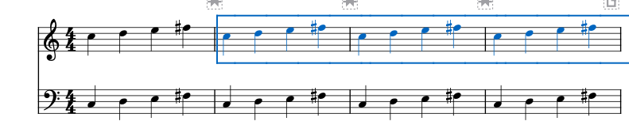

# 固定谱行、插入小节与字体对照

适用于0.138.0 · Kumo branch / Freddd13。

## 保留当前这一行的小节

1. 在谱面点这一行的一个音符或休止。
2. 打开“视图 → 谱行锁定”，点“锁定当前行”。编曲工具栏的锁图标也能打开同一个菜单。
3. 继续修改音符、文字或间距。行内会重新计算间距，所锁定的小节继续放在一起。
4. 按Ctrl+S保存。Ctrl+Z撤销本次锁定，重做可恢复。

想一次固定几行，先框选跨行的小节，再点“锁定选中行”。框选到一行的一部分时，会包含这整行。要重新安排，点“解除选中行锁定”；“解除全谱行锁定”一次释放本功能的所有锁定范围。

原来手工设置的换行、分页、分节和禁止换行继续保留。解锁操作可用Ctrl+Z撤销。

## 在已经锁定的行中插入小节

在行的中间插入小节，新小节会加入这行的锁定范围。一次插入对应一次撤销；保存重开后，新增小节继续采用该行的设置。

行外插入使用普通分行。插入后需要重新整理时，可以解除相关行，再按当前排法锁定。

## 总谱和分谱分别整理

打开要调整的总谱或分谱，再从这份谱中选择小节并锁行。它们各自保存排法：例如总谱固定前四小节，分谱固定后四小节，插入小节时会分别延续各自的范围。

音符和小节的音乐内容仍按原有分谱链接更新。锁行、解锁及插入均可撤销；保存MSCZ会一并保存总谱与分谱中的设置。

## 打印、PDF与普通MuseScore

打印和PDF采用当前谱的排法。文件里使用常规换行与禁止换行，官方3.6.2能够读取。

本分支会记录哪些标记由“谱行锁定”一起建立，方便成组解锁。普通版重存后会保留分行标记；继续使用本分支的成组操作时，保留原项目，另存一份分享。

## 标题和速度音符的字体

标题、普通文字和速度音符各自读取谱中的样式。字体缺少中文时，Windows会选择可用字体补齐文字；在“格式 → 样式”中可以直接指定想要的标题字体。

本机只读对照《如果有来生 release5》：

- 两版都将中文标题显示为楷体27点；原谱的标题样式保存为Palatino Linotype，中文由楷体补齐。
- 速度数字和拉丁文字采用Palatino Linotype，原有文字及字号继续保留。
- 默认Leland Text的速度音符与附点采用随包的兼容字形，轮廓和字宽数据与官方3.6.2来源相同。600dpi对照中，音符高度均为95像素，附点高度均为12像素。
- 两版均导出8页。读取与对照完成后，原谱文件的校验值保持不变。

使用个人音乐字体时，继续采用你在谱中选择的字体；本次保持已有个人字体设置。字体的实际选择、PDF与保存检查见[本批记录](ENGRAVING_138_CHECKS.md)。
