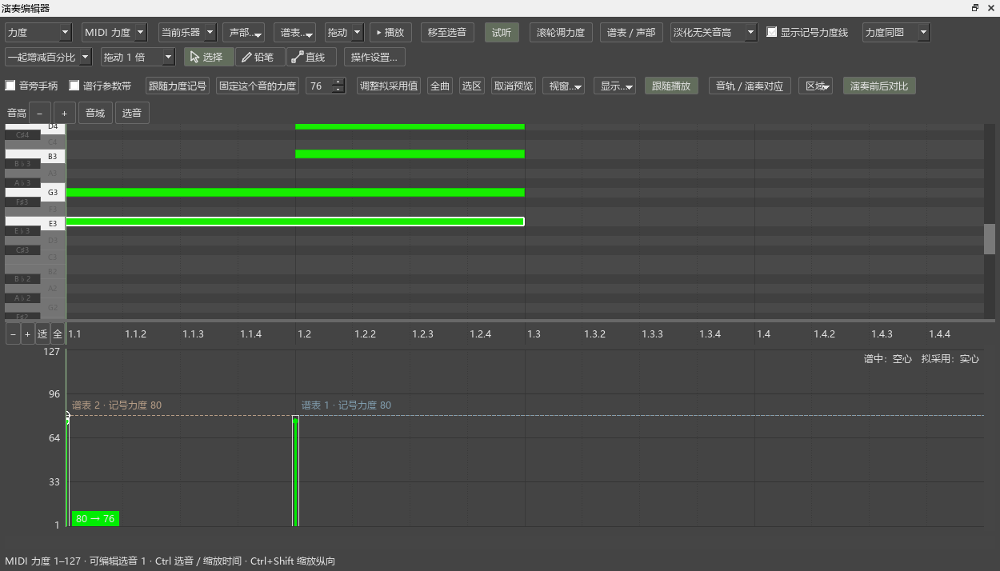
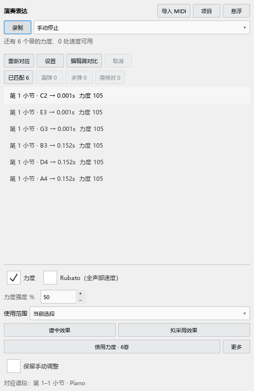

# 0.49.0 演奏表达操作检查

2026-10-16，Windows x64、Qt 5.15.2。

## 操作与结果

- 从演奏表达打开编辑器，原来的力度／速度选择框保持可见。对比按钮排列在操作行；窗口大小变化后再次检查位置，两个控件没有重叠。
- 在原力度区拖动同时刻的实心条，谱面已选中的音优先响应。拖动只改变拟采用值；点使用力度后，整次应用可以撤销。
- 使用实际播放事件切换谱中效果、拟采用效果，切换后从当前展开拍位继续。原谱标签页、选音和撤销记录保留；停止比较后恢复普通播放事件。
- 插件实际试听入口准备材料后原位播放。再次点当前效果继续播放，换效果保持拍位，结束比较释放材料。自动试听使用临时材料，原谱标签页数量保持。
- 先选一个音并使用力度，剩余数量相应减少；再使用其它音，最后从更多菜单恢复第一个音的原力度。每次使用和恢复分别对应一次撤销。
- 混合百分比和固定力度的音应用后保留原保存方式。保存MSCZ、重开，再恢复应用前力度，数值与首次应用前一致。新的比较起点及其撤销也保留。
- 录制检查通过同一个MIDI输入接口送入带时间的测试音，停止后自动对应，在主面板点击使用力度，再撤销。没有连接实体键盘进行这一项检查。
- 对应轨采用局部时间对应，漏弹和多弹保留。时间对应在结果更新时计算，选择音符时只发布选择状态；绘制时读取已准备的位置。
- 已使用项目可以收起或重新显示。逐音记录已应用值，恢复部分音后，其它音的已使用状态继续保留。

## 界面检查

检查过初次打开、已有工作区、浮动面板、原参数区和展开对应轨。检查中曾发现新按钮落在左上角默认位置，已增加即时布局处理，并用控件矩形交叠检查复查。

## 检查记录

整组窗口检查：演奏编辑器56项、P0工具23项、P1工作流40项，共119项通过。输出在插件仓库 `Repairs/out/repair-049-full-*`。另有局部时间对应、已使用状态、人工预览和错漏音匹配的JavaScript检查。

实际播放检查使用软件的播放事件和可记录输出的测试设备，核对力度、播放位置和停止行为。真实声音设备的日常听感仍需在正式安装后结合用户使用的音源比较。参考音频的联合播放、循环和定位继续在下一批一起检查。

用户说明第12章按导入、预览、试听、使用及恢复顺序重写；材料保存与乐谱保存分别说明。

## 正式安装复查

0.49独立安装后，119项窗口检查再次全部通过。大谱检查4项通过，Ctrl缩放95%耗时如下；窗口大小、音符数量和检查步骤沿用0.48。

| 谱中音符 | 关闭谱行带 | 开启谱行带 |
|---|---:|---:|
| 10080 | 18.546 ms | 20.036 ms |
| 50064 | 17.875 ms | 18.542 ms |

这些耗时包含原生谱面刷新。文档链接、跨仓库测试位置和源码行号检查通过：37份说明、306个本地链接、272个源码位置。原有Codex/MCP附录保留原文。
