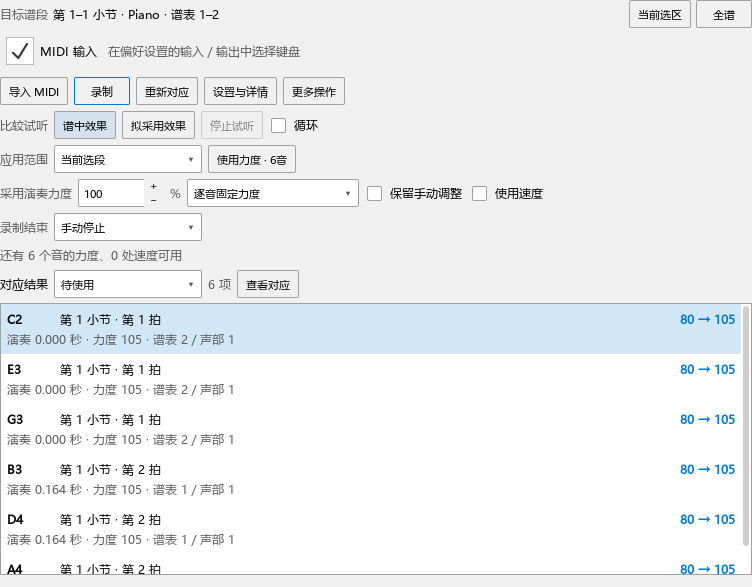

# 录一遍，再把力度用到谱子

## 打开与选择范围

在谱面框选要处理的一段，打开“视图 → 演奏表达”。顶部显示目标小节和谱表；点“当前选区”采用这次选择，点“全谱”返回整首。之后点音、定位和修改对应，顶部目标继续保留。

编辑器右上角的“区域”可以把演奏表达悬浮、放到右侧或放回编辑器。拖分隔条可给结果区多留一些空间。

## 用录制或 MIDI 得到结果

1. 使用 MIDI 文件时，点“导入 MIDI”。文件可以包含全曲，软件会在其中寻找目标段。
2. 使用键盘时，先核对“MIDI 输入”和设备状态，再点“录制”。弹完点“停止录制”。“录制结束”可以选择手动、到时或弹完选段停止。
3. “对应结果”会列出音名、小节与拍位，以及原力度和拟采用力度。例如 `80 → 100` 表示这个音原来采用 80，当前演奏结果准备采用 100。
4. 点一行查看对应的谱音；“查看对应”打开编辑器里的谱面音与演奏音。播放时可以先选结果，继续听当前材料。
5. 切到“需核对”“漏弹”或“多弹”，查看具体音。确认一处正确的对应，或在对应区重新连接后，相关结果会更新。

结果较多时在列表内滚动。相同音高出现在不同谱表或声部时分别列出，第二行标明所属谱表与声部。

## 比较和使用

“比较试听”一行的“谱中效果”播放当前谱子，“拟采用效果”播放当前预览；正在试听的一项会亮起。“停止试听”结束播放。

“应用范围”选择选中音、当前选段或全部已对应范围，再点“使用力度 · N音”。按钮上的数量就是本次准备更新的音。一次采用可用一次 Ctrl+Z 撤销，Ctrl+S 保存乐谱。

默认“采用演奏力度”为 100%。设为 50% 时，取谱中值与演奏值的中间值。“逐音固定力度”保存明确的力度数值；“继续跟随力度记号”保存相对增减，之后修改 p、mf 或渐强渐弱时会一起变化。

需要采用快慢变化时，打开“使用速度”，再点出现的“使用速度 · N处”。速度影响相同位置的全部声部。

## 已经用过的结果与恢复

采用后，相应音从“待使用”中收起。切到“已使用”可以继续查看。更多操作中的“恢复应用前力度”按当前应用范围恢复；恢复记录随乐谱保存。

“更多操作 → 保存表达项目”保存原始 MIDI、对应和设置，方便以后继续。录制原始文件也会保留。

本章对应个人版本 0.73.0；当前安装与检查状态见[操作记录](WINDOWS_072_CHECKS.md)。
