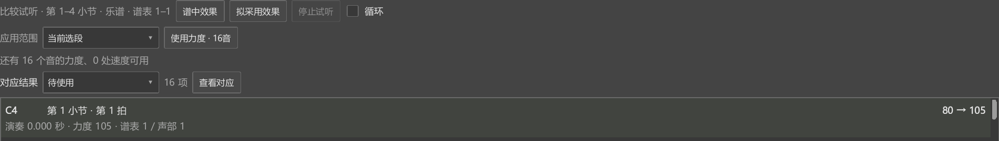
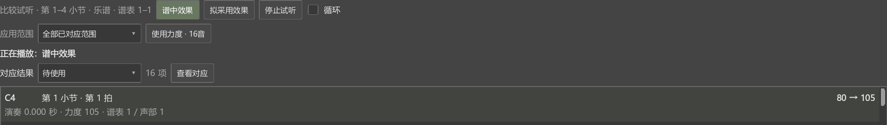

# 录制后看对应，再采用力度

录制步骤始于个人版本0.80.0，适用于当前0.149.0。分别选音、连接与撤销见[调整对应](EXPRESSION_096_GUIDE.md)。

## 先确定要处理哪一段

1. 在谱面选中要处理的范围，打开“视图 → 演奏表达”。
2. 点“当前选区”使用这段，点“全谱”处理整首。目标行写明小节和谱表。
3. 导入已有演奏时点“导入 MIDI”；用键盘时，核对“MIDI 输入”和设备，再点“录制”。弹完点“停止录制”。

录制与导入完成后，会直接显示比较试听、应用范围和对应结果。每个结果列出音名、小节拍位、演奏时刻和原／新力度。面板较小时，列表内可滚动查看其它音。

要再录一遍或修改录制设置，向上滚动到录制区。点那里的“对应结果”可以回到当前结果。

## 先听，再使用

“谱中效果”播放当前保存的演奏，“拟采用效果”播放准备使用的新力度。正在听的一项会亮起，下面写明播放对象。两种效果接着当前拍位切换。

“停止试听”结束播放。也可以直接选择其它操作；使用力度时会先结束试听，再写入乐谱。

默认采用演奏力度的比例为100%。例如在默认输入设置下，谱中力度80、演奏力度105：100%采用105，50%约为93。这个比例可在录制区调整。

## 只改一个音，再改其余音

1. 点对应结果中的一个音。谱面选中同一个音；播放时继续保持当前播放位置。
2. 在“应用范围”选择“选中音”，检查“使用力度 · 1音”，再点它。
3. 已采用的音从“待使用”收起。要采用其它已对应音，选择“全部已对应范围”，按钮会显示剩余数量。
4. 点“使用力度”。每次采用各对应一次Ctrl+Z撤销。

“当前选段”使用谱面此时选中的范围；没有范围选区时，使用目标段落。可先看按钮上的音符数量再使用。“需核对”“漏弹”“多弹”在结果下拉中查看，点“查看对应”打开编辑器中的对应轨。

## 怎样保存和恢复

Ctrl+S保存乐谱。已经采用的力度和应用前的力度记录会随MSCZ保存。重开后，更多操作中的“恢复应用前力度”可以按音、选段或全曲恢复。

“逐音固定力度”保存明确的MIDI力度。“继续跟随力度记号”保存相对增减，以后调整p、mf或渐强渐弱时，这些音一起变化。

“更多操作 → 保存表达项目”另外保存录音来源、对应和设置，方便以后重新计算。音符上的已采用力度仍随乐谱保存。

窗口、悬浮与返回操作见[区域与编辑器大小](LAYOUT_079_GUIDE.md)。

多份谱之间继续处理、关闭后的恢复见[换谱与表达项目](EXPRESSION_SESSIONS_149_GUIDE.md)。
