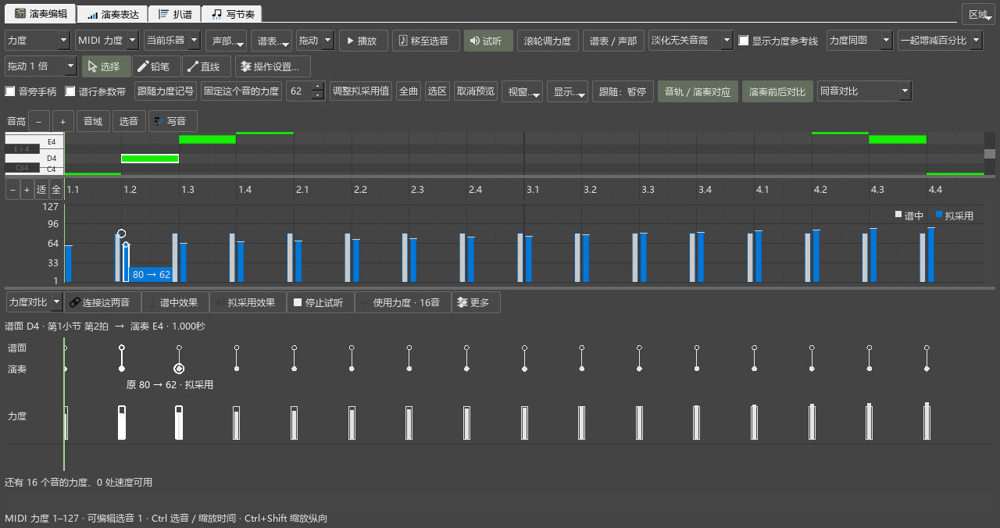

# 人工对应、连续琶音与实际采用

对应0.96.0，B1继续进行。操作见[本批说明](EXPRESSION_096_GUIDE.md)，后续顺序见[完整计划](REWORK_PROGRESS.md)。

## 实际查到并修复的问题

- 在上排选谱音A，再到下排点另一颗演奏音B，原实现会将谱面选择也换成B原来对应的谱音。修改前已用实际鼠标点击复现；两边现分别保存选择，显示具体音名、拍位和秒数。
- 应用范围变化后，对应工具行曾读到旧数量，造成“使用力度”仍不可用。现在候选范围完成更新时一起刷新；表达页收起后，从对应区采用也会完成谱值读取。
- 解除误连时，原实现同时移除被借用演奏音的另一处自动配对。现在解除作用于选中的谱音；另一处对应保留。撤销重做也恢复两边选音，接着可处理同一对音。
- 导入新MIDI和打开项目原先先清掉当前资料。现在成功读取并核对来源后再更新。文件缺失、MIDI读取失败时保留当前结果、设置和人工对应。
- 按时间把短间隔直接并成起音组，会将某些琶音尾音与下一组低音合在一起。粗匹配现在可把连续2—3组演奏起音按谱中音高集合合并；短间隔所占比例不符合和弦分组时，先保留各次起音。合并后再核对组间节奏。每颗演奏音保留原秒数和力度。

## 从选音到保存

实际窗口使用独立四小节谱和16音MIDI：

1. 上排选D4，再在下排选1.000秒处的E4；上排仍保持D4。
2. 点击“连接这两音”，D4采用指定E4的演奏力度，对应区显示这次连接。
3. 导入一个不存在的MIDI，当前演奏和人工连接继续保留。
4. 对应区按Ctrl+Z、Ctrl+Shift+Z，核对连接恢复和重做；再从“更多”实际选择“解除对应”，谱面仍选着这颗音，另一处自动配对恢复。撤销解除后继续采用，乐谱撤销位置保持原状。
5. 应用范围设为“选中音”，点“使用力度 · 1音”。读回该音的固定力度，乐谱只增加一次可撤销修改。
6. 保存MSCZ和表达项目，重新打开，核对人工对应和实际保存力度；16个谱音中1音已采用、1音未对应，剩余14个已对应音可以继续使用。
7. 再打开一份来源缺失的表达项目，先前项目、MIDI和对应继续保留。

## 演奏材料和数量

独立20小节钢琴谱使用210毫秒展开的三音琶音，起音组之间约240毫秒。完整MIDI用于中间四小节：全部96音、最高音旋律32音、上谱表64音、下谱表32音均核对到预期演奏起音和力度，待核对与漏配均为0。

真实材料采用[ASAP数据](https://github.com/CPJKU/asap-dataset)。原文件、许可及校验值保留在本地独立检查目录，测试读取脚本位于PerformanceExpression/tests。下表同时列出待核对和漏配，方便区分自动采用与人工修正工作。

| 材料与范围 | 人工对应 | 当前正确 | 可直接采用且正确 | 待核对 | 漏配 |
|---|---:|---:|---:|---:|---:|
| Bach BWV846，Shi05M，全曲 | 547 | 547 | 547 | 0 | 2 |
| 同曲第5–8、13–16、25–28小节，各段 | 64 | 64 | 64 | 0 | 0 |
| Chopin Berceuse op.57，LeungM07M，全曲 | 1646 | 1599 | 1311 | 314 | 131 |
| 同曲第5–8小节 | 60 | 60 | 60 | 0 | 0 |
| 同曲第17–20小节 | 115 | 108 | 80 | 35 | 5 |
| 同曲第28–31小节 | 108 | 106 | 101 | 7 | 5 |
| 同曲第45–48小节 | 116 | 115 | 113 | 2 | 1 |

肖邦第17–20小节在0.95为59对正确、53音漏配，本轮为108对正确、5音漏配。实际宿主读取MusicXML与MIDI也得到108对正确、80对可直接采用，自动采用中错误数为0。其余疑问包含快速装饰音和同音重触，可在对应区逐音选择。真实文件导入本身带有原有MusicXML连音组和延音警告，日志保留。

规则检查记录本机耗时：巴赫完整约372毫秒，肖邦完整约2286毫秒，四小节选段约109—322毫秒。计算在原有工作任务中进行。方法对照[ASAP人工对应研究](https://transactions.ismir.net/articles/10.5334/tismir.149)和[Parangonar](https://github.com/sildater/parangonar)，运行规则由本项目独立实现。

## 剩余安排

B1接着核对复杂节奏rubato、长休止和实体键盘。当前WinMM输入设备列表为空，程序内计时MIDI输入与实体键盘分别记录。随后按B2原曲、B3扒谱、B4写谱、B5音源与踏板，再到C—F。

## 连续操作与原功能回查

- `expression-096-verified-performanceeditor-run.txt`：10项连续操作，加准备和结束共12项通过。包含录制后的16音结果、完整选段试听、同拍位切换、固定／跟随力度、拖动采用、96音分批采用与保存，以及本批菜单与人工对应。
- `expression-096-chopin-final-performanceeditor-run.txt`：真实肖邦选段1项，加准备和结束共3项通过。
- 纯规则为27个对应场景、8项结果显示，原有多声部、延音、人工校正、缓存与rubato检查继续通过。

早期失败和菜单检查记录保留在P2/out。连续检查时补齐了每项自己的选音、角色及页面位置准备；实际按钮仍按当前范围更新。菜单通过工具栏动作直接打开，点击解除后可继续撤销和采用。

项目重开后自动显示对应结果；补查记录为`expression-096-restored-final-performanceeditor-run.txt`，一项完整操作加准备、结束共3项通过。

`workspace-096-recheck-pluginhost.txt`：工作视图宽度往返与停播后面板操作，两项加准备、结束共4项通过。播放打断编辑器时间尺操作后，实际点符号、应用并撤销重做，再点原曲参考循环按钮，读回改变后的状态。沿用0.93的共同鼠标释放及停播状态修复。

## 安装与版本

已安装到`E:\programming\funcodes\muse3_dev\MuseScore\msvc.install_repair_current_x64\bin\MuseScore3Evo.exe`，发布定位`personal-v0.96.0`。安装包中的四份表达资源与本批源码逐一核对，个人配置保持原值。此前程序备份保留在E盘本项目输出目录。

`expression-096-branding-pluginhost.txt`核对安装版本和“关于”中的Kumo branch／Freddd13；一项加准备、结束共3项通过。
