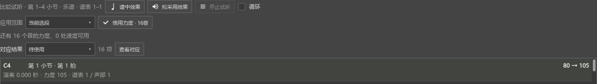

# 演奏速度、长休止与共同面板操作检查

对应0.97.0，B1本批记录。操作见[使用演奏中的快慢变化](EXPRESSION_097_GUIDE.md)，后续见[完整计划](REWORK_PROGRESS.md)。

## 查到的问题和改动

0.96只从已对应起音推算速度，休止中的速度标记和受保护的渐慢区间没有完整参加段长计算。独立谱例原本5秒，旧结果写入后会成为约5.60秒。旧写入还会跳过“数值等于修改前”的恢复点，前面的新速度因而可能延续到后面。

本批分批读取完整谱内速度、停顿、可写位置和保护范围。按实际采用范围分别计算时长；恢复点按修改后的整条速度顺序判断。原有速度记号、曲线和延长记号参与约束。来源资料跟随表达生成的隐藏速度点保存，重新读取时能继续处理剩余结果。

## 实际操作

### 完整一句，包含休止、rit.和a tempo

独立四小节谱包含15个起音，在第2小节休止处写80 BPM，第3小节加入rit.，第4小节恢复速度；传输速度设为1.5倍。

1. 从表达页导入演奏MIDI，开启使用速度和保持段长。
2. 核对状态行的原时长与拟采用时长，以及已有记号的保留位置。
3. 将480 tick处的预览速度调为130 BPM，重新整理相邻位置以保持段长。通过实际Seq播放候选，记录到全部15个起音；原谱保存状态和撤销位置保持一致。
4. 实际点击使用速度，只新增一次撤销。核对全部速度事件、rit.内各采样位置、休止处80 BPM与原段时长；传输倍速继续为1.5。
5. 保存MSCZ后重开，逐点核对速度与来源资料；撤销和重做同时恢复速度及资料。

### 先用两颗分开的音，再用另一小节

在16音谱中选第1、2小节各一颗音，关闭保持段长，采用比例100%。先按“选中音”使用速度，再框第3小节按“当前选段”继续使用。

每个音的范围末尾接回原速度，第3小节的采用保留前两处修改；段外速度保持120 BPM。两次采用对应两次撤销，连续撤销、重做后逐点一致。已采用范围的待使用速度数为0。

### 录制中间有长休止

独立五小节谱的第2小节为整小节休止。使用程序内计时MIDI输入，按选段结束方式录制：中途停顿1.1秒继续录；每次起音后，匹配位置前进到实际谱位；最后一音松键后自动结束。当前页得到16音对应，未漏配，随后实际点击使用力度，全部写为101，一次撤销。

这一项检查的是软件输入、定位、自动结束及录完继续操作。当前环境没有可用的实体MIDI输入设备，键盘与声卡检查继续放在B5／F。

## 符号面板与原曲参考的共同问题

沿用0.93的共同鼠标释放与停播状态处理。当前编译重新检查播放打断时间尺定位／框选、停止、切换视图、展开符号组、点击应用并撤销／重做，再点原曲参考循环控件。读回控件状态一致，两侧面板和中央谱面宽度往返也保持一致。

## 检查记录和耗时

- `expression-097-final-performanceeditor-run.txt`：12项实际流程，加准备和结束共14项通过。包含本批3项与此前录制、完整选段试听、同拍位切换、力度模式、拖动采用、96音分批使用、重复片段、人工连接和琶音角色选择。
- `workspace-097-recheck-pluginhost.txt`：视图宽度与共同面板点击，两项加准备、结束共4项通过。
- `test_alignment.js`、`test_expression_progress.js`、27个对应场景和12个独立速度场景通过。速度场景核对手工记号、休止位置、固定停顿、保护曲线、分开的音、采用比例、已采用结果和时间交叉。
- 原生四小节读取在本轮记录约1—2毫秒。这个数字对应本例，长谱和长录音继续按后续计划测量。

连续操作检查发现旧测试在读取尚未完成时立即点按钮；现按真实准备状态等待，并在保留滚动位置后实际滚轮找到按钮再点。早期失败记录留在P2/out，正式结果见上述最后一轮。

## 后续与安装

本批进入0.97.0，发布定位personal-v0.97.0。程序沿用`E:\programming\funcodes\muse3_dev\MuseScore\msvc.install_repair_current_x64\bin\MuseScore3Evo.exe`。

已安装程序的版本、关于标识与资源逐一核对，kumo.ini保持原值；0.96程序保留在E盘输出目录。`expression-097-branding-pluginhost.txt`一项加准备、结束共3项通过。

接着B2核对原曲播放与关联，再到B3扒谱、B4写谱、B5音源与踏板，以及C—F。复杂装饰音的对应质量继续保留0.96中的人工核对数量；真实键盘和声卡检查在相应批次继续。
