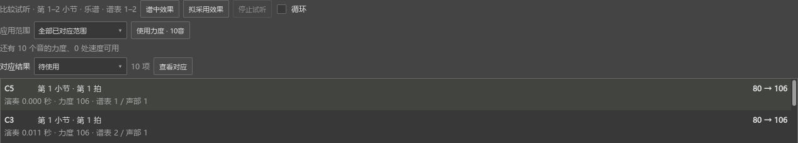

# 录制后怎样继续使用演奏

适用于0.150.0及之后版本。从“视图 → 演奏表达”打开。

## 录一段，切到别的谱，再回来

1. 在谱面选中要演奏的一段，点表达页的“当前选区”。想处理整首时点“全谱”。左上方会写出目标小节和谱表。
2. 接好键盘，打开页上的“MIDI 输入”，点“录制”。需要选择设备时，从偏好设置的输入／输出中选择键盘。
3. 弹完点“停止录制”。这时也可以直接切到另一份乐谱，本次录制会结束并保留。
4. 切回原谱。刚才的演奏会自动读入，显示对应音和力度变化；保存过程中会显示“正在保存刚才的演奏”。
5. 先听“谱中效果”与“拟采用效果”，再选“选中音”“当前选段”或“全部已对应范围”，点“使用力度 · N音”。

例如图中的C5和C3，原力度是80，录制得到106。采用比例为100%时，“逐音固定力度”会把对应音设为106。

每份谱分别保留自己的演奏与对应。刚点停止、文件正在保存、关闭后重新打开表达页，都可以接着处理。录制中修改了乐谱时，本次录制会结束，随后按当前谱面整理对应。

## 关掉原谱了，怎样找回刚才的录制

1. 打开要使用这段演奏的乐谱，选好目标谱段。
2. 打开演奏表达，点“更多操作 → 导入最近录制”。鼠标停在该项上可看到录自哪份谱、共有多少个音。
3. 等待对应结果出现，试听并使用力度或速度。

本机录制文件默认保存在 `E:\MuseScoreCache\recordings`，文件名以 `recording-` 开头。以前的录制也可以通过“导入 MIDI”选择。

## 保存与撤销

录制文件保存键盘演奏。点击“使用力度”或“使用速度”后，结果写入乐谱；Ctrl+Z可以撤销，再用Ctrl+S保存乐谱。

0.151起，撤销和重做后会自动更新对应与待使用数量。操作见[演奏比较自动更新](EXPRESSION_REFRESH_151_GUIDE.md)。

需要保存人工调整的对应和设置时，点“更多操作 → 保存表达项目”。以后用“打开表达项目”继续。完整步骤见[多份谱之间继续演奏表达](EXPRESSION_SESSIONS_149_GUIDE.md)；录制设置与试听见[演奏表达说明](EXPRESSION_080_GUIDE.md)。
