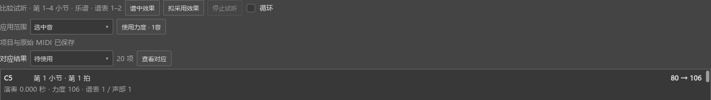

# 改谱、撤销后继续比较演奏

适用于0.151.0及之后版本。入口是“视图 → 演奏表达”。

## 采用一个音，再撤销和重做

1. 选好目标谱段，导入MIDI或录制演奏。
2. 在结果中点一个音，把“应用范围”设为“选中音”，点“使用力度”。这个音写入乐谱，从待使用结果中移出。
3. 按Ctrl+Z。谱内力度恢复，页面自动更新，这个音重新出现在待使用结果中。
4. 重做后，页面会再次将它列为已使用。选段、选中的对应音和人工连接保留。

固定力度、跟随力度记号都可这样操作。修改谱中力度、p／mf或速度记号后，比较区会读取新值。只改力度或速度时，已有逐音对应继续使用；改了音高、音长或延音关系时，会重新整理对应。

图中“80 → 106”表示这个音在谱中的力度是80，拟采用的演奏力度是106。“应用范围”控制本次要更新哪些音，目标谱段继续保留。

## 收起页面后继续

收起编辑器期间，自动更新暂停。重新打开表达页后，软件读取这段的最新内容，再继续显示。普通选音和点击空白处用于编辑，目标谱段一直保留到你主动更换。

只收起表达页、继续在编辑器的“音轨／演奏对应”或力度对比区操作时，可以照常校正和采用；这些区域共用同一份结果。

## 保存

使用后的力度和速度通过Ctrl+S保存在乐谱中，撤销和重做沿用乐谱的操作记录。需要保留人工对应、采用比例和项目设置时，点“更多操作 → 保存表达项目”。

录制后切谱或找回演奏，见[录制后继续处理](EXPRESSION_RECORDING_150_GUIDE.md)。完整的录制、试听和采用操作，见[演奏表达说明](EXPRESSION_080_GUIDE.md)。
