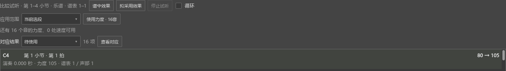

# 在多份谱之间继续演奏表达

适用于0.149.0及之后版本。打开“视图 → 演奏表达”。

## 从一首谱切到另一首，再接着修改

1. 在第一首谱导入MIDI，完成对应，调好“采用演奏力度的比例”。
2. 点另一份乐谱的标签页。这份谱显示自己的材料；首次使用时可重新选段、导入MIDI。
3. 点回第一首谱，刚才的对应、比例、人工调整和选中项继续保留。可以接着试听、调整或使用力度。

这些资料保留在当前打开的乐谱会话中。切换标签页、收起编辑器后再打开，都可继续处理。不同乐谱分别使用自己的MIDI与表达项目路径。

如果在另一处修改过音符或演奏设置，回来时页面会提示更新，点“重新对应”即可按当前谱面整理结果。

## 关闭乐谱前保存，重开后恢复

1. 在演奏表达页向上滚动，点“更多操作 → 保存表达项目”，选择JSON文件的位置。
2. 保存后的项目包含对应和设置，同目录会保留原始MIDI副本。
3. 用Ctrl+S保存乐谱，关闭后可以重新打开。
4. 打开“演奏表达”，点“更多操作 → 打开表达项目”，选择刚才的JSON文件。对应和设置会重新载入。

已经采用的力度、速度及恢复原力度的记录随MSCZ保存。表达项目便于保留原始演奏和继续调整对应。

## 对应好了，怎样真正使用力度

在比较区选择“选中音”“当前选段”或“全部已对应范围”，再点“使用力度 · N音”。一次使用可以用Ctrl+Z撤销。要先听效果，点“谱中效果”或“拟采用效果”，从当前拍位比较。

完整录制和使用步骤见[演奏表达说明](EXPRESSION_080_GUIDE.md)；人工调整对应见[分别选音并连接](EXPRESSION_096_GUIDE.md)。

录制时切谱和关闭后的找回见[录制后继续处理](EXPRESSION_RECORDING_150_GUIDE.md)。
