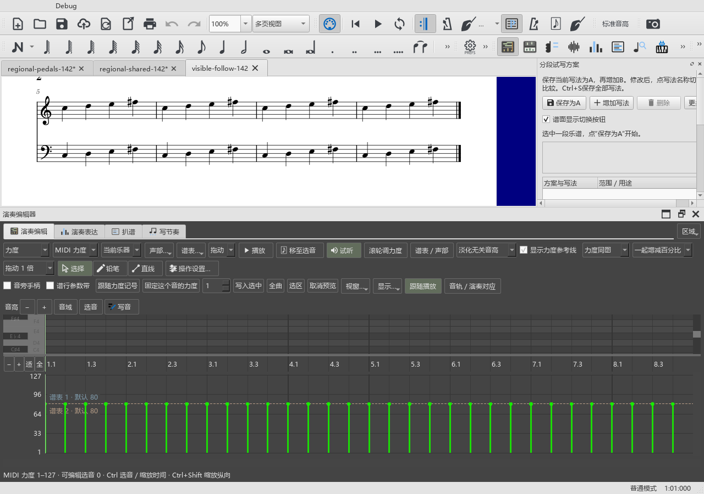

# 播放跟随与写法中的踏板

适用于0.142.0及之后版本 · Kumo branch / Freddd13。

## 让播放中的谱行保持可见

第一行播放工具栏中增加“跟随谱面”图标：小谱框中有竖直播放线和箭头。按钮亮起时开启，点一下关闭。

1. 打开乐谱，再打开下方演奏编辑器，把它拖到适合的高度。
2. 开启“跟随谱面”并播放。播放进入下一谱行时，软件会把它移到编辑器上方可见的谱面区域。
3. 想在播放中自己浏览其它位置时，关闭跟随；需要重新跟随时再开启。

这个按钮与播放面板原有的谱面跟随共用开关。编辑器停靠、悬浮或关闭后，跟随按当前可见区域计算，缩放和已经调好的面板比例保留。

当谱面区域比一整行还矮时，软件先显示这一行的上部。向下缩小编辑器，或手动缩小谱面，可同时看到上下谱表。

## 切换写法时保留踏板

同一段的A、B写法保存各自的音符、节奏和逐音演奏设置。踏板、谱上力度记号、渐强渐弱等作为这一段共用的演奏标记。

例如：

1. 选中左手两小节，建立A，再增加B。
2. 在B里改变伴奏音型，加上或调整踏板。
3. 切回A，再切到B。各自的音型保留，刚调整的踏板也继续显示和播放。
4. 按Ctrl+S保存；重开后继续切换，踏板与共用力度记号保持。

删除踏板也会作用于这些写法共用的标记。Ctrl+Z撤销刚才的编辑或切换，重做可恢复。切换只占一次撤销操作。

原有写法的增删、主方案、组合和普通版副本继续在“分段试写”中使用。完整操作见[分段写法说明](VARIANTS_070_GUIDE.md)。
