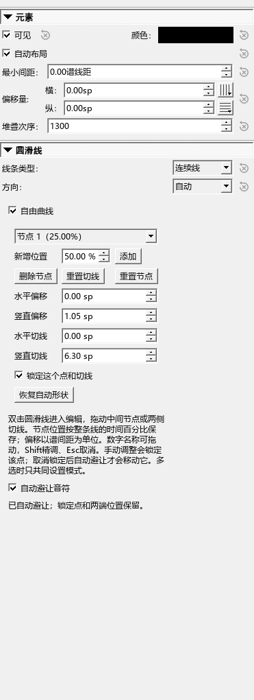

# 自由圆滑线检查记录（0.38.0）

日期：2026-10-13。Windows x64、Qt 5.15.2、Release；使用独立测试谱和临时设置。

## 已检查的操作

- 编辑器49项通过，插件菜单与显示12项通过。新测试覆盖简单上／下弧线、必要时的局部弯曲、锁定点与切线、仍有遮挡的提示，以及过密内容的处理限制。
- 实际鼠标操作检查开启、解除锁定、再锁定、添加点和恢复自动形状。锁定、添加和拖动从当前显示位置开始；恢复自动形状一次撤销后恢复原数据。
- 对原生符杠单独读取已有轮廓。测试清除了普通音符边界，只保留符杠，确认仍能绕开符杠，不依赖音头／符干间接起作用。
- 旧5值节点读取后保持锁定；新解除锁定数据、自动模式、复制、MSCX／MSCZ保存恢复、跨谱行和重置／撤销均通过。重复排版没有更改节点数据或新增撤销记录；MIDI事件保持一致。
- 自动曲线PDF／SVG导出通过；保留原有手动曲线的拖动、箭头、Home、Delete、Esc、分谱与导出检查。现有选择／播放颜色、键盘、参数编辑及版本／作者显示亦随编辑器检查通过。

## 计算耗时和范围

200次小例子的平均额外计算约0.029毫秒；2048个障碍的单个例子约4.062毫秒。它们测量曲线计算，不等同于整页重排或播放延迟。

自动计算只在相应曲线排版时执行，先尝试普通弧线，再最多增加4个临时局部点；最多30次调整候选，额外高度控制在6个谱间距内。障碍按横向位置分组，2048个以上不继续调整并说明原因。保存的人工节点始终不被计算任务写回。

## 使用和限制

选中圆滑线 → 检视器 → 自由曲线 → 自动避让音符；保持原有自动布局开启。手调点默认锁定，取消锁定才允许移动。原有两端手柄用于调整参考弧线；需要固定具体形状时可添加并锁定中间点。

跨谱行分别计算该行形状；跨谱表仍需核对，密集内容或锁定点压在音符上可能无法完全避开。旧文件默认不开自动模式。普通MuseScore不认识这些扩展时显示普通曲线；较早个人版也可能不保留新解除锁定数据。

首次撤销界面测试曾因读取已切换／等待删除的检视器页面而失败。已改为只查询当前可见页面，撤销恢复数据后重新选中曲线再检查控件；最终49项完整检查通过。失败与修正后的输出保留在插件仓库Repairs/out和P1/out中。

系统剪贴板复制子检查没有运行：先前外部程序占用系统剪贴板，未抢占它。版本、作者与关于窗口的其它检查通过。本轮没有改动OneDrive官谱。

设计参考：[LilyPond圆滑线候选评分源码](https://github.com/lilypond/lilypond/blob/master/lily/slur-scoring.cc)。本项目采用有限候选的几何计算，并保留用户点和原生保存／撤销方式。

