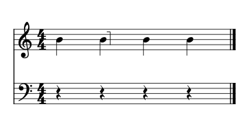
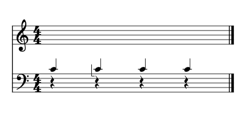
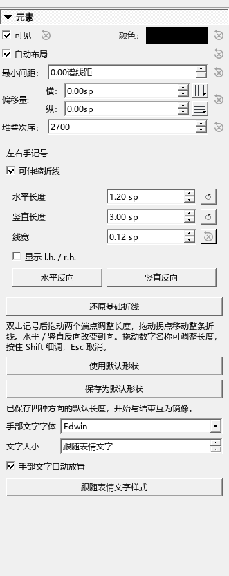

# 左右手分手记号：添加、调整与保存

适用于0.136.0 · Kumo branch / Freddd13。

## 想让另一只手弹这几个音

例如，下谱表的三个高音交给右手：

1. 点选第一个高音，展开符号面板的“指法”，添加“右手弹（可伸缩）”。
2. 点选最后一个高音，添加“右手结束（可伸缩）”。开始记号放在音前，结束记号放在音后。
3. 只给一个音分手时，添加一个开始记号即可。给和弦内某个音分手时，先选中那个音头。
4. 播放检查，再保存乐谱。编配检查和按左右手导出MIDI也会读取这里的手部安排。

“左手弹／左手结束”的用法相同。右手短横通常靠近音的下侧，左手短横靠近上侧；折角会结合线、间、加线、邻音和符杠寻找空隙。跨谱表的音按它实际显示的位置摆放。

## 拖动折线

双击记号进入编辑，三个小方点分别是横段端点、竖段端点和拐角。

- 拖横段端点改变横线长度。
- 拖竖段端点改变竖线长度。
- 拖拐角移动整条折线，形状保持原样。

一次拖动对应一次撤销。拖动中按Esc取消，完成后用Ctrl+Z撤销、Ctrl+Y重做。检视器中的长度使用正数；“水平反向／竖直反向”改变朝向。

## 添加和移动r.h.／l.h.文字

在检视器勾选“显示 l.h.／r.h.”。r.h.表示右手，l.h.表示左手。

双击记号后会多出一个文字手柄。拖它只移动文字，折线和所指音保持原位；拖完后“手部文字自动放置”会取消勾选。需要重新参加自动布局时，可重新勾选。

文字初始采用乐谱的表情文字样式。“手部文字字体”和“文字大小”可以单独调整；大小为“跟随表情文字”时，继续采用谱子的样式。“跟随表情文字样式”恢复字体和字号。

## 调好形状后，四种方向一起使用

选中一条折线，修改“水平长度”“竖直长度”和“线宽”，再点“保存为默认形状”。四种方向会采用相同长度和粗细，开始与结束互为镜像。新加的记号使用这个设置，已有记号保留自己的形状。

“使用默认形状”把当前记号改为你保存的设置。长度旁的小回转箭头只恢复那一项，保留当前朝向。“还原基础折线”恢复软件提供的横0.6谱间、竖2.5谱间细线，同时保留个人默认设置。

## 保存、自动位置和旧谱

形状、文字、所指音和手动位置随乐谱保存。新加的自动记号重开后继续跟随音符；改音高、变更符干或符杠后，自动位置随排版更新。

旧谱中已经摆好的位置继续保留。如果旧版保存的自动记号偏离了所指音，可以选中它，在检视器取消再勾选“自动布局”，核对位置后保存。旧字形切换为“可伸缩折线”时，会沿当时的外观建立长度和位置，之后就能拖端点调整。

本批实际操作与保存检查见[检查记录](HANDS_136_CHECKS.md)。
